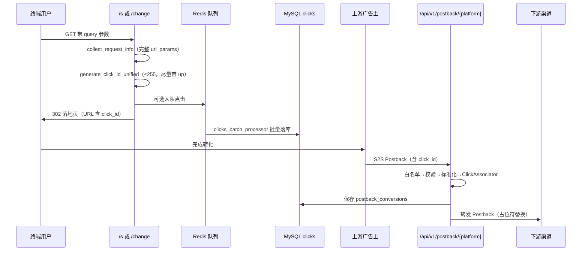

# Platform 广告数据与 CPL 管理平台 — 项目信息

## 文档目录

| 章节 | 内容 |
|------|------|
| [一、项目概述](#一项目概述) | 业务定位、角色术语 |
| [二、技术栈](#二技术栈) | 前后端技术、**环境变量清单** |
| [三、目录结构](#三目录结构超级详细) | 仓库树、逐文件职责、**API 路由总表** |
| [四、系统架构](#四系统架构逻辑) | 逻辑架构图、Postback 流水线 |
| [五、数据库](#五数据库表一览platform) | 表一览、**ORM 映射**、核心字段 |
| [六、后端模块详解](#六后端模块详解) | 各 API 模块、click_id、短链 |
| [七、前端模块详解](#七前端模块详解) | 路由、页面、API、**菜单权限矩阵 §7.5** |
| [八、安全与运维](#八安全与运维特性) | JWT、限流、**敏感路径防护** |
| [九、本地运行](#九本地运行参考) | 启动命令、Gunicorn 部署 |
| [十、版本与维护](#十版本与维护说明) | 废弃项、扩展任务 |
| [十一、近期变更](#十一近期关键变更click_id--短链--归因) | click_id / 归因修复记录 |
| [十二、端到端数据流](#十二端到端数据流时序) | 点击→转化→转发时序 |
| [十三、全局异常与错误码](#十三全局异常与错误码mainpy--coreerrorspy) | ErrorCode、响应格式 |
| §5.3 / §7.5 | ORM 全字段、菜单权限矩阵 |

| §3.16–3.17 | HTTP 路由总表、Redis 键 |
| §5.1–5.3 | ORM 映射、核心字段、**全字段字典** |
| §8.1–8.3 | 敏感路径、客户 API、部署 |

---

## 一、项目概述

**Platform** 是一套面向广告联盟 / CPL（Cost Per Lead）业务的综合管理平台，系统名称配置为「广告数据管理系统」。平台同时承担两类核心职责：

1. **广告数据管理**：聚合多上游 API 与 Excel 导入的广告投放数据，按客户、产品、国家维度展示收益与指标，支持扣减、归档与客户 API 查询。
2. **CPL 联盟运营**：管理上游广告主、下游渠道、Offer、Cap、扣量、点击追踪、短链接、Postback 转化接收与下游转发，并通过 Telegram 完成审批与通知。

**业务角色术语（项目内约定）**

| 术语 | 含义 |
|------|------|
| 上游 | 广告主（Advertiser） |
| 下游 | 客户 / 渠道 / 商户（Publisher / Client） |
| Offer | 单子，关联广告主与追踪链接 |
| Postback | 上游转化回调（S2S） |
| Cap | 转化数量上限（日/总） |
| 扣量 / 扣减 | 对转化数量或金额按比例削减 |

**用户角色**

| 角色 | 说明 |
|------|------|
| 管理员（ADMIN） | 全功能后台：CPL、Postback、系统配置、用户与客户管理等 |
| 客户（CLIENT） | 受限前台：广告数据、转化总览、关联渠道的 Offer、API 文档（需开启 `api_enabled`） |

---

## 二、技术栈

### 后端

| 类别 | 技术 |
|------|------|
| 框架 | FastAPI 0.104 + Uvicorn / Gunicorn |
| ORM | SQLAlchemy 2.0（异步 aiomysql） |
| 缓存/队列 | Redis（Cap 计数、短链点击、点击记录队列、缓存） |
| 认证 | JWT（RS256/HS256）、会话表、Token 黑名单 |
| 定时任务 | APScheduler（多进程 + 文件锁/进程分配） |
| 数据处理 | Pandas、openpyxl、scikit-learn（Excel 映射训练） |
| 通知 | Telegram Bot（pyTelegramBotAPI，Polling + 文件锁单实例） |
| 数据库 | MySQL 8.0（结构见 `sql/platform.sql`） |

默认 API 前缀：`/api/v1`；开发端口：`8960`。

### 前端

| 类别 | 技术 |
|------|------|
| 框架 | Vue 3 + Vue Router 4 + Pinia |
| UI | Element Plus + ECharts |
| 构建 | Vite 7（开发端口 `3310`） |
| HTTP | Axios |

### 部署相关

- 反向代理：Nginx（配置示例目录 `nginx/`）
- 日志：`logs/`（app、scheduler、telegram、postback、access、debug）
- 环境变量：`.env`（`PRODUCTION_ENV`、`SECRET_KEY`、`DATABASE_URL`、Redis、Telegram 等）

### 2.1 环境变量完整清单（`.env` / `config.py`）

> 生产环境带 **※** 的项必须在 `.env` 或 systemd `EnvironmentFile` 中显式配置；未列出默认值的项见 `app/core/config.py`。

#### 环境与进程

| 变量 | 说明 | 默认/备注 |
|------|------|-----------|
| `PRODUCTION_ENV` ※ | `production`/`prod` 为生产 | `development` |
| `GUNICORN_ROLE` | `api` 或 `scheduler`（独立调度进程） | `api` |
| `ENABLE_SCHEDULER` | API 进程是否跑调度器 | 多 worker 默认关 |
| `SCHEDULER_WORKER` | `1` 表示该 worker 跑调度 | 由 Gunicorn post_fork 设置 |
| `WORKERS` | Gunicorn worker 数 | 影响调度器默认开关 |
| `LOG_LEVEL` | 根日志级别 | 生产 `WARNING`，开发 `INFO` |

#### 安全与认证

| 变量 | 说明 | 默认/备注 |
|------|------|-----------|
| `SECRET_KEY` ※ | JWT 签名密钥（≥32 字符） | 开发可自动生成 |
| `JWT_ALGORITHM` | `RS256` 或 `HS256` | `RS256` |
| `RSA_PRIVATE_KEY` / `RSA_PUBLIC_KEY` | RS256 密钥内容 | 或 `RSA_*_PATH` 文件路径 |
| `ACCESS_TOKEN_EXPIRE_MINUTES` | 访问令牌有效期（分钟） | `240` |
| `ENABLE_CSRF` | CSRF 中间件 | `true` |
| `CSRF_TOKEN_EXPIRE_SECONDS` | CSRF 令牌 TTL | `28800` |
| `API_RATE_LIMIT` | 全局限流（次/分钟） | `100` |
| `LOGIN_RATE_LIMIT` | 登录限流（次/分钟） | `5` |
| `ENABLE_SENSITIVE_PATH_GUARD` | 敏感路径防扫描 | `true` |
| `SENSITIVE_PATH_BLOCK_EXTRA` | 额外拦截路径片段，逗号分隔 | 空 |
| `FIRST_SUPERUSER` ※ | 首次管理员用户名 | `admin` |
| `FIRST_SUPERUSER_PASSWORD` ※ | 首次管理员密码 | 生产 ≥12 位 |

#### 数据库与 Redis

| 变量 | 说明 | 默认/备注 |
|------|------|-----------|
| `DATABASE_URL` ※ | `mysql+aiomysql://...` | 生产禁止默认密码 |
| `DB_POOL_SIZE` / `DB_MAX_OVERFLOW` / `DB_POOL_RECYCLE` | 连接池 | `12` / `8` / `3600` |
| `REDIS_URL` | Redis 连接串 | `redis://localhost:6379/0` |
| `REDIS_HOST` / `REDIS_PORT` / `REDIS_DB` / `REDIS_PASSWORD` | 分项配置 | 可选 |
| `REDIS_MAX_CONNECTIONS` | 连接池大小 | `20` |

#### CPL / 追踪 / click_id

| 变量 | 说明 | 默认/备注 |
|------|------|-----------|
| `TRACKING_BASE_URL` | 生成 tracklink、postback URL 的域名 | 见 config |
| `USE_TRACKING_TOKEN` | 可解析 click_id 令牌 | `false` |
| `AD_TRACKING_MASTER_KEY_HEX` ※ | 64 位 hex 主密钥 | 生产令牌模式必填 |
| `TRACKING_TOKEN_MAX_AGE_SECONDS` | 解析时过期校验（秒） | 空=不校验 |
| `TRACKING_TOKEN_MAX_OUTER_CHARS` | 令牌外层上限 | `255` |
| `PERSIST_CLICKS_TO_DB` | 强制写 `clicks` 表 | 空=按令牌模式自动 |

#### 跨域与上传

| 变量 | 说明 | 默认/备注 |
|------|------|-----------|
| `BACKEND_CORS_ORIGINS` ※ | 允许来源，逗号分隔 | 生产必须 HTTPS |
| `MAX_UPLOAD_SIZE` | 上传大小上限（字节） | 10MB |
| `TIMEZONE` | 业务时区 | `Asia/Shanghai` |

#### Telegram

| 变量 | 说明 | 默认/备注 |
|------|------|-----------|
| `TELEGRAM_ENABLE` | 是否启用 Bot | `true` |
| `TELEGRAM_TOKEN` | Bot Token | 生产建议配置 |
| `TELEGRAM_ADMIN` | 管理员 Chat ID | 接收系统通知 |

#### 上游广告数据 API（定时拉数）

| 变量 | 对应任务 |
|------|----------|
| `TQT_APP_KEY` / `TQT_API_SECRET` | TQT API获取数据 |
| `SKYMOBI_API_ID` / `SKYMOBI_API_KEY` | Skymobi API获取数据 |
| `HUGUANG_API_KEY` / `HUGUANG_API_DOMAIN` / `HUGUANG_API_USERNAME` | Huguang API获取数据 |
| `TBSJ_API_USERNAME` / `TBSJ_API_PASSWORD` | yangyangdeyi API获取数据 |
| `ADDERMOBI_API_USERNAME` / `ADDERMOBI_API_PASSWORD` | Addermobi API获取数据 |

#### 审计与任务

| 变量 | 说明 | 默认 |
|------|------|------|
| `AUDIT_LOG_RETENTION_DAYS` | 审计日志保留天数 | `90` |
| `AUDIT_LOG_ARCHIVE` | 是否归档而非删除 | `false` |
| `MAX_CONCURRENT_SCHEDULED_TASKS` | 同进程并发任务数 | `2` |

---

## 三、目录结构（超级详细）

> 说明：下列树状结构按**实际仓库路径**整理；`__pycache__`、`.git`、`node_modules` 等运行时/依赖目录不列出。文件职责一句话概括，便于新人按路径定位代码。

### 3.1 仓库根目录

```
Platform/
├── app/                          # 后端 FastAPI 应用（见 §3.2–3.9）
├── frontend/                     # Vue 3 管理后台（见 §3.10）
├── sql/                          # 数据库 DDL 与项目文档（见 §3.11）
├── tests/                        # Pytest 与手工验证脚本（见 §3.12）
├── models/                       # ML 列映射规则 JSON（Excel 智能导入）
│   └── column_mapping_rules.json
├── logs/                         # 运行日志（app / scheduler / telegram / postback / access / debug）
├── nginx/                        # Nginx 站点配置与证书（见 §3.13）
├── systemd/                      # Linux systemd 单元文件（见 §3.13）
├── scripts/                      # 静态 HTML 样例（斗篷/落地页调试，非生产路由）
├── .cursor/rules/                # Cursor 工作区规则（如 simplified-chinese.mdc）
├── requirements.txt              # Python 依赖清单
├── pytest.ini                    # Pytest 发现与标记配置
├── .env                          # 环境变量（不入库；含 DB/Redis/JWT/追踪令牌密钥等）
└── README.md                     # 项目简要说明（若有）
```

### 3.2 后端入口与分层

```
app/
├── main.py                       # FastAPI 应用工厂：生命周期、中间件、/api/v1 与公开路由挂载
├── api_v1/                       # REST API 层（路由 + 轻量 Handler，见 §3.3）
├── core/                         # 领域核心：配置、安全、Postback 流水线、追踪、Cap 等（§3.4）
├── services/                     # 业务服务层：编排 DB/缓存/多 core 模块（§3.5）
├── schemas/                      # Pydantic 请求/响应模型（§3.6）
├── models/                       # SQLAlchemy ORM 模型（§3.7）
├── repositories/                 # 部分复杂查询封装（§3.7）
├── routes/                       # 非 /api/v1 的公开路由（短链、斗篷，§3.8）
├── scheduler_module/             # APScheduler 多进程任务（§3.9）
├── db/database.py                # 数据库连接辅助（与 core/database.py 配合使用）
└── logs/                         # 应用内日志目录占位（若配置写入 app/logs）
```

**调用关系（简图）**：`api_v1` / `routes` → `services` → `core` + `repositories` → `models` → MySQL；热点路径另走 Redis（Cap、短链缓存、点击队列）。

---

### 3.3 `app/api_v1/` — REST API 逐包说明

前缀均为 `/api/v1`（在 `main.py` 注册）。下表按目录列出**主要文件**与职责。

#### 3.3.1 认证与用户

| 路径 | 文件 | 职责 |
|------|------|------|
| `auth/` | `auth.py` | 登录、登出、当前用户 |
| `auth/` | `refresh.py` | JWT 刷新 |
| `users/` | `users.py` | 用户 CRUD、角色、权限相关 |

#### 3.3.2 客户与广告数据

| 路径 | 文件 | 职责 |
|------|------|------|
| `clients/` | `clients.py` | 客户（下游商户）管理、API Key、白名单 |
| `ad_data.py` | （根下） | 广告数据列表、导入导出入口 |
| `dashboard.py` | （根下） | 仪表盘聚合统计 |
| `tb_search_data.py` | （根下） | TB 搜索类广告数据 |
| `products/` | `products.py` | 产品 CRUD |
| `products/` | `assignments.py` | 产品分配给客户 |

#### 3.3.3 CPL 联盟业务

| 路径 | 文件 | 职责 |
|------|------|------|
| `cpl/advertisers.py` | | 上游广告主 |
| `cpl/publishers.py` | | 下游渠道 |
| `cpl/offers.py` | | Offer 单子、追踪链接 |
| `cpl/caps.py` | | Cap 上限配置 |
| `cpl/discounts.py` | | 扣量规则 |
| `cpl/conversions/summary.py` | | 转化汇总 |
| `cpl/conversions/log.py` | | 转化明细日志 |
| `cpl/conversions/clicks.py` | | 点击记录查询 |
| `cpl/conversions/deductions.py` | | 扣减配置与执行 |
| `cpl/affiliate_debug/affiliate_tests.py` | | 联盟链接调试 |

#### 3.3.4 Postback 与追踪

| 路径 | 文件 | 职责 |
|------|------|------|
| `postback/postback.py` | | Postback 路由聚合 |
| `postback/routes.py` | | 子路由注册 |
| `postback/bft.py` | | BFT 专用 Postback |
| `postback/ip_whitelist.py` | | IP 白名单管理 |
| `postback/dependencies.py` | | 依赖注入（DB、处理器） |
| `postback/handlers/receive_handler.py` | | **接收**上游 Postback（核心入口） |
| `postback/handlers/conversion_handler.py` | | 转化查询/操作 |
| `postback/handlers/duplicate_handler.py` | | 重复转化处理 |
| `postback/handlers/pending_handler.py` | | 待处理转化 |
| `postback/handlers/forward_log_handler.py` | | 下游转发日志 |
| `postback/handlers/stats_handler.py` | | Postback 统计 |
| `postback/handlers/diagnostic_handler.py` | | 诊断接口 |
| `tracking/tracking.py` | | `/track/click` 等点击追踪 API |
| `tracking/short_links.py` | | 短链 CRUD（管理端） |

#### 3.3.5 系统、外部与工具

| 路径 | 文件 | 职责 |
|------|------|------|
| `system/scheduled_tasks.py` | | 定时任务启停与状态 |
| `system/audit_logs.py` | | 审计日志 |
| `system/sessions.py` | | 会话管理 |
| `system/notification_configs.py` | | 通知配置 |
| `system/cloak_configs.py` | | 斗篷配置 |
| `system/telegram_status.py` | | Telegram Bot 状态 |
| `system/third_party_reports.py` | | 第三方报表配置 |
| `external/client_api.py` | | 客户对外 API（广告数据等） |
| `external/telegram.py` | | Telegram Webhook/工具接口 |
| `excel/router.py` | | Excel 导入导出路由 |
| `excel/import_handler.py` | `export_handler.py` | 导入/导出实现 |
| `excel/utils.py` | | Excel 工具函数 |
| `ml_model/ml_model.py` | | ML 列映射训练与管理 |
| `examples/` | | 重构示例（非生产） |

---

### 3.4 `app/core/` — 核心模块逐文件

#### 3.4.1 基础设施与横切

| 文件 | 职责 |
|------|------|
| `config.py` | 读取 `.env`；生产环境校验；追踪令牌相关 env 同步 |
| `database.py` | 异步 SQLAlchemy 引擎、Session 工厂、`get_db` |
| `security.py` | 密码哈希、JWT 签发/校验 |
| `middleware.py` | CORS、安全头、敏感路径防扫描、请求日志等 |
| `https_middleware.py` | HTTPS 相关重定向/校验 |
| `dependencies.py` | FastAPI 通用依赖 |
| `exceptions.py` / `errors.py` | 业务异常与 HTTP 错误映射 |
| `constants.py` | 全局常量 |
| `utils.py` / `query_utils.py` / `query_helpers.py` / `query_builder.py` / `query_optimizer.py` | 查询与工具 |
| `pagination.py` | 分页辅助 |
| `validation.py` | 通用校验 |
| `decorators.py` | 装饰器（权限、缓存等） |
| `audit_log.py` | 审计日志写入 |
| `csrf.py` / `csrf_utils.py` | CSRF |
| `api_auth.py` | API Key 鉴权 |
| `auth_response.py` | 统一认证响应结构 |
| `device_info.py` | **`collect_request_info`**：UA/IP/geo；**`url_params` 用 `multi_items()` 保留重复 key** |
| `clicks_queue.py` | Redis 点击写入队列 |
| `redis_client.py` | Redis 连接 |
| `cache.py` / `cache_manager.py` | 缓存封装 |
| `infrastructure/cache.py` | 缓存实现 |
| `infrastructure/cache_advanced.py` | 高级缓存策略 |
| `infrastructure/cache_compat.py` | 兼容层 |
| `infrastructure/cache_metrics.py` | 缓存指标 |
| `offer_cache.py` / `short_link_cache.py` | Offer、短链专用缓存 |
| `short_link_click_counter.py` | 短链点击计数（Redis） |
| `permission_cache.py` | 权限缓存 |
| `product_assignment.py` | 产品分配逻辑 |
| `country_code.py` | 国家码 |
| `timezone_utils.py` | 时区 |
| `fulltext_search.py` | 全文检索辅助 |
| `excel_io.py` | Excel 读写 |
| `ad_data_processor.py` | 广告数据处理 |
| `third_party_report.py` | 第三方报表 |
| `auto_bot.py` | 自动机器人相关 |
| `log_handlers.py` | 日志 Handler 配置 |
| `cloak_scripts_paths.py` | 斗篷脚本路径常量 |
| `query_monitor.py` | 慢查询监控 |

#### 3.4.2 `core/tracking/` — click_id 与追踪（重点）

| 文件 | 职责 |
|------|------|
| `click_id_generator.py` | **`generate_click_id_unified`** 统一入口；旧版随机串生成 |
| `click_token.py` | **可解析追踪令牌**：生成、解析、`url_params` 多档裁剪（上限 255） |
| `ad_tracking_codec.py` | 底层编解码（compact/auto/full）、密钥与长度约束 |
| `click_persist.py` | 点击落库策略（`PERSIST_CLICKS_TO_DB` 等） |
| `tracklink_generator.py` | Offer tracklink 生成 |

**解析调用链**：Postback 归因 → `click_associator.py` → `resolve_click_from_token`（`click_token.py`）。

#### 3.4.3 `core/postback/` — Postback 流水线

| 路径 | 职责 |
|------|------|
| `processor.py` | `PostbackProcessor` 主编排 |
| `pipeline.py` | 流水线阶段定义 |
| `request_parser.py` | 原始请求解析 |
| `handlers.py` / `handlers_registry.py` | 平台专用 Handler 注册 |
| `bft_handler.py` | BFT 格式处理 |
| `forwarder.py` | 下游转发总控 |
| `notifier.py` | 通知触发 |
| **validators/** | |
| `validators/data_validator.py` | 字段校验 |
| `validators/duplicate_checker.py` | 重复检测 |
| `validators/ip_validator.py` | IP 白名单 |
| **transformers/** | |
| `transformers/normalizer.py` | 标准化（含 `click_id`/`cid` 等别名） |
| `transformers/click_associator.py` | **Click 归因**：令牌解析 + **DB 回退补全 `publisher_id`** |
| **checks/** | |
| `checks/cap_checker.py` | Cap 校验 |
| `checks/discount_checker.py` | 扣量校验 |
| **savers/** | |
| `savers/conversion_saver.py` | 转化入库 |
| **forwarding/** | |
| `forwarding/url_builder.py` | 下游 URL 拼装 |
| `forwarding/placeholder_resolver.py` | 占位符解析 |
| `forwarding/http_client.py` | HTTP 转发 |
| `forwarding/cache_manager.py` | 转发缓存 |
| `forwarding/cache_invalidators.py` | 缓存失效 |
| `forwarding/success_checker.py` | 转发成功判定 |

#### 3.4.4 其他 core 子包

| 目录 | 主要文件 | 职责 |
|------|----------|------|
| `cap/` | `cap_manager.py`, `cap_sync.py`, `redis_counter.py`, `consistency_checker.py` | Cap 计数、Redis、一致性 |
| `deduction/` | `deduction_manager.py`, `deduction_cache.py`, `deduction_manager_patch.py` | 转化扣减 |
| `discount/` | `discount_manager.py` | Offer 扣量 |
| `url/` | `placeholder.py` | URL 占位符 `{click_id}` 等规范化 |
| `short_link/` | `generator.py` | 短码生成 |
| `telegram/` | `bot_initializer.py`, `polling_manager.py`, `message_sender.py`, `service_notify.py`, `notification_templates.py`, `bot_state.py`, `bot_diagnostics.py`, `file_lock.py`, `shared_state.py`, `telegram_utils.py` | Bot 单实例、命令与回调 |
| `telegram/command_handlers/` | `start_command.py`, `help_command.py`, `id_command.py` | 命令处理 |
| `telegram/callback_handlers/` | `menu_callbacks.py`, `postback_approval.py` | 内联按钮、Postback 审批 |

---

### 3.5 `app/services/` — 业务服务层

| 文件/目录 | 职责 |
|-----------|------|
| `base_service.py` | 服务基类 |
| `user_service.py` | 用户 |
| `client_service.py` | 客户 |
| `product_service.py` / `product_assignment_service.py` | 产品与分配 |
| `ad_data_service.py` | 广告数据门面 |
| `ad_data/service.py` | 广告数据核心逻辑 |
| `ad_data/validators.py` | 校验 |
| `ad_data/queries/list_query.py` | 列表查询 |
| `ad_data/queries/detail_query.py` | 明细查询 |
| `ad_data/queries/stats_query.py` | 统计查询 |
| `ad_data/calculators/revenue_calculator.py` | 收益计算 |
| `ad_data/calculators/rate_calculator.py` | 比率计算 |
| `ad_data/ad_data_service_stub.py` | 桩/测试用 |
| `dashboard_service.py` | 仪表盘 |
| `click_service.py` | 点击查询 |
| `short_link_service.py` | 短链业务 |
| `cloak_pixel_mapping.py` | 斗篷像素映射 |
| `session_service.py` | 会话 |
| `audit_log_service.py` | 审计 |
| `scheduled_task_service.py` | 定时任务元数据 |
| `notification_config_service.py` | 通知配置 |
| `telegram_notification_service.py` | Telegram 通知发送 |
| `tracking/clicks_archive_service.py` | 点击归档 |
| **cpl/** | |
| `cpl/advertiser_service.py` | 广告主 |
| `cpl/publisher_service.py` | 渠道 |
| `cpl/offer_service.py` | Offer |
| `cpl/offer_stats.py` | Offer 统计 |
| `cpl/cap_service.py` | Cap |
| `cpl/discount_service.py` | 扣量 |
| `cpl/conversion_service.py` | 转化 |
| `cpl/conversion_log_service.py` | 转化日志 |
| `cpl/conversion_deduction_service.py` | 扣减 |
| `cpl/postback_receive_service.py` | Postback 接收编排 |
| `cpl/postback_conversion_service.py` | 转化保存 |
| `cpl/postback_pending_service.py` | 待处理 |
| `cpl/postback_duplicate_service.py` | 重复 |
| `cpl/postback_forward_log_service.py` | 转发日志 |
| `cpl/postback_stats_service.py` | 统计 |
| `cpl/postback_diagnostic_service.py` | 诊断 |
| `cpl/postback_bft_service.py` | BFT |
| `cpl/postback_ip_whitelist_service.py` | IP 白名单 |
| `cpl/postback_attribution_helper.py` | 归因辅助 |

---

### 3.6 `app/schemas/` — Pydantic 模型

| 文件 | 对应领域 |
|------|----------|
| `base.py` | 基类、分页 |
| `auth.py` | 登录/Token |
| `user.py` / `client.py` | 用户、客户 |
| `product.py` / `product_assignment.py` | 产品 |
| `ad_data.py` / `tb_search_data.py` | 广告数据 |
| `postback.py` / `postback_ip_whitelist.py` | Postback |
| `short_link.py` / `cloak.py` | 短链、斗篷 |
| `audit_log.py` / `notification.py` / `third_party_report.py` | 系统 |
| `excel.py` | Excel |
| `cpl/advertiser.py` … `cpl/click.py` | CPL 各实体（offer、publisher、cap、discount、deduction 等） |

---

### 3.7 数据层：`models` / `repositories` / `db`

| 路径 | 职责 |
|------|------|
| `models/models.py` | **全部** SQLAlchemy 表模型（单文件集中定义，见 §5.1） |
| `models/session.py` | `UserSession`、`TokenBlacklist` |
| `models/__init__.py` | 模型导出（`main.py` lifespan 建表时引用） |
| `repositories/base_repository.py` | 仓储基类（通用 CRUD） |
| `repositories/offer_repository.py` | Offer 列表/筛选复杂 SQL |
| `db/database.py` | `create_database()` 等建库辅助 |

**设计说明**：除 Offer 等复杂查询外，多数业务直接在 `services/` 使用 `AsyncSession` + `select()`，未全部抽象到 repository 层。

表结构 DDL 见 `sql/platform.sql`（第五章表一览与之对应）。

### 3.17 Redis 键与用途（高并发路径）

| 键/前缀 | 模块 | 用途 |
|---------|------|------|
| `clicks:queue`（`CLICKS_QUEUE_KEY`） | `clicks_queue.py` | 点击记录 JSON 列表，RPUSH/LPOP 批量消费 |
| `short_link:{short_code}` | `short_link_cache.py` | 短链配置缓存（SETEX） |
| Cap 相关计数键 | `cap/redis_counter.py` | Offer Cap 实时计数 |
| 短链点击计数 | `short_link_click_counter.py` | 点击数增量，定时同步到 DB |
| 限流 / CSRF | `middleware.py`、`csrf.py` | 滑动窗口、令牌存储（若启用 Redis） |
| 转发/配置缓存 | `postback/forwarding/cache_manager.py` | 下游 URL 模板等 |

消费 `clicks:queue` 的定时任务：**点击记录队列批量处理**（`tasks/short_link_tasks.py` → `process_clicks_queue_task`，默认每分钟）。

---

### 3.8 `app/routes/short_link/` — 公开短链与斗篷（无 `/api/v1` 前缀）

| 文件 | HTTP 路径（典型） | 职责 |
|------|-------------------|------|
| `router.py` | 路由挂载 | 聚合子路由 |
| `handlers.py` | **`GET /s/{short_code}`** | 短链跳转：缓存 → DB；`collect_request_info`；生成 click_id；重定向 |
| `cloak_change.py` | **`GET /change/{short_code}`** | 斗篷换链：**先渠道回退再生成 click_id** |
| `cloak_report.py` | **`POST /report`** | 斗篷前端上报 |
| `cloak_click_persist.py` | | `/report` 点击落库 |
| `cloak_report_service.py` | | 上报业务逻辑 |
| `cloak_show_count.py` | | 展示计数 |
| `cloak_bridge.py` / `cloak_bridge_html.py` | | 桥接页 HTML |
| `cloak_constants.py` | | 斗篷常量 |
| `url_builder.py` | | 最终落地 URL |
| `placeholder.py` | | 占位符替换 |
| `utils.py` | | **`create_click_record`**、`resolve_default_publisher_for_offer` |
| `errors.py` | | 短链错误页 |

---

### 3.9 `app/scheduler_module/` — 定时任务

| 文件 | 职责 |
|------|------|
| `scheduler.py` | APScheduler 主进程调度 |
| `task_init.py` | 任务初始化 |
| `task_config.py` | 任务开关与 cron 配置 |
| `task_registry.py` / `task_names.py` | 任务注册与名称 |
| `task_queue.py` | 任务队列 |
| `task_utils.py` | 工具（含上游日期处理） |
| `task_result_store.py` / `task_result_registry.py` | 任务结果存储 |
| `process_allocator.py` | 多进程任务分配 |
| `lock.py` | 文件锁（防多实例重复执行） |
| `upstream_http.py` / `upstream_fetch.py` / `upstream_import.py` | 上游 HTTP 拉数与导入 |
| **tasks/** | |
| `clicks_batch_processor.py` | **消费 Redis 点击队列批量写库** |
| `short_link_tasks.py` | 短链相关维护 |
| `forward_tasks.py` | 转发重试等 |
| `cpl_tasks.py` | CPL 汇总类任务 |
| `archive_old_clicks.py` / `archive_old_data.py` | 归档 |
| `cleanup_expired_sessions.py` / `cleanup_old_logs.py` | 清理 |
| `notification_summary_task.py` | 通知汇总 |
| `skymobi_task.py` / `addermobi_task.py` / `huguang_task.py` / `tqt_task.py` / `tbsj_task.py` | 各上游 API 拉数任务 |

---

### 3.10 `frontend/` — Vue 管理后台

```
frontend/
├── package.json / vite.config.js   # 依赖与 Vite 配置（端口 3310）
├── index.html
└── src/
    ├── main.js                     # 应用入口
    ├── App.vue
    ├── style.css / styles/         # 全局样式
    ├── router/index.js             # 路由表、懒加载、requiresAuth / requiresAdmin 守卫
    ├── store/index.js              # Pinia：认证态、用户信息
    ├── config/                     # 前端常量配置
    ├── data/                       # 静态数据
    ├── api/                        # Axios 封装（一模块一文件，见下表）
    ├── composables/                # 组合式函数（列表/表单/列显隐，47+ 个 use*.js）
    ├── components/
    │   ├── Layout/MainLayout.vue   # 主布局
    │   ├── Layout/Sidebar.vue      # 侧栏菜单
    │   ├── VirtualList.vue / VirtualTable.vue
    │   └── admin/                  # 管理端复用组件（短链表单、点击日志筛选等）
    ├── views/                      # 页面（路由 component）
    └── utils/                      # api.js、logger、格式化、斗篷事件等
```

#### 3.10.1 `frontend/src/api/` — 与后端模块对应

`auth.js`、`user.js`、`client.js`、`ad-data.js`、`dashboard.js`、`product.js`、`tb-search-data.js`、  
`advertiser.js`、`publisher.js`、`offer.js`、`cap.js`、`discount.js`、`deduction.js`、`clicks.js`、  
`conversion-summary.js`、`postback.js`、`short-link.js`、`cloak-config.js`、`affiliate-test.js`、  
`scheduled-task.js`、`session.js`、`audit-log.js`、`notification.js`、`third-party-report.js`、`ml-model.js`

#### 3.10.2 `frontend/src/views/` — 页面与路由

| 目录/文件 | 页面说明 | 路由前缀（典型） |
|-----------|----------|------------------|
| `Login.vue` | 登录 | `/login` |
| `Dashboard.vue` | 仪表盘 | `/app/dashboard` |
| `AdData.vue` | 广告数据（客户/管理员） | `/app/ad-data` |
| `ad-data/TBSearchData.vue` | TB 搜索数据 | `/app/ad-data/tb-search` |
| `ad-data/DailyReport.vue` | 日报 | `/app/ad-data/daily-report` |
| `ApiDocumentation.vue` | 客户 API 文档 | `/app/api-documentation` |
| `admin/UserManagement.vue` | 用户管理 | `/app/admin/users` |
| `admin/user/UserList.vue` / `UserForm.vue` | 用户子页 | |
| `admin/AdvertiserManagement.vue` | 广告主 | `/app/admin/advertisers` |
| `admin/PublisherManagement.vue` | 渠道 | `/app/admin/publishers` |
| `admin/OfferManagement.vue` | Offer | `/app/admin/offers` |
| `admin/CapManagement.vue` | Cap | `/app/admin/caps` |
| `admin/DiscountManagement.vue` | 扣量 | `/app/admin/discounts` |
| `admin/ShortLinkManagement.vue` | 短链 | `/app/admin/short-links` |
| `admin/CloakManagement.vue` | 斗篷配置 | `/app/admin/cloak` |
| `admin/PostbackManagement.vue` | Postback 转化 | `/app/admin/postback` |
| `admin/PostbackIpWhitelist.vue` | Postback IP 白名单 | |
| `admin/ClickLog.vue` | 点击日志 | `/app/admin/clicks` |
| `admin/ConversionSummary.vue` | 转化汇总 | |
| `admin/ConversionDeductionManagement.vue` | 扣减配置 | |
| `admin/DeductionStats.vue` / `DeductionLogs.vue` | 扣减统计/日志 | |
| `admin/AffiliateTest.vue` | 联盟调试 | |
| `admin/ScheduledTaskManagement.vue` | 定时任务 | |
| `admin/SessionManagement.vue` | 会话 | |
| `admin/AuditLogManagement.vue` | 审计 | |
| `admin/CacheManagement.vue` | 缓存管理 | |
| `admin/TelegramNotificationConfig.vue` | Telegram 通知 | |
| `admin/ThirdPartyReportManagement.vue` | 第三方报表 | |
| `admin/MLModelManagement.vue` | ML 列映射 | |
| `admin/ad-data/AdDataList.vue` | 管理端广告数据列表 | |
| `client/ClientUserManagement.vue` | 客户侧用户 | `/app/client/users` |
| `NotFound.vue` | 404 | `/*` |

#### 3.10.3 `composables/` 命名规律

- `useXxxList`：列表加载、筛选、分页  
- `useXxxForm`：创建/编辑表单  
- `useXxxColumnVisibility`：表格列显隐持久化  
- `usePageAuth`：页面级权限  
- `useScheduledTasks` / `useCacheList` 等：对应系统功能页  

---

### 3.11 `sql/` — 数据库与文档

| 文件 | 说明 |
|------|------|
| `platform.sql` | **全量** MySQL 表结构（建库参考） |
| `verify_dual_track_prerelease.sql` | click_id 双轨（令牌 vs 旧版）上线前校验 SQL |
| `项目信息.md` | **本文档** |

---

### 3.12 `tests/` — 测试与脚本

#### 3.12.1 Pytest 自动化（根目录 `test_*.py`）

| 文件 | 覆盖点 |
|------|--------|
| `conftest.py` | 全局 fixture |
| `test_click_id_tracking.py` | click_id 生成策略、255 上限、url_params |
| `test_request_params_recording.py` | `/s`、`/change` 请求参数完整记录 |
| `test_click_associator_token.py` | 令牌归因 + DB 补全 publisher |
| `test_tracking_token_integration.py` | 追踪令牌集成 |
| `test_click_token_compat.py` | 令牌兼容 |
| `test_ad_tracking_codec_production_key.py` | 编解码与生产密钥 |
| `test_click_persist.py` | 点击落库 |
| `test_postback_pipeline.py` | Postback 流水线 |
| `test_postback_request_parser.py` | 请求解析 |
| `test_postback_attribution_helper.py` | 归因辅助 |
| `test_conversion_saver_attribution.py` | 转化保存归因 |
| `test_sensitive_path_guard.py` | 敏感路径中间件 |
| `test_url_placeholder.py` | URL 占位符 |
| `test_cloak_*` | 斗篷 bridge/report/show_count/click_persist |
| `test_dual_track_*.py` | 双轨冒烟与门禁 |
| `dual_track_prerelease_checklist.py` | 上线检查清单脚本 |
| `generate_tracking_master_key.py` | 生成 `AD_TRACKING_MASTER_KEY_HEX` |
| `test_upstream_import_preprocess.py` | 上游导入预处理 |
| `test_task_utils_upstream_dates.py` | 定时任务日期工具 |
| `test_offer_stats_helpers.py` | Offer 统计 |
| `test_api_exceptions.py` / `test_auth_response.py` | API 异常与认证响应 |

#### 3.12.2 手工/专项目录（非 CI 必选）

| 目录 | 用途 |
|------|------|
| `平台API测试/` | `platformAPI.py` 等平台接口手工测 |
| `API/` | `UserAPI.py` 等 |
| `生成点击值/` | `ad_tracking.py` 点击值实验 |
| `像素上传/` | Facebook 像素验证脚本 |
| `真实跳转/`、`全球手机号码/` 等 | 一次性验证脚本 |

运行示例：`pytest tests/test_click_id_tracking.py -q`

---

### 3.13 部署与运维相关

```
nginx/btfrx.online/
├── nginx.conf                    # 站点反向代理（API、前端静态、短链域名）
├── client.btfrx.online_bundle.pem
├── client.btfrx.online.key
└── 使用说明.txt

systemd/
├── Platform-backend.service      # Uvicorn/Gunicorn 后端
└── Platform-scheduler.service    # 调度器独立进程

logs/                             # 建议按组件分子目录或文件轮转
```

---

### 3.14 按角色快速定位（附录）

| 你想做的事 | 优先打开 |
|------------|----------|
| 改 Postback 接收/转发逻辑 | `api_v1/postback/handlers/receive_handler.py` → `core/postback/processor.py` |
| 改 click_id 生成/解析 | `core/tracking/click_token.py`、`click_id_generator.py`、`transformers/click_associator.py` |
| 改短链跳转 `/s` | `routes/short_link/handlers.py`、`utils.py` |
| 改斗篷 `/change` | `routes/short_link/cloak_change.py` |
| 改访问参数落库 | `core/device_info.py` → `clicks.url_params` |
| 改 Cap/扣量 | `core/cap/`、`core/deduction/`、`services/cpl/cap_service.py` |
| 改管理后台页面 | `frontend/src/views/admin/*.vue` + 对应 `api/*.js` |
| 改表结构 | `sql/platform.sql` + `app/models/models.py` |
| 改定时拉数 | `scheduler_module/tasks/*_task.py` |
| 上线前 click_id 检查 | `tests/test_dual_track_*.py`、`sql/verify_dual_track_prerelease.sql` |

---

### 3.15 核心公开 URL 与代码映射

| URL | 处理文件 | 说明 |
|-----|----------|------|
| `GET /s/{short_code}` | `handlers.py` | 标准短链；完整 query 写入 `url_params` |
| `GET /change/{short_code}` | `cloak_change.py` | 斗篷换链；先解析默认渠道再生成 click_id |
| `POST /report` | `cloak_report.py` | 斗篷上报 |
| `GET/POST /api/v1/track/...` | `api_v1/tracking/tracking.py` | 追踪 API |
| Postback 回调路径 | `postback/handlers/receive_handler.py` | 上游 S2S（见 §3.16） |

### 3.16 完整 HTTP 路由注册表

> 管理端 API 统一前缀 **`/api/v1`**（`settings.API_V1_STR`）。公开短链/斗篷路由**无**此前缀，在 `main.py` 单独 `include_router`。

#### 3.16.1 公开路由（无需 JWT）

| 方法 | 路径 | 处理位置 | 说明 |
|------|------|----------|------|
| GET | `/` | `main.py` | 健康检查 |
| GET | `/favicon.ico` | `main.py` | 站点图标 |
| GET | `/s/{short_code}` | `routes/short_link/router.py` | 短链重定向 + 点击记录 |
| GET | `/change/{short_code}` | `cloak_change.py` | 斗篷桥页（`dp` 可选） |
| GET | `/report` | `cloak_report.py` | 斗篷点击上报（`id`,`fbclid`,`email`,`phone`…） |
| GET | `/bridge/{filename}` | `cloak_bridge.py` | 桥页静态资源 |
| GET/POST | `/api/v1/postback/{platform}` | `postback/routes.py` | **上游 Postback 主入口** |
| GET/POST | `/api/v1/bft/postback` | `postback/bft.py` | BFT 兼容入口 |
| GET | `/api/v1/track/click/{offer_id}` | `tracking/tracking.py` | Offer 点击追踪跳转 |
| POST | `/api/v1/client_products` | `external/client_api.py` | 客户 API（签名） |
| POST | `/api/v1/client_data` | `external/client_api.py` | 客户广告数据查询 |

#### 3.16.2 管理端 API（需 JWT，`/api/v1` 前缀）

| 前缀 | 模块文件 | 主要能力 |
|------|----------|----------|
| `/auth` | `auth/auth.py`, `refresh.py` | login / logout / refresh |
| `/users` | `users/users.py` | 用户 CRUD、me、导出 |
| `/clients` | `clients/clients.py` | 客户 CRUD、开关 |
| `/products` | `products/products.py` | 产品 CRUD |
| `/product-assignments` | `products/assignments.py` | 产品分配历史 |
| `/ad-data` | `ad_data.py` | 广告数据查询/编辑/导入 |
| `/tb-search-data` | `tb_search_data.py` | TB 搜索数据 |
| `/dashboard` | `dashboard.py` | 仪表盘统计 |
| `/excel` | `excel/router.py` | Excel 导入导出 |
| `/ml-model` | `ml_model/ml_model.py` | 列映射训练 |
| `/scheduled-tasks` | `system/scheduled_tasks.py` | 定时任务管理 |
| `/audit-logs` | `system/audit_logs.py` | 审计日志 |
| `/sessions` | `system/sessions.py` | 会话与黑名单 |
| `/notification-configs` | `system/notification_configs.py` | 通知配置 |
| `/telegram` | `system/telegram_status.py` | Bot 状态 |
| `/third-party-reports` | `system/third_party_reports.py` | 第三方上报日志 |
| `/cloak-configs` | `system/cloak_configs.py` | 斗篷配置 |
| `/advertisers` | `cpl/advertisers.py` | 广告主 |
| `/publishers` | `cpl/publishers.py` | 渠道 |
| `/offers` | `cpl/offers.py` | Offer |
| `/caps` | `cpl/caps.py` | Cap |
| `/discounts` | `cpl/discounts.py` | 扣量 |
| `/conversion-deductions` | `cpl/conversions/deductions.py` | 转化扣减 |
| `/conversion-summary` | `cpl/conversions/summary.py` | 转化汇总 |
| `/clicks` | `cpl/conversions/clicks.py` | 点击记录查询 |
| `/affiliate-tests` | `cpl/affiliate_debug/affiliate_tests.py` | 下游联调 |
| `/short-links` | `tracking/short_links.py` | 短链 CRUD、统计、诊断 |

#### 3.16.3 Postback 管理 API（需管理员）

| 方法 | 路径 | 说明 |
|------|------|------|
| GET | `/postback/conversions` | 转化列表（多维度筛选） |
| GET | `/postback/stats` | 转化统计 |
| GET | `/postback/forward-logs` | 下游转发日志 |
| POST | `/postback/forward-logs/{id}/resend` | 重发转发 |
| GET | `/postback/diagnose` | 诊断 |
| PUT | `/postback/conversions/{id}/status` | 修改转化状态 |
| GET | `/postback/pending-conversions` | 待 IP 审批列表 |
| POST | `/postback/pending-conversions/{id}/approve` | 审批通过 |
| POST | `/postback/pending-conversions/{id}/reject` | 拒绝 |
| GET | `/postback/check-duplicates` | 重复检测 |
| GET/POST/PUT/DELETE | `/postback/ip-whitelist`… | IP 白名单 CRUD + batch |

#### 3.16.4 短链管理 API 要点（`/short-links`）

| 方法 | 路径 | 说明 |
|------|------|------|
| GET | `/short-links/generate-code` | 生成短码 |
| GET | `/short-links/check-code/{code}` | 校验短码可用 |
| POST/GET | `/short-links/` | 创建 / 列表 |
| GET/PUT/DELETE | `/short-links/{link_id}`… | 详情 / 更新 / 删除 |
| GET | `/short-links/stats/summary` | 汇总统计 |
| POST | `/short-links/sync-clicks` | Redis→DB 点击数同步 |
| GET | `/short-links/diagnose/{short_code}` | 单链诊断 |

路由注册源码：`app/api_v1/__init__.py`（`api_router.include_router` 列表）。

---

## 四、系统架构（逻辑）

```mermaid
flowchart TB
    subgraph 上游侧
        ADV[广告主 / 上游 API]
        PB_IN[Postback 回调]
    end

    subgraph Platform
        API[FastAPI /api/v1]
        CORE[Core: Postback / Cap / 扣减 / 短链]
        DB[(MySQL)]
        REDIS[(Redis)]
        SCH[APScheduler]
        TG[Telegram Bot]
    end

    subgraph 下游侧
        PUB[渠道 Publisher]
        CLIENT[客户 Client / 客户 API]
        SL[短链接访问用户]
    end

  ADV -->|定时拉数| SCH
  SCH --> DB
  PB_IN --> API --> CORE --> DB
  CORE --> REDIS
  CORE -->|转发 Postback| PUB
  CORE --> TG
  SL -->|/s/{code}| API
  API --> CORE
  CLIENT -->|API Key| API
  管理端[Vue 管理后台] --> API
```

**Postback 处理流水线（`PostbackProcessor`）**

1. IP 白名单验证 → 2. 数据验证（含平台专用 Handler）→ 3. 数据标准化 → 4. Click 关联  
5. 重复检测 → 6. Cap 检查 → 7. 扣量/扣减计算 → 8. 保存转化 → 9. 下游转发 → 10. Telegram/第三方通知

---

## 五、数据库表一览（`platform`）

| 表名 | 说明 |
|------|------|
| `users` | 系统用户（管理员/客户） |
| `clients` | 客户扩展信息（公司、API Key、IP 白名单、通知 URL 等） |
| `products` | 广告产品 |
| `product_assignments` | 产品分配给客户的历史记录 |
| `ad_data` | 广告指标数据（按日/产品/国家） |
| `ad_data_archive` | 广告数据归档 |
| `tb_search_data` | TB 搜索类广告数据 |
| `advertisers` | 上游广告主 |
| `publishers` | 下游渠道 |
| `offers` | Offer 单子 |
| `offer_publisher_assignments` | Offer 与渠道分配关系 |
| `offer_caps` | Cap 配置 |
| `offer_discounts` | Offer 扣量规则 |
| `conversion_deduction_configs` | 转化扣减配置 |
| `conversion_deduction_logs` | 转化扣减执行日志 |
| `clicks` / `clicks_archive` | 点击记录及归档 |
| `short_links` | 短链接 |
| `postback_conversions` | 已确认转化 |
| `pending_postback_conversions` | 待 IP 审批的转化 |
| `postback_forward_logs` | 下游转发日志 |
| `postback_forward_queue` | 转发重试队列 |
| `postback_ip_whitelist` | Postback IP 白名单 |
| `postback_notifications` | 转化通知记录 |
| `advertiser_tests` / `affiliate_tests` | 上游/下游联调测试记录 |
| `admin_notification_configs` | 管理员 Telegram 通知（单例） |
| `client_notification_configs` | 客户通知配置 |
| `product_notification_configs` | 产品级通知配置 |
| `scheduled_tasks` | 定时任务元数据 |
| `user_audit_logs` | 操作与运行错误审计 |
| `user_sessions` / `token_blacklist` | 会话与注销黑名单 |
| `third_party_report_logs` | 第三方上报日志 |
| `cloak_configs` | 斗篷（流量过滤）配置 |
| `countries` | 国家代码字典 |

### 5.1 ORM 模型与表映射（`app/models/`）

> 主模型集中在 `app/models/models.py`；会话相关在 `app/models/session.py`。

| SQL 表名 | ORM 类 | 文件 | 业务说明 |
|----------|--------|------|----------|
| `users` | `User` | models.py | 登录账号（ADMIN/CLIENT） |
| `clients` | `Client` | models.py | 客户扩展（API Key、白名单、通知 URL） |
| `products` | `Product` | models.py | 广告产品 |
| `product_assignments` | `ProductAssignment` | models.py | 产品分配历史 |
| `ad_data` | `AdData` | models.py | 广告指标（日/产品/国家） |
| `ad_data_archive` | （归档表，结构见 SQL） | platform.sql | 历史归档 |
| `tb_search_data` | `TBSearchData` | models.py | TB 搜索数据 |
| `scheduled_tasks` | `ScheduledTask` | models.py | 定时任务元数据 |
| `user_audit_logs` | `UserAuditLog` | models.py | 操作/运行错误审计 |
| `countries` | `CountryInfo` | models.py | 国家字典 |
| `advertisers` | `Advertiser` | models.py | 上游广告主 |
| `publishers` | `Publisher` | models.py | 下游渠道 |
| `offers` | `Offer` | models.py | Offer 单子 |
| `offer_publisher_assignments` | `OfferPublisherAssignment` | models.py | Offer↔渠道分配 |
| `offer_caps` | `OfferCap` | models.py | Cap 配置 |
| `offer_discounts` | `OfferDiscount` | models.py | 扣量规则 |
| `clicks` | `Click` | models.py | 点击记录（含 `url_params` JSON） |
| `clicks_archive` | （归档，见 SQL） | platform.sql | 点击归档 |
| `short_links` | `ShortLink` | models.py | 短链接 |
| `postback_conversions` | `PostbackConversion` | models.py | 已确认转化 |
| `pending_postback_conversions` | `PendingPostbackConversion` | models.py | 待 IP 审批转化 |
| `postback_forward_logs` | `PostbackForwardLog` | models.py | 下游转发日志 |
| `postback_forward_queue` | `PostbackForwardQueue` | models.py | 转发重试队列 |
| `postback_ip_whitelist` | `PostbackIpWhitelist` | models.py | Postback IP 白名单 |
| `postback_notifications` | `PostbackNotification` | models.py | 转化通知记录 |
| `conversion_deduction_configs` | `ConversionDeductionConfig` | models.py | 扣减配置 |
| `conversion_deduction_logs` | `ConversionDeductionLog` | models.py | 扣减执行日志 |
| `advertiser_tests` | `AdvertiserTest` | models.py | 上游联调 |
| `affiliate_tests` | `AffiliateTest` | models.py | 下游联调 |
| `admin_notification_configs` | `AdminNotificationConfig` | models.py | 管理员 Telegram 通知 |
| `client_notification_configs` | `ClientNotificationConfig` | models.py | 客户通知 |
| `product_notification_configs` | `ProductNotificationConfig` | models.py | 产品通知 |
| `cloak_configs` | `CloakConfig` | models.py | 斗篷配置 |
| `third_party_report_logs` | `ThirdPartyReportLog` | models.py | 第三方上报 |
| `user_sessions` | `UserSession` | session.py | 活跃会话 |
| `token_blacklist` | `TokenBlacklist` | session.py | 注销令牌黑名单 |

### 5.2 核心表字段说明（追踪/归因相关）

#### `clicks`（`Click` 模型）

| 字段 | 类型 | 说明 |
|------|------|------|
| `click_id` | varchar(255) UNIQUE | 系统生成；令牌可解析或旧版随机串 |
| `offer_id` / `publisher_id` / `advertiser_id` | int FK | 归因维度；可为 NULL |
| `short_link_id` | int FK | 来源短链 |
| `click_time` | datetime | 点击时间 |
| `ip` / `user_agent` / `referer` | | 客户端信息 |
| `url_params` | text (JSON) | **`dict[str, list[str]]`**，保留重复 key 与空值 |
| `all_headers` | text (JSON) | 请求头快照 |
| `original_request_url` | text | 用户访问的完整 URL |
| `final_redirect_url` | text | 302 目标 URL |
| `os` / `browser` / `device_*` / `is_bot` | | `device_info.py` 解析结果 |
| `conversion_id` | int | 关联转化（若已转化） |

#### `postback_conversions`（转化主表，节选）

| 字段 | 说明 |
|------|------|
| `click_id` | 上游/下游传来的点击标识，用于 `ClickAssociator` |
| `offer_id` / `publisher_id` / `advertiser_id` | 归因结果快照（可能来自令牌或 clicks 表） |
| `platform` | 平台标识（URL path 中的 `{platform}`） |
| `conversion_id` | 上游转化 ID（去重键之一） |
| `status` | Approved / Pending 等 |
| `payout` / `revenue` | 金额字段（含扣量/扣减后） |

#### `short_links`

| 字段 | 说明 |
|------|------|
| `short_code` | 短码（`/s/{short_code}`） |
| `original_url` | 目标落地 URL（可含占位符） |
| `offer_id` | 绑定 Offer |
| `click_count` | DB 侧点击计数（Redis 定期同步） |
| `status` | 启用/关闭（Cap 满可自动关） |

#### `offer_publisher_assignments`

| 字段 | 说明 |
|------|------|
| `offer_id` + `publisher_id` | 渠道分配；**默认渠道回退**依赖启用中的记录 |

### 5.3 ORM 全字段字典（`app/models/models.py` + `session.py`）

> 下列字段表由代码自动提取，**以 `sql/platform.sql` 与 ORM 源码为准**。`可空` 列中「是」表示未写 `nullable=False`（含有默认值字段）。


#### `UserSession` → `user_sessions`（`app/models/session.py`）

| 字段 | 类型 | 可空 | 说明 |
|------|------|------|------|
| `id` | Integer | 否 | 会话ID |
| `user_id` | Integer | 否 | 用户ID |
| `token_jti` | String(64) | 否 | JWT jti，唯一 |
| `ip_address` | String(50) | 是 | 登录 IP |
| `user_agent` | String(500) | 是 | UA |
| `device_info` | String(200) | 是 | 设备信息 |
| `location` | String(200) | 是 | 登录位置 |
| `is_active` | Boolean | 是 | 是否活跃 |
| `last_activity` | DateTime | 否 | 最后活动时间 |
| `created_at` | DateTime | 否 | 登录时间 |
| `expires_at` | DateTime | 否 | 过期时间 |

#### `TokenBlacklist` → `token_blacklist`

| 字段 | 类型 | 可空 | 说明 |
|------|------|------|------|
| `id` | Integer | 否 | 黑名单ID |
| `token_jti` | String(64) | 否 | 已撤销 jti |
| `user_id` | Integer | 否 | 用户ID |
| `revoked_at` | DateTime | 否 | 撤销时间 |
| `expires_at` | DateTime | 否 | Token 过期时间 |
| `reason` | String(200) | 是 | 撤销原因 |


#### `User` → `users`

| 字段 | 类型 | 可空 | 说明 |
|------|------|------|------|
| `id` | Integer | 是 | 用户ID |
| `username` | String(50) | 否 | 用户名称(登录名称) |
| `hashed_password` | 'hashed_password' | 否 | 用户Hash密码 |
| `full_name` | String(100) | 是 | 用户全名 |
| `email` | String(100) | 是 | 用户邮箱 |
| `role` | Enum(UserRole | 是 | - |
| `is_active` | Boolean | 是 | 是否激活 |
| `login_restricted` | Boolean | 是 | 是否限制登录 |
| `login_message` | Text | 是 | 登录提示消息 |
| `created_at` | DateTime | 是 | 创建时间 |
| `updated_at` | DateTime | 是 | - |

#### `Client` → `clients`

| 字段 | 类型 | 可空 | 说明 |
|------|------|------|------|
| `id` | Integer | 是 | 客户ID |
| `user_id` | Integer | 否 | 用户ID |
| `key` | String(36) | 否 | 客户唯一标识UUID |
| `company_name` | String(100) | 否 | 公司名称 |
| `contact_person` | String(50) | 是 | 联系人 |
| `phone` | String(20) | 是 | 联系电话 |
| `address` | Text | 是 | 公司地址 |
| `allowed_ips` | Text | 是 | IP白名单，多个IP用逗号分隔，为空则不限制 |
| `is_active` | Boolean | 是 | 是否激活 |
| `api_enabled` | Boolean | 是 | 是否允许API访问（开启后允许客户通过API查询产品和广告数据，并显示API对接菜单） |
| `password_change_enabled` | Boolean | 是 | 是否允许客户修改密码（开启后客户可以修改自己的密码） |
| `created_at` | DateTime | 是 | 创建时间 |
| `updated_at` | DateTime | 是 | - |

#### `Product` → `products`

| 字段 | 类型 | 可空 | 说明 |
|------|------|------|------|
| `id` | Integer | 是 | 产品ID |
| `client_id` | Integer | 否 | - |
| `name` | String(100) | 否 | 产品名称 |
| `ecpm_deduct_ratio` | Float | 是 | eCPM减扣比例 |
| `revenue_deduct_ratio` | Float | 是 | 收益减扣比例 |
| `downstream_postback_url` | String(500) | 是 | 下游 Postback URL（可选，配置后将自动转发转化数据） |
| `downstream_postback_method` | String(10) | 是 | 下游 Postback 请求方式：GET 或 POST（默认GET） |
| `downstream_postback_success_check` | Text | 是 | 下游转发成功检查配置（JSON格式，用于检查响应内容是否表示成功） |
| `notification_address` | String(500) | 是 | 通知地址（Telegram Chat ID、邮箱地址、Webhook URL等，用于接收转化通知） |
| `is_active` | Boolean | 是 | 是否激活 |
| `created_at` | DateTime | 是 | 创建时间 |
| `updated_at` | DateTime | 是 | - |

#### `AdData` → `ad_data`

| 字段 | 类型 | 可空 | 说明 |
|------|------|------|------|
| `id` | Integer | 是 | 广告数据ID |
| `date` | DateTime | 否 | 数据日期 |
| `country_code` | String(2) | 是 | 国家代码（ISO 3166-1 二字母代码） |
| `product_id` | Integer | 否 | 产品ID |
| `ad_unit` | String(100) | 否 | 广告单元 |
| `request_count` | Integer | 是 | 请求数 |
| `match_count` | Integer | 是 | 匹配数 |
| `coverage_rate` | Float | 是 | 覆盖率（%） |
| `display_count` | Integer | 是 | 展示数 |
| `display_rate` | Float | 是 | 展示率（%） |
| `click_count` | Integer | 是 | 点击数 |
| `click_rate` | Float | 是 | 点击率（%） |
| `viewability_rate` | Float | 是 | 可见率（%） |
| `cpc` | Float | 是 | CPC |
| `pageviews` | Integer | 是 | PageViews |
| `ecpm_before_deduct` | Float | 是 | eCPM未减扣 |
| `ecpm_after_deduct` | Float | 是 | eCPM已减扣 |
| `revenue_before_deduct` | Float | 是 | 收益未减扣 |
| `revenue_after_deduct` | Float | 是 | 收益已减扣 |
| `created_at` | DateTime | 是 | 创建时间 |
| `updated_at` | DateTime | 是 | - |

#### `TBSearchData` → `tb_search_data`

| 字段 | 类型 | 可空 | 说明 |
|------|------|------|------|
| `id` | Integer | 是 | ID |
| `date` | DateTime | 否 | 日期 |
| `product_id` | Integer | 否 | 产品ID |
| `country_code` | String(2) | 是 | 国家代码 |
| `redirects` | Integer | 是 | REDIRECTS |
| `searches` | Integer | 是 | SEARCHES |
| `monetized` | Integer | 是 | MONETIZED |
| `clicks` | Integer | 是 | CLICKS |
| `revenue` | Float | 是 | REVENUE（扣减后） |
| `rpm` | Float | 是 | RPM（扣减后） |
| `revenue_before_deduct` | Float | 是 | REVENUE（扣减前） |
| `rpm_before_deduct` | Float | 是 | RPM（扣减前） |
| `created_at` | DateTime | 是 | 创建时间 |
| `updated_at` | DateTime | 是 | 更新时间 |

#### `ProductAssignment` → `product_assignments`

| 字段 | 类型 | 可空 | 说明 |
|------|------|------|------|
| `id` | Integer | 是 | 分配记录ID |
| `product_id` | Integer | 否 | 产品ID |
| `client_id` | Integer | 否 | 客户ID |
| `start_date` | Date | 否 | 分配开始日期 |
| `end_date` | Date | 是 | 分配结束日期（NULL表示当前有效） |
| `created_at` | DateTime | 是 | 创建时间 |
| `updated_at` | DateTime | 是 | - |

#### `ScheduledTask` → `scheduled_tasks`

| 字段 | 类型 | 可空 | 说明 |
|------|------|------|------|
| `id` | Integer | 是 | 定时任务ID |
| `task_name` | String(100) | 否 | 任务名称（唯一） |
| `last_run_time` | DateTime | 是 | 上次执行时间 |
| `is_running` | Boolean | 是 | 是否正在执行 |
| `last_run_pid` | Integer | 是 | 上次执行的进程ID |
| `last_run_host` | String(100) | 是 | 上次执行的服务器主机名 |
| `run_count` | Integer | 是 | 执行次数 |
| `success_count` | Integer | 是 | 成功次数 |
| `error_count` | Integer | 是 | 失败次数 |
| `last_error` | Text | 是 | 最后一次错误信息 |
| `is_active` | Boolean | 是 | 是否启用 |
| `cron_expression` | String(100) | 是 | Cron表达式 |
| `description` | Text | 是 | 任务描述 |
| `function_path` | String(255) | 是 | - |
| `created_at` | DateTime | 是 | 创建时间 |
| `updated_at` | DateTime | 是 | - |

#### `UserAuditLog` → `user_audit_logs`

| 字段 | 类型 | 可空 | 说明 |
|------|------|------|------|
| `id` | Integer | 是 | 日志ID |
| `user_id` | Integer | 是 | - |
| `username` | String(50) | 是 | 用户名（冗余字段，便于查询） |
| `action_type` | String(50) | 否 | - |
| `resource_type` | String(50) | 是 | - |
| `resource_id` | Integer | 是 | 资源ID |
| `resource_name` | String(255) | 是 | 资源名称（冗余字段，便于查询） |
| `ip_address` | String(50) | 是 | IP地址 |
| `user_agent` | String(500) | 是 | 用户代理（浏览器信息） |
| `request_method` | String(10) | 是 | HTTP请求方法 |
| `request_path` | String(500) | 是 | 请求路径 |
| `request_params` | Text | 是 | 请求参数（JSON格式，不包含敏感信息） |
| `status_code` | Integer | 是 | HTTP状态码 |
| `success` | Boolean | 是 | 操作是否成功 |
| `error_message` | Text | 是 | 错误信息（如果失败） |
| `details` | Text | 是 | 详细信息（JSON格式） |
| `created_at` | DateTime | 否 | - |

#### `CountryInfo` → `countries`

| 字段 | 类型 | 可空 | 说明 |
|------|------|------|------|
| `id` | Integer | 是 | ID |
| `alpha_2_code` | String(2) | 否 | 国家二字代码 |
| `alpha_3_code` | String(3) | 否 | 国家三字代码 |
| `numeric_code` | String(3) | 否 | 国家数字代码 |
| `country_name_zh` | String(100) | 否 | 国家中文名称 |
| `country_name_en` | String(100) | 否 | 国家英文名称 |
| `official_name_zh` | String(150) | 是 | 官方中文名称 |
| `official_name_en` | String(150) | 是 | 官方英文名称 |
| `independent_status` | Boolean | 是 | 是否独立国家 |
| `continent` | String(50) | 是 | 所属大洲 |
| `subregion` | String(50) | 是 | 所属地区 |

#### `PostbackConversion` → `postback_conversions`

| 字段 | 类型 | 可空 | 说明 |
|------|------|------|------|
| `id` | Integer | 是 | 转化记录ID |
| `platform` | String(50) | 否 | 平台名称：bft等 |
| `conversion_id` | String(255) | 否 | 转化ID（各平台唯一标识，如clk_id） |
| `event_name` | String(100) | 是 | 事件名称 |
| `event_value` | Float | 是 | 事件价值（购买价格等） |
| `original_payout` | Float | 是 | 原始支付金额（PO） |
| `payout` | Float | 是 | 扣后支付金额（PO(扣)） |
| `devad_id` | String(255) | 是 | 设备广告ID（IDFA或GAID） |
| `os` | String(20) | 是 | 操作系统（IOS或Android） |
| `carrier` | String(50) | 是 | 用户运营商 |
| `ip` | String(50) | 是 | 点击IP地址 |
| `gid` | String(100) | 是 | 渠道ID（Channel ID） |
| `product_id` | Integer | 是 | 关联的产品ID |
| `client_id` | Integer | 是 | 关联的客户ID |
| `offer_id` | Integer | 是 | Offer ID（转化时快照） |
| `publisher_id` | Integer | 是 | 渠道 ID（转化时快照） |
| `advertiser_id` | Integer | 是 | 广告主 ID（转化时快照） |
| `click_id` | String(255) | 是 | 关联的Click ID |
| `click_time` | DateTime | 是 | 点击时间 |
| `conversion_status` | String(20) | 是 | 转化状态：Pending(待处理-默认)/Approved(已批准)/CapReached(达到上限)/OfferInactive(Offer关闭)/Click |
| `raw_data` | Text | 是 | 原始回调数据（JSON格式） |
| `is_deducted` | Boolean | 是 | 是否已被扣减 |
| `deduction_type` | String(20) | 是 | 扣减类型：volume（扣量）/amount（扣金额）/both（两者） |
| `original_volume` | Integer | 是 | 原始转化数量 |
| `deducted_volume` | Integer | 是 | 扣减的转化数量 |
| `created_at` | DateTime | 否 | 创建时间 |

#### `PostbackForwardLog` → `postback_forward_logs`

| 字段 | 类型 | 可空 | 说明 |
|------|------|------|------|
| `id` | Integer | 是 | 转发日志ID |
| `conversion_id` | Integer | 否 | 关联的转化记录ID |
| `product_id` | Integer | 是 | 产品ID |
| `publisher_id` | Integer | 是 | 渠道ID（转发到渠道时使用） |
| `downstream_url` | String(500) | 否 | 下游URL |
| `request_method` | String(10) | 否 | 请求方式：GET 或 POST |
| `request_data` | Text | 是 | 请求数据（JSON格式，用于POST请求） |
| `request_params` | Text | 是 | 请求参数（URL参数，用于GET请求） |
| `response_status` | Integer | 是 | 响应状态码 |
| `response_body` | Text | 是 | 响应内容 |
| `success` | Boolean | 是 | 是否转发成功 |
| `error_message` | Text | 是 | 错误信息（如果转发失败） |
| `retry_count` | Integer | 是 | 重试次数 |
| `created_at` | DateTime | 否 | 创建时间 |
| `completed_at` | DateTime | 是 | 完成时间 |

#### `PostbackForwardQueue` → `postback_forward_queue`

| 字段 | 类型 | 可空 | 说明 |
|------|------|------|------|
| `id` | Integer | 是 | 队列ID |
| `conversion_id` | Integer | 否 | 关联的转化记录ID |
| `product_id` | Integer | 否 | 产品ID |
| `downstream_url` | String(500) | 否 | 下游URL |
| `request_method` | String(10) | 否 | 请求方式：GET 或 POST |
| `request_data` | Text | 是 | 请求数据（JSON格式，用于POST请求） |
| `request_params` | Text | 是 | 请求参数（URL参数，用于GET请求） |
| `retry_count` | Integer | 是 | 已重试次数 |
| `next_retry_time` | DateTime | 否 | 下次重试时间 |
| `created_at` | DateTime | 否 | 创建时间 |

#### `ClientNotificationConfig` → `client_notification_configs`

| 字段 | 类型 | 可空 | 说明 |
|------|------|------|------|
| `id` | Integer | 是 | 通知配置ID |
| `client_id` | Integer | 否 | 客户ID |
| `notification_enabled` | Boolean | 是 | 是否启用通知 |
| `notify_on_conversion` | Boolean | 是 | 转化时通知 |
| `notify_on_high_value` | Boolean | 是 | 高价值转化通知 |
| `high_value_threshold` | Float | 是 | 高价值阈值 |
| `notify_channels` | Text | 是 | 通知渠道（JSON格式：["telegram", "email", "sms"]） |
| `telegram_chat_id` | String(100) | 是 | Telegram Chat ID |
| `email_address` | String(255) | 是 | 邮箱地址 |
| `phone_number` | String(20) | 是 | 手机号 |
| `notification_frequency` | String(20) | 是 | 通知频率：realtime, hourly, daily |
| `created_at` | DateTime | 是 | 创建时间 |
| `updated_at` | DateTime | 是 | - |

#### `ProductNotificationConfig` → `product_notification_configs`

| 字段 | 类型 | 可空 | 说明 |
|------|------|------|------|
| `id` | Integer | 是 | 通知配置ID |
| `product_id` | Integer | 否 | 产品ID |
| `notification_enabled` | Boolean | 是 | 是否启用通知 |
| `notify_on_conversion` | Boolean | 是 | 转化时通知 |
| `notify_on_high_value` | Boolean | 是 | 高价值转化通知 |
| `high_value_threshold` | Float | 是 | 高价值阈值 |
| `notify_channels` | Text | 是 | 通知渠道（JSON格式：["telegram", "email", "sms"]） |
| `telegram_chat_id` | String(100) | 是 | Telegram Chat ID |
| `email_address` | String(255) | 是 | 邮箱地址 |
| `phone_number` | String(20) | 是 | 手机号 |
| `notification_frequency` | String(20) | 是 | 通知频率：realtime, hourly, daily |
| `created_at` | DateTime | 是 | 创建时间 |
| `updated_at` | DateTime | 是 | - |

#### `AdminNotificationConfig` → `admin_notification_configs`

| 字段 | 类型 | 可空 | 说明 |
|------|------|------|------|
| `id` | Integer | 是 | 配置ID（固定为1） |
| `telegram_enabled` | Boolean | 是 | 是否启用 Telegram 通知 |
| `telegram_chat_id` | String(100) | 是 | 管理员 Telegram Chat ID |
| `notify_all_conversions` | Boolean | 是 | 通知所有转化 |
| `notify_forward_failure` | Boolean | 是 | 通知转发失败 |
| `notify_forward_success` | Boolean | 是 | 通知转发成功 |
| `notify_system_errors` | Boolean | 是 | 通知系统异常 |
| `notify_statistics` | Boolean | 是 | 定时统计通知 |
| `statistics_frequency` | String(20) | 是 | 统计频率：hourly, daily |
| `created_at` | DateTime | 是 | 创建时间 |
| `updated_at` | DateTime | 是 | - |

#### `CloakConfig` → `cloak_configs`

| 字段 | 类型 | 可空 | 说明 |
|------|------|------|------|
| `id` | Integer | 是 | 配置ID |
| `cloak_name` | String(100) | 否 | 斗篷名称（如 master） |
| `pixel_id` | String(50) | 否 | 主像素ID |
| `access_token` | String(500) | 否 | 主像素Token |
| `backup_pixel_id` | String(50) | 是 | 备份像素ID |
| `backup_access_token` | String(500) | 是 | 备份像素Token |
| `report_event` |  | 是 | - |
| `report_value` | Float | 是 | 购物类事件金额（Purchase 等需配合 report_currency） |
| `report_currency` |  | 是 | - |
| `click_report_enabled` |  | 是 | - |
| `load_report_enabled` |  | 是 | - |
| `load_report_event` |  | 是 | - |
| `load_report_value` | Float | 是 | 加载上报为 Purchase 时的金额 |
| `load_report_currency` |  | 是 | - |
| `postback_report_enabled` |  | 是 | - |
| `postback_report_event` |  | 是 | - |
| `postback_report_value` |  | 是 | - |
| `postback_report_currency` |  | 是 | - |
| `is_enabled` | Boolean | 否 | 是否启用 |
| `created_at` | DateTime | 否 | 创建时间 |
| `updated_at` | DateTime | 是 | - |

#### `PostbackNotification` → `postback_notifications`

| 字段 | 类型 | 可空 | 说明 |
|------|------|------|------|
| `id` | Integer | 是 | 通知记录ID |
| `conversion_id` | Integer | 是 | 转化记录ID（汇总通知时为NULL） |
| `client_id` | Integer | 是 | 客户ID |
| `product_id` | Integer | 是 | 产品ID |
| `publisher_id` | Integer | 是 | 渠道ID（转发通知时使用） |
| `notification_type` | String(50) | 是 | 通知类型：conversion, high_value, error, forward, summary_hourly, summary_daily |
| `notification_channel` | String(50) | 否 | 通知渠道：telegram, email, sms, webhook |
| `notification_status` | String(20) | 是 | 通知状态：sent, failed, pending |
| `notification_message` | Text | 是 | 通知消息内容 |
| `error_message` | Text | 是 | 错误信息（如果失败） |
| `auto_notify` | Boolean | 是 | 是否自动通知（True=自动通知，False=手动通知） |
| `postback_url` | Text | 是 | Postback URL（转发通知时使用） |
| `created_at` | DateTime | 否 | 创建时间 |

#### `ShortLink` → `short_links`

| 字段 | 类型 | 可空 | 说明 |
|------|------|------|------|
| `id` | Integer | 是 | 短链接 ID |
| `short_code` | String(20) | 否 | 短链接代码（唯一） |
| `original_url` | Text | 否 | 原始 URL |
| `title` | String(200) | 是 | 短链接标题（可选） |
| `description` | Text | 是 | 短链接描述（可选） |
| `created_by` | Integer | 是 | 创建者用户 ID |
| `offer_id` | Integer | 是 | 关联的 Offer ID |
| `channel_id` | Integer | 是 | 关联的渠道 ID（Publisher ID） |
| `click_count` | Integer | 是 | 点击次数 |
| `show_count` | Integer | 是 | 展示次数 |
| `is_active` | Boolean | 是 | 是否激活 |
| `expires_at` | DateTime | 是 | 过期时间（可选） |
| `facebook_pixel_id` | String(50) | 是 | Facebook 像素 ID |
| `facebook_access_token` | String(500) | 是 | Facebook 访问令牌 |
| `facebook_api_version` | String(20) | 是 | Facebook API 版本 |
| `created_at` | DateTime | 否 | 创建时间 |
| `updated_at` | DateTime | 是 | - |

#### `Advertiser` → `advertisers`

| 字段 | 类型 | 可空 | 说明 |
|------|------|------|------|
| `id` | Integer | 是 | 广告主ID |
| `advertiser_name` | String(100) | 否 | 广告主名称 |
| `email` | String(255) | 是 | 邮箱（可选） |
| `mobile` | String(20) | 是 | 手机号 |
| `advertiser_params` | Text | 是 | 广告主参数 |
| `is_active` | Boolean | 是 | 是否激活 |
| `created_at` | DateTime | 否 | 创建时间 |
| `updated_at` | DateTime | 是 | - |

#### `Publisher` → `publishers`

| 字段 | 类型 | 可空 | 说明 |
|------|------|------|------|
| `id` | Integer | 是 | 渠道ID |
| `publisher_name` | String(100) | 否 | 渠道名称 |
| `email` | String(255) | 是 | 邮箱（可选） |
| `price_discount` | Float | 是 | 渠道级别的价格折扣比例（0-100），用于旧价格折扣系统，计算给渠道的最终金额（affiliate_payout） |
| `postback_url` | Text | 是 | Postback URL（渠道的Postback配置） |
| `postback_method` | String(10) | 是 | Postback请求方式：GET/POST |
| `postback_success_check` | Text | 是 | 转发成功检查配置（JSON格式，用于检查响应内容是否表示成功） |
| `active_advertiser_count` | Integer | 是 | 活跃的广告主数量 |
| `client_id` | Integer | 是 | 关联的客户ID |
| `is_active` | Boolean | 是 | 是否激活 |
| `created_at` | DateTime | 否 | 创建时间 |
| `updated_at` | DateTime | 是 | - |

#### `Offer` → `offers`

| 字段 | 类型 | 可空 | 说明 |
|------|------|------|------|
| `id` | Integer | 是 | Offer ID（主键） |
| `offer_name` | String(200) | 否 | Offer名称 |
| `advertiser_offer_id` | String(100) | 是 | 上游系统中的Offer ID（ADV Offer ID） |
| `advertiser_id` | Integer | 否 | 关联的广告主ID |
| `preview_link` | Text | 是 | 预览链接 |
| `payout` | Float | 是 | 上游支付金额（PO） |
| `affiliate_payout` | Float | 是 | 扣价后给渠道的金额（PO扣价后） |
| `country` | String(50) | 是 | 国家 |
| `category` | String(50) | 是 | 分类 |
| `type` | String(50) | 是 | 类型 |
| `status` | String(20) | 是 | 状态：Active/Inactive |
| `upstream_cap` | Integer | 是 | 上游转化上限 |
| `downstream_cap` | Integer | 是 | 下游转化上限 |
| `advertiser_tracklink` | Text | 是 | 上游的Tracklink（不显示给下游，建立单子时配置我们的参数） |
| `downstream_tracklink` | Text | 是 | 生成给下游的Tracklink |
| `postback_url` | Text | 是 | Postback URL（配置我们的参数） |
| `postback_method` | String(10) | 是 | Postback请求方式：GET/POST |
| `click_validity_hours` | Integer | 是 | 点击有效期（小时），默认720小时（30天） |
| `is_active` | Boolean | 是 | 是否激活 |
| `created_at` | DateTime | 否 | 创建时间 |
| `updated_at` | DateTime | 是 | - |

#### `OfferPublisherAssignment` → `offer_publisher_assignments`

| 字段 | 类型 | 可空 | 说明 |
|------|------|------|------|
| `id` | Integer | 是 | 分配ID |
| `offer_id` | Integer | 否 | Offer ID |
| `publisher_id` | Integer | 否 | 渠道ID |
| `downstream_cap` | Integer | 是 | 该渠道的下游每天转化个数的限制，如果渠道转化超过了这个值就不通知渠道了。客户登录查看时，也只显示真实的（真实不超过【下游Cap】的）转化 |
| `affiliate_payout` | Float | 是 | 该渠道的转化金额（不是金额的扣减比例）。如果上游通知的金额大于这个金额，就按照【下游PO】的金额通知渠道 |
| `is_active` | Boolean | 是 | 是否激活 |
| `created_at` | DateTime | 否 | 创建时间 |
| `updated_at` | DateTime | 是 | - |

#### `Click` → `clicks`

| 字段 | 类型 | 可空 | 说明 |
|------|------|------|------|
| `id` | Integer | 是 | 点击记录ID |
| `click_id` | String(255) | 否 | 点击ID（系统生成，唯一标识） |
| `offer_id` | Integer | 是 | 关联的Offer ID |
| `publisher_id` | Integer | 是 | 关联的渠道ID |
| `advertiser_id` | Integer | 是 | 关联的广告主ID |
| `short_link_id` | Integer | 是 | 关联的短链接ID |
| `click_time` | DateTime | 否 | 点击时间 |
| `ip` | String(50) | 是 | 点击IP地址 |
| `device` | String(100) | 是 | 设备信息（兼容旧字段） |
| `country` | String(50) | 是 | 国家 |
| `user_agent` | Text | 是 | User Agent |
| `referer` | Text | 是 | 来源页面 |
| `conversion_id` | Integer | 是 | 关联的转化ID（如果已转化） |
| `created_at` | DateTime | 否 | 创建时间 |
| `os` | String(50) | 是 | 操作系统名称 |
| `os_version` | String(50) | 是 | 操作系统版本 |
| `browser` | String(50) | 是 | 浏览器名称 |
| `browser_version` | String(50) | 是 | 浏览器版本 |
| `accept_language` | String(200) | 是 | 接受的语言 |
| `accept_encoding` | String(200) | 是 | 接受的编码 |
| `is_bot` | Boolean | 否 | 是否为机器人/爬虫 |
| `device_type` | String(20) | 是 | 设备类型（mobile/tablet/desktop） |
| `device_brand` | String(50) | 是 | 设备品牌 |
| `device_model` | String(100) | 是 | 设备型号 |
| `url_params` | Text | 是 | URL参数（JSON格式） |
| `all_headers` | Text | 是 | 所有请求头（JSON格式） |
| `original_request_url` | Text | 是 | 原始点击URL（用户访问的短链接URL） |
| `final_redirect_url` | Text | 是 | 最终跳转URL（系统重定向后的URL） |

#### `OfferCap` → `offer_caps`

| 字段 | 类型 | 可空 | 说明 |
|------|------|------|------|
| `id` | Integer | 是 | Cap配置ID |
| `cap_type` | String(50) | 否 | Cap类型：advertiser_offer/offer |
| `advertiser_id` | Integer | 是 | 广告主ID（如果是advertiser_offer类型） |
| `offer_id` | Integer | 否 | Offer ID |
| `publisher_id` | Integer | 是 | 渠道ID（如果为空，表示所有渠道） |
| `daily_cap` | Integer | 是 | 每日Cap |
| `total_cap` | Integer | 是 | 总Cap |
| `current_daily_count` | Integer | 是 | 当前每日计数 |
| `current_total_count` | Integer | 是 | 当前总计数 |
| `cap_start_date` | DateTime | 是 | Cap开始日期（用于Total Cap） |
| `is_active` | Boolean | 是 | 是否激活 |
| `created_at` | DateTime | 否 | 创建时间 |
| `updated_at` | DateTime | 是 | - |

#### `OfferDiscount` → `offer_discounts`

| 字段 | 类型 | 可空 | 说明 |
|------|------|------|------|
| `id` | Integer | 是 | 扣量配置ID |
| `discount_type` | String(50) | 否 | 扣量类型：offer/channel |
| `offer_id` | Integer | 是 | Offer ID（如果是offer类型） |
| `publisher_id` | Integer | 否 | 渠道ID |
| `discount_ratio` | Float | 否 | 扣量比例（0-100） |
| `is_active` | Boolean | 是 | 是否激活 |
| `created_at` | DateTime | 否 | 创建时间 |
| `updated_at` | DateTime | 是 | - |

#### `AdvertiserTest` → `advertiser_tests`

| 字段 | 类型 | 可空 | 说明 |
|------|------|------|------|
| `id` | Integer | 是 | 测试记录ID |
| `advertiser_id` | Integer | 否 | 广告主ID |
| `advertiser_name` | String(100) | 是 | 广告主名称 |
| `advertiser_offer_id` | String(100) | 是 | 上游系统中的Offer ID |
| `offer_id` | Integer | 否 | 平台内的Offer ID |
| `offer_name` | String(200) | 是 | Offer名称 |
| `price` | Float | 是 | 价格 |
| `country` | String(50) | 是 | 国家 |
| `click_id` | String(255) | 是 | 测试生成的Click ID |
| `click_url` | Text | 是 | 测试生成的Click Url |
| `test_time` | DateTime | 是 | 测试时间 |
| `created_at` | DateTime | 否 | 创建时间 |

#### `AffiliateTest` → `affiliate_tests`

| 字段 | 类型 | 可空 | 说明 |
|------|------|------|------|
| `id` | Integer | 是 | 测试记录ID |
| `publisher_id` | Integer | 否 | 渠道ID |
| `click_id` | String(255) | 否 | 下游提供的Click ID |
| `offer_id` | Integer | 否 | Offer ID |
| `offer_name` | String(200) | 是 | Offer名称 |
| `price` | Float | 是 | 价格 |
| `country` | String(50) | 是 | 国家 |
| `platform` | String(50) | 是 | 平台 |
| `postback_time` | DateTime | 是 | Postback发送时间 |
| `status` | String(50) | 是 | 发送状态：Send Success/Failed |
| `affiliate_return_content` | Text | 是 | 渠道返回内容 |
| `created_at` | DateTime | 否 | 创建时间 |

#### `ConversionDeductionConfig` → `conversion_deduction_configs`

| 字段 | 类型 | 可空 | 说明 |
|------|------|------|------|
| `id` | Integer | 是 | 配置ID |
| `advertiser_id` | Integer | 是 | 广告主ID（如果配置在广告主级别） |
| `offer_id` | Integer | 是 | Offer ID（如果配置在Offer级别） |
| `publisher_id` | Integer | 是 | 渠道ID（如果配置在渠道级别） |
| `volume_deduction_ratio` | Float | 是 | 按比例扣量比例（0-1，如0.10表示扣量10%） |
| `amount_deduction_ratio` | Float | 是 | 按比例扣金额比例（0-1，如0.10表示扣金额10%） |
| `deduction_strategy` | String(50) | 是 | 扣减策略：random（随机）/proportional（按比例）/round_robin（轮询） |
| `enable_volume_deduction` | Boolean | 是 | 是否启用按比例扣量 |
| `enable_amount_deduction` | Boolean | 是 | 是否启用按比例扣金额 |
| `priority` | Integer | 是 | 优先级（数字越大优先级越高） |
| `is_active` | Boolean | 是 | 是否激活 |
| `created_at` | DateTime | 否 | 创建时间 |
| `updated_at` | DateTime | 是 | - |

#### `ConversionDeductionLog` → `conversion_deduction_logs`

| 字段 | 类型 | 可空 | 说明 |
|------|------|------|------|
| `id` | Integer | 是 | 记录ID |
| `conversion_id` | Integer | 是 | 转化记录ID（关联postback_conversions.id，可为NULL因为扣量的转化可能不保存） |
| `click_id` | String(255) | 是 | 点击ID |
| `advertiser_id` | Integer | 是 | 广告主ID |
| `offer_id` | Integer | 是 | Offer ID |
| `publisher_id` | Integer | 是 | 渠道ID |
| `original_volume` | Integer | 是 | 原始转化数量（通常为1） |
| `original_amount` | Float | 否 | 原始转化金额 |
| `deducted_volume` | Integer | 是 | 扣减的转化数量 |
| `deducted_amount` | Float | 是 | 扣减的转化金额 |
| `final_volume` | Integer | 是 | 最终转化数量（扣减后） |
| `final_amount` | Float | 否 | 最终转化金额（扣减后） |
| `deduction_config_id` | Integer | 是 | 使用的扣减配置ID |
| `volume_deduction_ratio` | Float | 是 | 使用的扣量比例 |
| `amount_deduction_ratio` | Float | 是 | 使用的扣金额比例 |
| `deduction_strategy` | String(50) | 是 | 使用的扣减策略 |
| `deduction_reason` | Text | 是 | 扣减原因说明 |
| `created_at` | DateTime | 否 | 创建时间 |

#### `PendingPostbackConversion` → `pending_postback_conversions`

| 字段 | 类型 | 可空 | 说明 |
|------|------|------|------|
| `id` | Integer | 是 | 待确认记录ID |
| `platform` | String(50) | 否 | 平台名称 |
| `conversion_id` | String(255) | 否 | 转化ID |
| `event_name` | String(100) | 是 | 事件名称 |
| `event_value` | Float | 是 | 事件价值 |
| `original_payout` | Float | 是 | 原始支付金额（PO） |
| `payout` | Float | 是 | 扣后支付金额（PO(扣)） |
| `devad_id` | String(255) | 是 | 设备广告ID |
| `os` | String(20) | 是 | 操作系统 |
| `carrier` | String(50) | 是 | 用户运营商 |
| `ip` | String(50) | 是 | IP地址 |
| `gid` | String(100) | 是 | 渠道ID |
| `product_id` | Integer | 是 | 关联的产品ID |
| `client_id` | Integer | 是 | 关联的客户ID |
| `click_id` | String(255) | 是 | 关联的Click ID |
| `click_time` | DateTime | 是 | 点击时间 |
| `raw_data` | Text | 是 | 原始回调数据（JSON格式） |
| `request_ip` | String(50) | 否 | 请求IP地址（不在白名单） |
| `status` | String(20) | 是 | 状态：pending(待确认)/approved(已批准)/rejected(已拒绝) |
| `telegram_message_id` | Integer | 是 | Telegram 消息ID（用于更新消息） |
| `telegram_chat_id` | String(50) | 是 | Telegram Chat ID |
| `created_at` | DateTime | 否 | 创建时间 |
| `updated_at` | DateTime | 否 | 更新时间 |
| `approved_at` | DateTime | 是 | 批准时间 |
| `rejected_at` | DateTime | 是 | 拒绝时间 |

#### `PostbackIpWhitelist` → `postback_ip_whitelist`

| 字段 | 类型 | 可空 | 说明 |
|------|------|------|------|
| `id` | Integer | 是 | 白名单ID |
| `ip_address` | String(45) | 否 | IP地址（支持IPv4和IPv6） |
| `description` | String(255) | 是 | IP地址描述/备注 |
| `is_active` | Boolean | 否 | 是否启用 |
| `created_at` | DateTime | 否 | 创建时间 |
| `updated_at` | DateTime | 否 | 更新时间 |

#### `ThirdPartyReportLog` → `third_party_report_logs`

| 字段 | 类型 | 可空 | 说明 |
|------|------|------|------|
| `id` | Integer | 是 | 日志ID |
| `source` | String(50) | 否 | 上报来源：short_link/斗篷点击, postback/转化回调 |
| `adsid` | String(500) | 否 | 广告事件ID |
| `event` | String(50) | 否 | 事件类型：ViewContent, Purchase |
| `conversion_id` | String(255) | 是 | 转化ID |
| `use_hash` | Boolean | 否 | 是否对email、ip、phone进行哈希处理：True=哈希，False=不哈希 |
| `email` | String(255) | 是 | 邮箱（原始值） |
| `ip` | String(50) | 是 | IP地址（原始值） |
| `phone` | String(50) | 是 | 手机号（原始值） |
| `ua` | Text | 是 | 用户代理 |
| `currency` | String(10) | 是 | 货币类型 |
| `amount` | Float | 是 | 支付金额 |
| `report_params` | Text | 是 | 完整上报参数（JSON格式） |
| `status` | String(20) | 否 | 上报状态：pending, success, failed |
| `attempt_count` | Integer | 是 | 尝试次数 |
| `max_attempts` | Integer | 是 | 最大尝试次数 |
| `response_status` | Integer | 是 | 响应状态码 |
| `response_body` | Text | 是 | 响应内容 |
| `log_id` | String(100) | 是 | 第三方返回的logId |
| `error_message` | Text | 是 | 错误信息（如果失败） |
| `created_at` | DateTime | 否 | 创建时间 |
| `report_start_time` | DateTime | 是 | 上报开始时间 |
| `report_success_time` | DateTime | 是 | 上报成功时间 |
| `completed_at` | DateTime | 是 | 完成时间 |


> 归档表 `ad_data_archive`、`clicks_archive` 字段与主表类似，见 `platform.sql`。


---

## 六、后端模块详解

### 6.1 应用入口与基础设施（`app/main.py`、`app/core/`）

#### 6.1.1 `main.py` 启动生命周期（`lifespan`）

每个 Worker 进程启动时顺序执行：

1. **时区校验**：`check_and_validate_timezone()`、`log_timezone_info()`
2. **点击落库策略日志**：`log_click_persist_mode_at_startup()`（令牌模式是否写 clicks）
3. **数据库**：`create_database()` → `Base.metadata.create_all`（多 worker 并发 DDL 错误 1684 可忽略）
4. **默认管理员**：`init_db()`（`FIRST_SUPERUSER` / `FIRST_SUPERUSER_PASSWORD`）
5. **Redis**：`get_redis_client()`
6. **调度器**（仅 `settings.should_run_scheduler()` 为真时）：`init_scheduled_tasks_in_db()` → `init_scheduled_tasks()` → `start_scheduler()`
7. **Telegram Bot**（文件锁单实例）：`start_bot_thread()`（`should_run_telegram_polling()`）
8. **缓存预热**：`CacheManager.warmup()` 等

关闭时：停止调度器、释放 Bot 锁、关闭 Redis、通知服务停止。

#### 6.1.2 中间件执行顺序（请求进入方向）

> FastAPI **后添加的先执行**（最外层先拦截）。实际请求链（由外到内）：

```
StreamErrorHandling → SensitivePathGuard → HTTPSRedirect(生产)
  → PerformanceMonitoring → RequestLogging → CSRF(可选)
  → RateLimit → SecurityHeaders → CORS → 路由处理
```

| 中间件 | 作用 |
|--------|------|
| `StreamErrorHandlingMiddleware` | 客户端断连（EndOfStream）不记 ERROR |
| `SensitivePathGuardMiddleware` | 拦截 `.env`、`wp-admin` 等扫描（§8.1） |
| `HTTPSRedirectMiddleware` | 生产强制 HTTPS |
| `PerformanceMonitoringMiddleware` | 慢请求告警 |
| `RequestLoggingMiddleware` | 访问日志 → `logs/access.log` |
| `CSRFMiddleware` | `ENABLE_CSRF=true` 时校验 |
| `RateLimitMiddleware` | 全局限流 + 登录专用限流 |
| `SecurityHeadersMiddleware` | XSS/点击劫持等响应头 |
| `CORSMiddleware` | 跨域（`BACKEND_CORS_ORIGINS`） |

#### 6.1.3 日志文件（`logs/`）

| 文件 | 级别 | 内容 |
|------|------|------|
| `app.log` | WARNING+ | 全站重要日志 |
| `scheduler.log` | DEBUG+ | 调度器详细日志 |
| `telegram.log` | DEBUG+ | Bot 轮询与消息 |
| `postback.log` | DEBUG+ | Postback 流水线 |
| `access.log` | INFO+ | HTTP 访问（含中文 path 解码） |
| `debug.log` | DEBUG+ | 仅开发环境 |

#### 6.1.4 全局异常处理

| 处理器 | 文件位置 | 说明 |
|--------|----------|------|
| `validation_exception_handler` | `main.py` | Pydantic 校验失败 → `code=422`，HTTP 200 |
| `http_exception_handler` | `main.py` | `HTTPException` / `raise_api_exception` |
| `global_exception_handler` | `main.py` | 未捕获异常 → 500，写审计 |

**完整 ErrorCode 表、响应 JSON 结构、抛错约定** → 见 [第十三章](#十三全局异常与错误码mainpy--coreerrorspy)。

| 模块/文件 | 功能 |
|-----------|------|
| `main.py` | 应用生命周期：建库建表、Redis、调度器、Telegram、缓存预热；注册路由与全局异常 |
| `config.py` | 环境配置：生产/开发、JWT、CORS、数据库、Telegram 开关等 |
| `database.py` | 异步数据库会话、初始化默认管理员 |
| `security.py` | JWT 签发/校验、密码哈希、`require_admin` 等依赖 |
| `middleware.py` | 流异常处理、HTTPS 重定向、性能监控、请求日志、限流、安全响应头 |
| `csrf.py` | CSRF 中间件（可配置 `ENABLE_CSRF`） |
| `errors.py` / `response.py` | 统一错误码与响应体格式 |
| `audit_log.py` | 用户操作与运行时错误写入审计表 |
| `cache_manager.py` | 缓存预热与管理 |
| `redis_client.py` | Redis 连接池 |
| `ad_data_processor.py` | 广告数据处理（导入、扣减标记等） |
| `third_party_report.py` | 向客户 `notify_url` 等第三方上报 |
| `timezone_utils.py` | 时区校验与统一时间处理 |

### 6.2 认证与用户（`app/api_v1/auth`、`users`）

**API 前缀：`/api/v1/auth`、`/api/v1/users`**

| 接口 | 功能 |
|------|------|
| `POST /auth/login` | 登录，返回 JWT 与会话信息 |
| `POST /auth/logout` | 退出，会话失效/黑名单 |
| `POST /auth/refresh` | 刷新访问令牌 |
| `GET /users/` | 用户列表（分页、筛选） |
| `GET /users/me` | 当前用户信息 |
| `PUT /users/me/password` | 修改自己的密码 |
| `GET/POST/PUT/DELETE /users/{id}` | 用户 CRUD |
| `GET /users/stats` | 用户统计 |
| `GET /users/export/excel` | 导出用户 Excel |

客户账号在用户管理中创建，关联 `clients` 表（公司名、API Key、开关等）。

### 6.3 客户管理（`app/api_v1/clients`）

**API 前缀：`/api/v1/clients`**

| 接口 | 功能 |
|------|------|
| `GET /` | 客户列表 |
| `GET /{id}` | 客户详情 |
| `POST /` | 创建客户 |
| `PUT /{id}` | 更新客户 |
| `PATCH /{id}/switches` | 快速切换 API 启用、改密启用等开关 |
| `DELETE /{id}` | 删除客户 |
| `GET /export` | 导出客户数据 |

### 6.4 产品与分配（`app/api_v1/products`）

**API 前缀：`/api/v1/products`、`/api/v1/product-assignments`**

| 功能 | 说明 |
|------|------|
| 产品 CRUD | 产品名称、关联客户、状态等 |
| `GET /available-names` | 可选产品名称列表 |
| 产品分配历史 | 记录产品在不同时间段分配给哪些客户（`product_assignments`） |
| 分配 CRUD | 创建/更新/结束分配，支持按客户、产品查询 |

### 6.5 广告数据（`app/api_v1/ad_data`）

**API 前缀：`/api/v1/ad-data`**

| 接口 | 功能 |
|------|------|
| `GET /` | 分页查询广告数据（客户/产品/国家/日期筛选） |
| `GET /daily-summary` | 按日汇总 |
| `GET /date-range` | 可用数据日期范围 |
| `GET /clients-with-data` 等 | 有数据的客户/产品/国家筛选项 |
| `GET/PUT/DELETE /{id}` | 详情、更新、删除 |
| `DELETE /batch` | 批量删除 |

指标字段包括：请求数、匹配数、展示、点击、覆盖率、eCPM、收益（扣减前后）等。

### 6.6 TB 搜索数据（`app/api_v1/tb_search_data`）

**API 前缀：`/api/v1/tb-search-data`**

| 功能 | 说明 |
|------|------|
| 列表查询 | 独立 TB 搜索类报表数据 |
| Excel 导入 | 批量导入 |
| 单条更新/删除 | 维护数据 |
| 批量删除 | 按条件清理 |
| 筛选项接口 | 有数据的客户/产品/国家 |

### 6.7 仪表盘（`app/api_v1/dashboard`）

**API 前缀：`/api/v1/dashboard`**

| 接口 | 功能 |
|------|------|
| `GET /stats` | 汇总统计（收益、展示等） |
| `GET /recent-ads` | 近期广告数据 |
| `GET /trends` | 趋势图数据 |

### 6.8 Excel 与 ML 导入训练（`app/api_v1/excel`、`ml_model`）

**API 前缀：`/api/v1/excel`、`/api/v1/ml-model`**

| 模块 | 功能 |
|------|------|
| Excel | 通用导入/导出处理 |
| ML 映射 | 解析 Excel 列名、保存/校验列映射规则（`models/column_mapping_rules.json`）、预览、导入训练数据到 `ad_data` |

前端对应页面：**训练导入**（`MLModelManagement.vue`）。

### 6.9 CPL — 广告主（`app/api_v1/cpl/advertisers`）

**API 前缀：`/api/v1/advertisers`**

| 功能 | 说明 |
|------|------|
| CRUD | 广告主名称、邮箱、手机、参数、激活状态 |
| 测试记录 | `advertiser_tests` 表记录上游联调（生成 Click URL 等） |

### 6.10 CPL — 渠道（`app/api_v1/cpl/publishers`）

**API 前缀：`/api/v1/publishers`**

| 功能 | 说明 |
|------|------|
| CRUD | 渠道名称、Postback URL、参数模板、关联客户等 |
| 与客户关系 | 客户用户登录后通过 `has_publisher` 控制可见菜单 |

### 6.11 CPL — Offer（`app/api_v1/cpl/offers`）

**API 前缀：`/api/v1/offers`**

| 功能 | 说明 |
|------|------|
| CRUD | Offer 名称、上游 Offer ID、PO/扣后价、国家、分类、状态 |
| Tracklink | 上游追踪链、下游追踪链自动生成 |
| Postback URL | 下游回调地址模板 |
| 渠道分配 | `offer_publisher_assignments`：每渠道 Cap、Affiliate Payout |
| `GET /{id}/check-short-link` | 检查关联短链状态 |

### 6.12 CPL — Cap（`app/api_v1/cpl/caps`）

**API 前缀：`/api/v1/caps`**

| 功能 | 说明 |
|------|------|
| CRUD | Offer/渠道级 Cap（日 Cap、总 Cap 等） |
| `POST /check-consistency` | Redis 与数据库 Cap 计数一致性检查 |
| 定时任务 | 每日 00:00 UTC 重置日 Cap（`reset_daily_caps_task`） |

核心实现：`app/core/cap/`（`cap_manager`、`redis_counter`、`consistency_checker`）。

### 6.13 CPL — 扣量（`app/api_v1/cpl/discounts`）

**API 前缀：`/api/v1/discounts`**

| 功能 | 说明 |
|------|------|
| CRUD | Offer 级扣量规则（比例、策略等） |
| Postback 集成 | `discount_checker` 在转化处理时应用 |

### 6.14 CPL — 转化扣减（`app/api_v1/cpl/conversions/deductions`）

**API 前缀：`/api/v1/conversion-deductions`**

| 功能 | 说明 |
|------|------|
| 配置 CRUD | 广告主/Offer/渠道级扣减比例与策略 |
| 批量启用/禁用/删除 | 运维批量操作 |
| `GET /stats` | 扣减统计 |
| `GET /logs` | 扣减执行日志 |
| 导出 | 统计与日志 Excel 导出 |

核心实现：`app/core/deduction/deduction_manager.py`。

### 6.15 CPL — 转化统计与日志（`conversions`）

| 前缀 | 功能 |
|------|------|
| `/api/v1/conversion-summary` | 转化总览、按 Offer 汇总 |
| `/api/v1/conversion-logs` | 转化日志（已废弃，功能合并至 Postback 管理） |
| `/api/v1/clicks` | 短链接点击访问记录查询 |

### 6.16 CPL — 下游测试（`app/api_v1/affiliate-tests`）

**API 前缀：`/api/v1/affiliate-tests`**

| 功能 | 说明 |
|------|------|
| 创建测试 | 模拟向渠道 Postback URL 发送测试转化 |
| 查询记录 | 发送状态、渠道返回内容 |

### 6.17 Postback 服务（`app/api_v1/postback`）

**公开回调（无需登录）**

| 路由 | 功能 |
|------|------|
| `GET/POST /postback/{platform}` | 统一动态平台 Postback 入口 |
| `GET/POST /bft/postback` | BFT 专用入口（向后兼容，内部走统一 Processor） |

**管理接口（管理员）**

| 路由 | 功能 |
|------|------|
| `GET /postback/conversions` | 转化记录查询（融合原转化日志） |
| `PUT /postback/conversions/{id}/status` | 更新转化状态 Approved/Pending |
| `GET /postback/stats` | Postback 统计 |
| `GET /postback/forward-logs` | 下游转发日志 |
| `POST /postback/forward-logs/{id}/resend` | 补发转发 |
| `GET /postback/diagnose` | 按转化 ID/Click ID 诊断 |
| `GET /postback/pending-conversions` | 待审批转化（IP 不在白名单） |
| `POST .../approve`、`.../reject` | Telegram/后台审批 |
| `GET /postback/check-duplicates` | 重复转化检查 |

**IP 白名单：`/postback/ip-whitelist`**

- 列表、新增、修改、批量导入、删除

**核心子模块（`app/core/postback/`）**

| 子目录 | 职责 |
|--------|------|
| `validators/` | IP、数据、重复校验 |
| `transformers/` | 标准化、Click 关联 |
| `checks/` | Cap、扣量检查 |
| `savers/` | 转化入库 |
| `forwarding/` | URL 构建、占位符、HTTP 转发、缓存 |
| `handlers.py` | 各平台专用解析器注册 |
| `notifier.py` | 通知编排 |
| `bft_handler.py` | BFT 平台适配 |

### 6.18 点击追踪与短链接

**点击追踪：`GET /track/click/{offer_id}`**（`app/api_v1/tracking/tracking.py`）

- 记录点击（IP、UA、设备、请求头、**全部查询参数**等，落库到 `clicks`）
- 生成 `click_id` 并跳转（可用于转化归因与日志检索）
- 高并发写入 Redis 队列，定时任务批量落库

**click_id 说明（重要）**

- **长度上限**：`click_id` 全场景统一 **≤255**（与 `clicks.click_id varchar(255)` 对齐）。
- **两种形态**：
  - **追踪令牌 click_id（可解析）**：当 `USE_TRACKING_TOKEN=true` 时生成。令牌内部可携带 `offer_id/publisher_id/advertiser_id/short_link_id`，并且会在 255 限制内**尽量携带用户 `url_params`**（多档裁剪 + zlib/compact 多格式尝试；仅当所有带 `up` 的组合均塞不下时才去掉 `up`）。
  - **旧版随机 click_id（不可解析）**：当 `USE_TRACKING_TOKEN=false` 或令牌生成失败回退时生成（`generate_click_id_from_timestamp()`）。该串本身不可逆，只能作为主键查库。
- **解析入口（可解析的令牌 click_id）**：
  - 纯解析（不查库）：`app/core/tracking/click_token.py::resolve_click_from_token`
  - 归因用（令牌优先，必要时回退 DB 补全）：`app/core/postback/transformers/click_associator.py::ClickAssociator.associate`

**短链接 API：`/api/v1/short-links`**

| 功能 | 说明 |
|------|------|
| 生成/校验短码 | `generate-code`、`check-code` |
| CRUD | 创建、列表、详情、更新、删除 |
| 统计 | 汇总、点击统计、诊断单链/批量 |
| `POST /sync-clicks` | 手动触发 Redis→DB 点击数同步 |

**公开重定向：`app/routes/short_link/`**

- 访问 `/s/{short_code}` 计数并 302 跳转；会写入 `clicks` 访问记录（受 `PERSIST_CLICKS_TO_DB` 控制）
- 斗篷桥页：`/change/{short_code}`（见 `app/routes/short_link/cloak_change.py`）也会记录访问点击（同会话 + 同 IP 短窗口去重），并保证 **在渠道回退之后**生成 click_id，避免出现 “未关联渠道”

**访问记录必须完整保存参数**

- `collect_request_info` 会把用户请求的 query **完整保留**到 `clicks.url_params`（JSON：`dict[str, list[str]]`，包含重复 key 与空值），用于审计与排障。
- 同时提供 `url_params_dict`（dict 视图）给 click_id 令牌生成使用（重复值保留为 list）。

#### 6.18.1 click_id 生成策略（统一入口）

- 统一入口：`app/core/tracking/click_id_generator.py::generate_click_id_unified`
- 实际实现：`app/core/tracking/click_token.py::generate_click_id_unified`
- 长度约束：`CLICK_ID_MAX_LENGTH=255`，写库前由 `ensure_click_id_db_length` 做最后保护

**模式 A：追踪令牌（可解析）**

- 开关：`USE_TRACKING_TOKEN=true`
- 编解码器：`app/core/tracking/ad_tracking_codec.py::AdTrackingCodec`
- 令牌中可携带：`offer_id/publisher_id/advertiser_id/short_link_id/url_params`
- 生成时会在 255 约束内做多轮尝试：
  1. 带 `up(url_params)` 的紧凑/完整格式多轮尝试（`auto/full/compact`）
  2. 对 `url_params` 逐级瘦身（保留关键追踪键优先）
  3. 若全部带 `up` 的组合都失败，再尝试不带 `up`
  4. 全部失败才回退旧版 click_id

**模式 B：旧版随机串（不可解析）**

- 开关：`USE_TRACKING_TOKEN=false` 或令牌生成异常回退
- 生成函数：`generate_click_id_from_timestamp()`
- 该串不可逆，只能作为主键/索引去 `clicks` 表查询关联

#### 6.18.2 click_id 解析策略（归因链路）

- 纯令牌解析（不查库）：`resolve_click_from_token(click_id)`
- 业务归因入口：`ClickAssociator.associate(click_id, db)`

归因顺序：
1. 先尝试令牌解析（快路径）
2. 令牌失败时回退 `clicks` 表
3. 令牌成功但缺 `publisher_id` 时，回查 `clicks` 做补全（避免“未关联渠道”误判）

#### 6.18.3 `/s` 与 `/change` 路由说明

- `/s/{short_code}`：标准短链重定向入口（`app/routes/short_link/router.py`）
- `/change/{short_code}`：斗篷桥页入口（`app/routes/short_link/cloak_change.py`）
- `/report`：斗篷报告点击落库辅助链路（`app/routes/short_link/cloak_click_persist.py`）

关键行为：
- `/s`、`/change` 都会记录访问点击（是否真正落库受 `PERSIST_CLICKS_TO_DB` 控制）
- `/change` 现已保证“先渠道回退，再生成 click_id”，避免令牌遗漏渠道
- 斗篷桥页记录带会话与 IP 短窗口去重，避免同次打开写入多条重复点击

#### 6.18.4 访问参数记录（审计级）

`collect_request_info`（`app/core/device_info.py`）现在区分两份参数：

- `url_params`：JSON 字符串，结构 `dict[str, list[str]]`  
  - 保留**全部参数**（含重复 key 与空值）
  - 用于 clicks 表落库与后续审计排障
- `url_params_dict`：dict 视图  
  - 用于 click_id 生成
  - 重复参数保留为 list，不丢失多值信息

---

#### 6.18.5 相关配置项（`.env` / `config.py`）

| 配置项 | 说明 | 默认值 |
|------|------|------|
| `USE_TRACKING_TOKEN` | 是否启用可解析令牌 click_id | `false` |
| `AD_TRACKING_MASTER_KEY_HEX` | 令牌主密钥（64 hex） | 空（生产必须配置） |
| `TRACKING_TOKEN_MAX_AGE_SECONDS` | 令牌最大有效期校验（解析时） | `None` |
| `TRACKING_TOKEN_MAX_OUTER_CHARS` | 外层长度上限（最终仍受 255 列约束） | `255` |
| `PERSIST_CLICKS_TO_DB` | 是否强制 clicks 落库（覆盖默认策略） | `None` |

补充说明：
- `PERSIST_CLICKS_TO_DB` 未显式设置时：
  - `USE_TRACKING_TOKEN=true` 默认不写 `clicks`
  - `USE_TRACKING_TOKEN=false` 默认写 `clicks`
- 生产环境下启用令牌模式时必须设置独立密钥，不得使用开发默认密钥

#### 6.18.6 Postback 中 click_id 参数别名（`normalizer.py`）

上游回调 query/body 中以下字段名均会映射为 `click_id`（按顺序取首个非空）：

`click_id`、`clk_id`、`cid`、`clickid`、`clickId`、`ClickId`、`aff_click_id`、`AFF_CLICK_ID`、`affclickid`

#### 6.18.7 URL 占位符（短链 / 下游转发）

花括号占位符由 `core/url/placeholder.py` 解析，常用：

`{click_id}`、`{clickid}`、`{conversion_id}`、`{payout}`、`{event_name}`、`{offer_id}`、`{publisher_id}`、`{advertiser_id}`、`{ip}`、`{country}`、`{os}`、`{device}`、`{short_link_id}`

短链 `original_url` 与下游 Postback URL 均经 `replace_short_link_placeholders` / `placeholder_resolver` 替换。

### 6.19 系统管理（`app/api_v1/system`）

| 子模块 | 前缀 | 功能 |
|--------|------|------|
| 定时任务 | `/scheduled-tasks` | 列表、启用/禁用、手动执行、执行历史与结果 |
| 审计日志 | `/audit-logs` | 操作日志查询、导出、清理 |
| 会话 | `/sessions` | 当前用户/指定用户会话、撤销、Token 黑名单 |
| 通知配置 | `/notification-configs` | 客户/产品/管理员 Telegram 通知、转化通知重发 |
| Telegram 状态 | `/telegram` | Bot 状态查询、重启 |
| 第三方上报 | `/third-party-reports` | 上报日志查询、重试 |
| 斗篷配置 | `/cloak-configs` | 流量过滤规则 CRUD、测试 |

### 6.20 外部接口（`app/api_v1/external`）

| 路由 | 认证 | 功能 |
|------|------|------|
| `POST /client_products` | 客户 API Key | 查询可访问产品列表 |
| `POST /client_data` | 客户 API Key + IP 白名单 | 查询广告数据 |
| `GET/POST /telegram/*` | 管理员 | Bot 状态、发消息、诊断、Webhook 重置、告警、批量通知 |

### 6.21 Telegram Bot（`app/core/telegram/`）

| 能力 | 说明 |
|------|------|
| 命令 | `/start`、`/help`、`/id`（获取 Chat ID） |
| 回调 | 菜单回调、Postback 待审批按钮（批准/拒绝） |
| 通知 | 转化、转发失败、系统错误、定时统计（可配置） |
| 单实例 | 文件锁 + 独立线程 Polling，多 Worker 仅一个进程持锁 |
| 启停 | 服务启动/关闭消息；`TELEGRAM_ENABLE` 可关闭 |

### 6.22 定时任务（`app/scheduler_module/`）

| 任务名称 | Cron（默认） | 功能 |
|----------|--------------|------|
| 数据归档任务 | 每月 1 日 01:00 | 归档 6 个月前 `ad_data` |
| 清理旧日志 | 每月 1 日 02:00 | 清理 90 天前审计日志 |
| 清理过期会话和黑名单 | 每天 02:00 | 会话清理、黑名单过期 |
| 每日 Cap 重置 | 每天 00:00 UTC | 重置 Cap 日计数 |
| 短链接点击次数同步 | 每 1 分钟 | Redis 点击数写入 DB |
| 点击记录队列批量处理 | 每分钟 | Redis 队列批量插入 `clicks` |
| 点击记录归档 | 每月 1 日 03:00 | 归档 90 天前点击 |
| 每日打开短链接 | 每天 00:00 UTC | 重新激活因 Cap 关闭的短链 |
| TQT API 获取数据 | 每 30 分钟 | 拉取 TQT 广告数据 |
| Skymobi API 获取数据 | 每 30 分钟 | 拉取 Skymobi 数据 |
| yangyangdeyi API 获取数据 | 每 30 分钟 | 拉取 TB 相关上游数据 |
| Addermobi API 获取数据 | 每 30 分钟 | 拉取 Addermobi 数据 |
| Huguang API 获取数据 | 每 30 分钟 | 拉取 Huguang 数据 |
| 通知汇总（每小时/每天） | 每小时 / 每天 00:00 | 客户通知聚合发送 |

任务配置源：`task_config.py`；运行时元数据表：`scheduled_tasks`。

**`TASK_CONFIGS` 全量任务一览**（配置键 → 默认 cron）：

| 配置键 | task_name | cron（默认） | 模块函数 |
|--------|-----------|--------------|----------|
| 数据归档任务 | 数据归档任务 | `0 1 1 * *` 每月1日 01:00 | `archive_old_ad_data` |
| 清理旧日志 | 清理旧日志 | `0 2 1 * *` | `cleanup_old_audit_logs` |
| 清理过期会话和黑名单 | 清理过期会话和黑名单 | `0 2 * * *` 每天 02:00 | `cleanup_expired_sessions` |
| 每日Cap重置 | 每日Cap重置 | `0 0 * * *` | `reset_daily_caps_task` |
| 短链接点击次数同步 | 短链接点击次数同步 | `*/5 * * * *` | `sync_short_link_clicks_task` |
| 点击记录队列批量处理 | 点击记录队列批量处理 | `* * * * *` 每分钟 | `process_clicks_queue_task` |
| 点击记录归档 | 点击记录归档 | `0 3 1 * *` | `archive_old_clicks` |
| 每日打开短链接 | 每日打开短链接 | `0 0 * * *` | `open_closed_short_links_task` |
| TQT API获取数据 | TQT API获取数据 | `*/30 * * * *` | `tqt_api_task` |
| Skymobi API获取数据 | Skymobi API获取数据 | `*/30 * * * *` | `skymobi_api_task` |
| yangyangdeyi API获取数据 | yangyangdeyi API获取数据 | `*/30 * * * *` | `tbsj_api_task` |
| Addermobi API获取数据 | Addermobi API获取数据 | `*/30 * * * *` | `addermobi_api_task` |
| Huguang API获取数据 | Huguang API获取数据 | `*/30 * * * *` | `huguang_api_task` |
| 通知汇总任务（每小时） | 通知汇总任务（每小时） | `0 * * * *` | `process_hourly_notification_task` |
| 通知汇总任务（每天） | 通知汇总任务（每天） | `0 0 * * *` | `process_daily_notification_task` |

管理端可在「定时任务」页覆盖 cron / 启停；以数据库 `scheduled_tasks` 为准。

---

## 七、前端模块详解

### 7.1 路由与权限（`frontend/src/router/index.js`）

| 路径 | 页面 | 权限 |
|------|------|------|
| `/login` | 登录 | 公开 |
| `/app/dashboard` | 数据仪表 | 登录；有关联渠道的客户隐藏 |
| `/app/ad-data/daily-report` | 每日统计 | 同上 |
| `/app/ad-data/detail-report` | 详细报表 | 同上 |
| `/app/ad-data/tb-search-data` | TB 搜索数据 | 同上 |
| `/app/admin/users` | 用户管理（含客户） | 管理员 |
| `/app/admin/import-training` | 训练导入 | 管理员 |
| `/app/admin/scheduled-tasks` | 定时任务 | 管理员 |
| `/app/admin/audit-logs` | 操作日志 | 管理员 |
| `/app/admin/third-party-reports` | 第三方上报日志 | 管理员 |
| `/app/admin/postback` | Postback 管理 | 管理员 |
| `/app/admin/postback-ip-whitelist` | Postback IP 白名单 | 管理员 |
| `/app/admin/short-links` | 短链接管理 | 管理员 |
| `/app/admin/advertisers` | 广告主管理 | 管理员 |
| `/app/admin/publishers` | 渠道管理 | 管理员 |
| `/app/admin/offers` | Offer 管理 | 管理员或有关联渠道的客户 |
| `/app/admin/caps` | Cap 管理 | 管理员 |
| `/app/admin/discounts` | 扣量管理 | 管理员 |
| `/app/admin/conversion-deductions` | 扣减配置 | 管理员 |
| `/app/admin/deduction-stats` | 扣减统计 | 管理员 |
| `/app/admin/deduction-logs` | 扣减日志 | 管理员 |
| `/app/admin/affiliate-test` | 下游测试 | 管理员 |
| `/app/admin/conversion-summary` | 转化总览 | 管理员或有关联渠道的客户 |
| `/app/admin/click-log` | 短链接访问记录 | 管理员 |
| `/app/admin/sessions` | 会话管理 | 登录用户 |
| `/app/admin/telegram-notification-config` | Telegram 通知配置 | 管理员 |
| `/app/admin/cache` | 缓存管理 | 管理员 |
| `/app/admin/cloak-management` | 斗篷管理 | 管理员 |
| `/app/client/user-management` | 客户侧用户管理 | 客户 |
| `/app/api-documentation` | API 对接文档 | 客户且 `api_enabled` |

侧边栏菜单逻辑见 `components/Layout/Sidebar.vue`。

### 7.2 主要页面功能

| 页面组件 | 功能要点 |
|----------|----------|
| `Dashboard.vue` | 收益/展示统计卡片、趋势图、近期数据 |
| `AdData.vue` | 广告详细报表：筛选、表格、编辑、导出 |
| `DailyReport.vue` | 按日汇总视图 |
| `TBSearchData.vue` | TB 数据维护与导入 |
| `UserManagement.vue` | 管理员/客户用户 CRUD、客户 API Key、开关 |
| `PostbackManagement.vue` | 转化列表、待审批、转发日志、诊断、状态修改 |
| `PostbackIpWhitelist.vue` | IP 白名单维护 |
| `ShortLinkManagement.vue` | 短链 CRUD、统计、诊断 |
| `AdvertiserManagement.vue` | 广告主 CRUD |
| `PublisherManagement.vue` | 渠道 CRUD、关联客户 |
| `OfferManagement.vue` | Offer 表单、过滤、渠道分配、短链检查 |
| `CapManagement.vue` | Cap 配置与一致性检查 |
| `DiscountManagement.vue` | 扣量规则 |
| `ConversionDeductionManagement.vue` | 扣减配置 |
| `DeductionStats.vue` / `DeductionLogs.vue` | 扣减统计与日志 |
| `AffiliateTest.vue` | 下游 Postback 联调 |
| `ConversionSummary.vue` | 转化总览图表/表格 |
| `ClickLog.vue` | 点击记录查询 |
| `ScheduledTaskManagement.vue` | 任务启停、手动运行、执行结果 |
| `AuditLogManagement.vue` | 审计日志查询 |
| `TelegramNotificationConfig.vue` | 管理员/客户/产品通知策略 |
| `CacheManagement.vue` | 缓存查看与清理 |
| `CloakManagement.vue` | 斗篷规则配置 |
| `ThirdPartyReportManagement.vue` | 第三方上报追踪 |
| `SessionManagement.vue` | 多端会话与强制下线 |
| `MLModelManagement.vue` | Excel 列映射训练与导入 |
| `ClientUserManagement.vue` | 客户账号自助管理 |
| `ApiDocumentation.vue` | 客户 API 使用说明 |

### 7.3 前端 API 封装（`frontend/src/api/`）

| 文件 | 对应后端 |
|------|----------|
| `auth.js` | 认证 |
| `user.js` | 用户 |
| `client.js` | 客户 |
| `product.js` | 产品 |
| `ad-data.js` | 广告数据 |
| `tb-search-data.js` | TB 数据 |
| `dashboard.js` | 仪表盘 |
| `advertiser.js` / `publisher.js` / `offer.js` | CPL 实体 |
| `cap.js` / `discount.js` | Cap、扣量 |
| `conversion-summary.js` | 转化汇总 |
| `deduction.js` | 转化扣减 |
| `postback.js` | Postback |
| `short-link.js` | 短链接 |
| `cloak-config.js` | 斗篷配置 |
| `notification.js` | 通知配置 |
| `scheduled-task.js` | 定时任务 |
| `session.js` | 会话 |
| `audit-log.js` | 审计 |
| `third-party-report.js` | 第三方上报 |
| `ml-model.js` | ML 导入训练 |
| `affiliate-test.js` | 下游联调 |

### 7.4 前端工具与状态（`utils/`、`store/`）

| 文件 | 用途 |
|------|------|
| `utils/api.js` / `axiosConfig.js` | Axios 实例、拦截器、BaseURL |
| `utils/csrfToken.js` | CSRF 头注入 |
| `utils/authResponse.js` | 登录响应解析 |
| `utils/clientApiSignature.js` | 客户 API 文档中的签名示例 |
| `utils/logger.js` | 前端日志 |
| `utils/globalErrorHandler.js` | 全局错误处理 |
| `utils/*FormRules.js` | 各表单校验规则 |
| `utils/*Format.js` | 表格列格式化 |
| `store/index.js` | Pinia：`useAuthStore`、token、角色、默认路由 |

**`utils/` 完整文件列表**（30 个）：

`api.js`、`axiosConfig.js`、`authResponse.js`、`auditLogFormat.js`、`cacheFormat.js`、`capFormRules.js`、`clientApiSignature.js`、`clipboard.js`、`cloakReportEvents.js`、`conversionDeductionFormat.js`、`conversionDeductionFormRules.js`、`conversionSummaryFormat.js`、`cronValidate.js`、`crudApi.js`、`csrfToken.js`、`date.js`、`dateFormat.js`、`discountFormRules.js`、`domFixes.js`、`errorFilter.js`、`globalErrorHandler.js`、`logger.js`、`messages.js`、`offerTracklink.js`、`postbackFormat.js`、`shortLinkFormRules.js`、`thirdPartyReportFormat.js`、`userClient.js`、`uuid.js`、`versionCheck.js`

开发代理：Vite 将 `/api` 代理到后端 `8960`（见 `frontend/vite.config.js`）。

**菜单与路由权限详解** → 见 [§7.5](#75-侧栏菜单与权限矩阵sidebarvue--router)。

### 7.5 侧栏菜单与权限矩阵（`Sidebar.vue` + `router`）

#### 7.5.1 显示条件变量

| 变量 | 含义 | 来源 |
|------|------|------|
| `isAdmin` | 管理员 | `authStore.isAdmin`（`user.role === admin`） |
| `hasClientPublisher` | 客户且**已关联渠道** | `userInfo.has_publisher` 或 `client.has_publisher` |
| `apiEnabled` | 客户且开启 API | `userInfo.api_enabled === true` |

**`hasClientPublisher` 对菜单的影响**：为 `true` 时**隐藏**「数据仪表」「广告数据」整块（客户走 CPL/转化路径，不看广告报表）。

#### 7.5.2 菜单项 × 角色矩阵

| 菜单 | 路由 | 管理员 | 客户（无渠道） | 客户（有渠道） | 路由 `meta` |
|------|------|--------|----------------|----------------|-------------|
| 数据仪表 | `/app/dashboard` | ✓ | ✓ | ✗ | requiresAuth |
| 广告数据 › 每日统计 | `/app/ad-data/daily-report` | ✓ | ✓ | ✗ | requiresAuth |
| 广告数据 › 详细报表 | `/app/ad-data/detail-report` | ✓ | ✓ | ✗ | requiresAuth |
| 广告数据 › TB搜索 | `/app/ad-data/tb-search-data` | ✓ | ✓ | ✗ | requiresAuth |
| Postback管理 | `/app/admin/postback` | ✓ | ✗ | ✗ | requiresAdmin |
| Postback IP白名单 | `/app/admin/postback-ip-whitelist` | ✓ | ✗ | ✗ | requiresAdmin |
| CPL › 广告主/渠道/Cap/扣量等 | `/app/admin/advertisers` 等 | ✓ | ✗ | ✗ | requiresAdmin |
| Offer管理 | `/app/admin/offers` | ✓ | ✗ | ✓ | 路由无 requiresAdmin |
| 转化总览 | `/app/admin/conversion-summary` | ✓ | ✗ | ✓ | 无 requiresAdmin |
| 短链接管理 | `/app/admin/short-links` | ✓ | ✗ | ✗ | 路由无 requiresAdmin（仅侧栏限管理员） |
| 训练导入 | `/app/admin/import-training` | ✓ | ✗ | ✗ | requiresAdmin |
| 用户管理 | `/app/admin/users` | ✓ | ✗ | ✗ | requiresAdmin |
| 系统服务 › 定时任务/审计/斗篷等 | 各 `/app/admin/...` | ✓ | ✗ | ✗ | 多数 requiresAdmin；**会话管理** requiresAuth |
| 用户管理（客户） | `/app/client/user-management` | ✗ | ✓ | ✓ | requiresAuth |
| API对接文档 | `/app/api-documentation` | ✗ | ✓（需 api_enabled） | ✓（需 api_enabled） | requiresAuth |

> **注意**：部分路由（如 `short-links`、`offers`）在 `router/index.js` 未设 `requiresAdmin`，实际访问控制依赖侧栏是否展示 + 后端 API 权限；客户若直接输入 URL 访问 Offer，后端仍会校验数据范围。

#### 7.5.3 路由守卫逻辑摘要（`router.beforeEach`）

1. `/login`、`/` → 直接放行  
2. `requiresAuth` → 未登录跳转 `/login`  
3. 已登录访问 `/login` → `getDefaultRoute(userInfo)` 重定向  
4. `requiresAdmin` → 非管理员拒绝，回退 `from.path` 或 `/app/dashboard`  
5. 异常 → 清空认证并跳转登录  

#### 7.5.4 `getDefaultRoute` 登录后落点（`store`）

| 用户类型 | 默认跳转 |
|----------|----------|
| 管理员 | `/app/dashboard` |
| 客户 + `has_publisher` | `/app/admin/conversion-summary` |
| 客户无渠道 | `/app/ad-data/detail-report` |


---

## 八、安全与运维特性

| 特性 | 说明 |
|------|------|
| JWT + 会话表 | 支持多设备会话管理与撤销 |
| Token 黑名单 | 注销后令牌失效 |
| CSRF | 可配置 CSRF Token（前后端 `csrfToken` 协作） |
| API 限流 | `RateLimitMiddleware` |
| 敏感路径防扫描 | `SensitivePathGuardMiddleware`（§8.1） |
| 客户 API | client_id + secret + 10 秒内时间戳 + MD5 签名 |
| Postback IP 白名单 | 未命中进入待审批 + Telegram 通知 |
| 审计日志 | 用户操作 + 未捕获异常自动记录 |
| 生产环境 | 关闭 Swagger/ReDoc、强制 HTTPS、500 错误不泄露堆栈 |
| 多进程 | Gunicorn 多 Worker；Bot/调度器文件锁防重复 |

### 8.1 敏感路径防护（`SensitivePathGuardMiddleware`）

**目的**：拦截自动化扫描（`.env`、WordPress、`phpmyadmin`、路径穿越等），统一返回 **404**，避免暴露框架/环境信息。

**开关**：`ENABLE_SENSITIVE_PATH_GUARD`（默认 `true`）

**内置拦截片段**（路径包含即拦截，不区分大小写）：

`/.env`、`/.git`、`/.svn`、`/wp-admin`、`/wp-login`、`/phpmyadmin`、`/config.php`、`/vendor/phpunit`、`/actuator`、`/../`、`swagger-ui` 等（完整列表见 `app/core/middleware.py` 中 `_DEFAULT_BLOCKED_PATH_MARKERS`）。

**精确拦截**：`/.env`、`/env`、`/.git/config`、`/server-status`、`/server-info`

**生产环境额外**：`/docs`、`/redoc`、`/openapi.json`（与 `main.py` 关闭 OpenAPI 文档一致）

**自定义扩展**：`SENSITIVE_PATH_BLOCK_EXTRA=/backup,/shell`（逗号分隔，可写 `/xxx` 或 `xxx`）

**日志**：拦截时写 WARNING，含 `path`、`ip`、`user-agent` 前 120 字符。

### 8.2 客户 API 鉴权流程

1. 请求体含 `client_id`、`req_time`（10 位秒级）、`sign`
2. 校验 `req_time` 与服务器时间差 ≤ 10 秒
3. 查 `clients.secret_key`，按约定字段拼接后 MD5 与 `sign` 比对
4. 可选：校验来源 IP ∈ `clients.allowed_ips`

### 8.3 生产部署要点（Gunicorn + systemd）

| 组件 | 说明 |
|------|------|
| `systemd/Platform-backend.service` | API 进程（多 worker） |
| `systemd/Platform-scheduler.service` | 独立调度进程，`GUNICORN_ROLE=scheduler` |
| `nginx/btfrx.online/nginx.conf` | 反代 API、静态前端、短链域名 |
| 环境文件权限 | 建议 `640`，属主运行用户（见 config 注释） |

---

## 九、本地运行与部署参考

### 9.1 本地开发

```bash
# 后端（项目根目录）
pip install -r requirements.txt
# 配置 .env：DATABASE_URL、REDIS_URL、SECRET_KEY 等
# 导入 sql/platform.sql（或依赖 init 自动建表）
python -m app.main
# 等价：uvicorn app.main:app --host 0.0.0.0 --port 8960 --reload

# 前端
cd frontend
npm install
npm run dev   # http://localhost:3310 ，API 代理到 8960
```

默认会创建管理员（`FIRST_SUPERUSER` / `FIRST_SUPERUSER_PASSWORD`，见 `init_db`）。

### 9.2 常用验证命令

```bash
# click_id / 参数记录回归
pytest tests/test_click_id_tracking.py tests/test_request_params_recording.py -q

# Postback / 归因
pytest tests/test_click_associator_token.py tests/test_postback_pipeline.py -q

# 敏感路径
pytest tests/test_sensitive_path_guard.py -q

# 生成追踪主密钥（64 hex）
python tests/generate_tracking_master_key.py
```

### 9.3 生产启用可解析 click_id（清单）

1. `.env` 设置 `USE_TRACKING_TOKEN=true`
2. 生成并配置 `AD_TRACKING_MASTER_KEY_HEX`（勿与开发环境共用）
3. 按需设置 `TRACKING_TOKEN_MAX_AGE_SECONDS`、`PERSIST_CLICKS_TO_DB=true`（若需 clicks 审计表）
4. 执行 `sql/verify_dual_track_prerelease.sql` 与 `tests/test_dual_track_*.py`
5. 重启 API + 调度器 worker

---

## 十、版本与维护说明

- 后端版本：`1.0.0`（见 `main.py` FastAPI 元数据）
- 数据库基准：`sql/platform.sql`（导出日期见文件头注释）
- 已废弃功能：`/api/v1/conversion-logs` 及前端 `conversion-log` 路由（重定向至 Postback 管理）
- 新增定时任务：在 `scheduler_module/tasks/` 实现函数，并在 `task_config.py` 增加配置项即可自动注册

---

## 十一、近期关键变更（click_id / 短链 / 归因）

### 11.1 已完成

1. **click_id 长度统一**
   - 全场景统一限制为 255（数据库列与业务逻辑一致）
2. **令牌尽量携带 url_params**
   - 改为“尽量保留”而非“一次失败即去掉”
   - 多档裁剪 + 多格式尝试后才降级不带 `up`
3. **访问记录参数完整保留**
   - `/s`、`/change` 访问写入 clicks 时保留全部 query（重复 key、空值）
4. **渠道归因补强**
   - `/change` 改为先渠道回退后生成 click_id
   - `ClickAssociator` 对缺渠道的令牌结果做 DB 回查补全
5. **配置与安全强化**
   - 令牌密钥从 settings 同步到环境变量
   - 生产环境下启用令牌模式时增加强校验日志

### 11.2 风险与边界（仍可能出现“未关联渠道”）

以下场景仍可能出现真实的 `publisher_id=NULL`（非代码缺陷）：

- Offer 本身没有任何启用的渠道分配（回退无可用渠道）
- 历史脏数据或手工导入数据未填渠道
- 点击链路明确不传渠道且业务规则允许为空

建议：对 “offer 有值但渠道为空” 增加监控告警，便于快速识别数据侧问题。

### 11.3 验证建议

- 单测：
  - `tests/test_click_id_tracking.py`
  - `tests/test_request_params_recording.py`
  - `tests/test_click_associator_token.py`
- SQL 验证脚本：
  - `sql/verify_dual_track_prerelease.sql`
  - 核查 `clicks` 与 `postback_conversions` 中 `offer_id/publisher_id` 快照是否齐全

---

## 十二、端到端数据流（时序）

### 12.1 短链点击 → 转化 → 下游转发



### 12.2 click_id 在链路中的传递

| 阶段 | click_id 来源 | 渠道 publisher_id |
|------|---------------|-------------------|
| `/s` 跳转 | 生成后写入 URL + 可选 clicks 表 | query `channel_id` 或 Offer 默认渠道回退 |
| `/change` 跳转 | **先**默认渠道回退，**再**生成令牌 | 同上（修复后令牌内可带 publisher） |
| Postback 归因 | 请求参数 `click_id`/`cid`/…（normalizer 统一） | 令牌解析 → 缺则查 clicks 补全 |
| 下游转发 | 占位符 `{click_id}` 等 | 使用转化记录快照 |

### 12.3 `/s` 与 `/change` 差异速查

| 项目 | `/s/{short_code}` | `/change/{short_code}` |
|------|-------------------|------------------------|
| 响应 | 302 重定向 | HTML 桥页 + JS 跳转 |
| 典型用途 | 标准短链 | 斗篷 / 像素 / 桥页 |
| 去重 | 按业务配置 | 同会话 + 同 IP 短窗口 |
| 静态资源 | — | `/bridge/{filename}` |
| 上报 | — | `GET /report` |

### 12.4 Postback 流水线阶段与代码位置

| 序号 | 阶段 | 主要代码 |
|------|------|----------|
| 1 | IP 白名单 | `validators/ip_validator.py` |
| 2 | 数据验证 | `validators/data_validator.py` + `handlers.py` 平台 Handler |
| 3 | 标准化 | `transformers/normalizer.py` |
| 4 | Click 关联 | `transformers/click_associator.py` |
| 5 | 重复检测 | `validators/duplicate_checker.py` |
| 6 | Cap | `checks/cap_checker.py` + Redis 计数 |
| 7 | 扣量/扣减 | `checks/discount_checker.py` + `deduction/` |
| 8 | 保存转化 | `savers/conversion_saver.py` |
| 9 | 下游转发 | `forwarding/*` + `forwarder.py` |
| 10 | 通知 | `notifier.py` + Telegram |

编排入口：`core/postback/processor.py` → `PostbackProcessor`；API 适配：`services/cpl/postback_receive_service.py`。

---

## 十三、全局异常与错误码（`main.py` + `core/errors.py`）

### 13.1 异常处理器一览

| 处理器 | 捕获类型 | HTTP 状态码 | 响应体 |
|--------|----------|-------------|--------|
| `validation_exception_handler` | `RequestValidationError` | **200** | `code=422`，`data.errors` 含字段明细 |
| `http_exception_handler` | `HTTPException` | 见下表 | 标准 `create_error_response` |
| `global_exception_handler` | 其余 `Exception` | **500**（生产简化 detail） | `code=500`；开发环境可含异常摘要 |

**HTTP 状态码策略**（`http_exception_handler`）：

- 业务错误（`raise_api_exception` 抛出的 dict 含 `code`）：多数返回 **HTTP 200**，前端以 body.`code` 判断。
- **401 / 403**：保持原 HTTP 状态，便于前端跳转登录。
- **500 / 503**：保持 5xx。
- 客户端断连（`EndOfStream`）：不构造响应，由 ASGI 处理。

### 13.2 `ErrorCode` 完整对照表

| 错误码 | 枚举名 | 默认 message | 典型场景 |
|--------|--------|--------------|----------|
| 200 | SUCCESS | 操作成功 | 正常响应 |
| 400 | BAD_REQUEST | 请求参数错误 | 参数格式错误 |
| 401 | UNAUTHORIZED | 未授权，请先登录 | 无 Token / 无效 |
| 403 | FORBIDDEN | 禁止访问，权限不足 | 非管理员访问管理接口 |
| 404 | NOT_FOUND | 资源不存在 | ID 不存在 |
| 405 | METHOD_NOT_ALLOWED | 请求方法不允许 | HTTP 方法错误 |
| 409 | CONFLICT | 资源冲突 | 唯一键冲突 |
| 422 | VALIDATION_ERROR | 数据验证失败 | Pydantic / 表单校验 |
| 429 | TOO_MANY_REQUESTS | 请求过于频繁 | 限流中间件 |
| 500 | INTERNAL_ERROR | 服务器内部错误 | 未捕获异常 |
| 503 | SERVICE_UNAVAILABLE | 服务暂时不可用 | 依赖不可用 |
| 2001 | INVALID_CREDENTIALS | 用户名或密码错误 | 登录失败 |
| 2002 | TOKEN_EXPIRED | 登录已过期 | JWT 过期 |
| 2003 | TOKEN_INVALID | 登录凭证无效 | JWT 校验失败 |
| 2004 | USER_DISABLED | 用户已被禁用 | `is_active=false` |
| 2101 | USER_NOT_FOUND | 用户不存在 | |
| 2102 | USER_ALREADY_EXISTS | 用户已存在 | |
| 2103 | USERNAME_TAKEN | 用户名已被使用 | |
| 2104 | EMAIL_TAKEN | 邮箱已被使用 | |
| 2201 | CLIENT_NOT_FOUND | 客户不存在 | |
| 2202 | CLIENT_ALREADY_EXISTS | 客户已存在 | |
| 2203 | CLIENT_NO_PERMISSION | 没有权限访问此客户 | |
| 2204 | CLIENT_HAS_PRODUCTS | 客户有关联产品，无法删除 | |
| 2205 | CLIENT_API_VALIDATION_FAILED | 参数验证不通过 | 客户 API 签名/时间戳 |
| 2251 | PRODUCT_NOT_FOUND | 产品不存在 | |
| 2252 | PRODUCT_ALREADY_EXISTS | 产品已存在 | |
| 2253 | PRODUCT_NO_PERMISSION | 没有权限访问此产品 | |
| 2254 | PRODUCT_HAS_DATA | 产品有关联广告数据，无法删除 | |
| 2255 | PRODUCT_DEDUCT_RATIO_INVALID | 减扣比例必须在0到1之间 | |
| 2256 | PRODUCT_CLIENT_REQUIRED | 创建产品必须指定客户ID | |
| 2261 | AD_DATA_NOT_FOUND | 广告数据不存在 | |
| 2262 | AD_DATA_NO_PERMISSION | 没有权限访问此广告数据 | |
| 2263 | AD_DATA_UPDATE_FORBIDDEN | 仅管理员可更新广告数据 | |
| 2264 | AD_DATA_DELETE_FORBIDDEN | 没有权限删除此广告数据 | |
| 2265 | AD_DATA_PRODUCT_NOT_FOUND | 关联的产品不存在 | |
| 2266 | AD_DATA_EMPTY_SELECTION | 请选择要删除的数据 | |
| 2301 | TASK_NOT_FOUND | 定时任务不存在 | |
| 2302 | TASK_ALREADY_EXISTS | 定时任务已存在 | |
| 2303 | TASK_NAME_INVALID | 任务名称无效 | |
| 2304 | TASK_IS_RUNNING | 任务正在运行中 | |
| 2305 | TASK_CRON_INVALID | Cron 表达式格式错误 | |
| 2306 | TASK_FUNCTION_NOT_FOUND | 任务函数不存在 | |
| 2401 | IMPORT_FILE_INVALID | 导入文件格式无效 | Excel |
| 2402 | IMPORT_COLUMN_MAPPING_INCOMPLETE | 列映射不完整 | ML 导入 |
| 2403 | IMPORT_DATA_VALIDATION_FAILED | 数据验证失败 | |
| 2404 | IMPORT_DUPLICATE_DATA | 存在重复数据 | |
| 2501 | OPERATION_FAILED | 操作失败 | 通用业务失败 |
| 2502 | RESOURCE_LOCKED | 资源被锁定 | |
| 2503 | CANNOT_DELETE_SELF | 不能删除自己的账户 | |
| 2504 | CANNOT_MODIFY_SELF_ROLE | 不能将自己的角色修改为非管理员 | |
| 2505 | USER_HAS_CLIENTS | 用户有关联客户数据，无法删除 | |
| 2506 | NO_ADMIN_USERS | 系统中没有管理员用户 | |
| 2507 | RESOURCE_NOT_FOUND | 资源不存在 | |
| 2508 | RESOURCE_ALREADY_EXISTS | 资源已存在 | |
| 2509 | ACCESS_DENIED | 访问被拒绝 | |
| 2510 | INVALID_PARAMETER | 参数无效 | |

### 13.3 标准错误响应 JSON 结构

```json
{
  "code": 2001,
  "status": "error",
  "message": "用户名或密码错误",
  "timestamp": "2026-05-27T12:00:00",
  "path": "/api/v1/auth/login",
  "detail": "可选详细说明",
  "solution": "请先登录或重新登录获取访问凭证",
  "data": null
}
```

成功响应使用 `app/schemas/base.py` 中 `ResponseBaseSchema` / `PaginatedResponseBaseSchema`（`code=200`，`status=success`）。

### 13.4 业务侧抛错方式

| 方式 | 说明 |
|------|------|
| `raise_api_exception(ErrorCode.xxx, detail=...)` | **推荐**；`app/core/exceptions.py` |
| `HTTPException` | 不推荐直接使用；由 `http_exception_handler` 映射 |
| 未捕获异常 | `global_exception_handler` → 500 + 审计日志（`log_runtime_error`） |


---

用最优的方法 全面重构整个项目
将 click_id 功能拓展 以达到 能携带所有参数生成和解析 click_id  
增加 限制恶意扫描敏感信息的访问 的功能

*文档根据当前代码库与 `platform.sql` 整理，随功能迭代需同步更新。*
