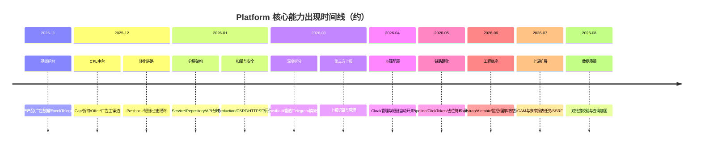

# Platform 平台版本迭代报告

> 报告生成日期：2026-08-03  
> 数据来源：Git 全量历史（约 **1579** 次提交，`main` 分支）  
> 时间跨度：2025-11-22 → 2026-08-03  
> 说明：仓库提交信息多数为日期/时间戳代号（如 `20260803`、`1125`），本报告在提交信息之外，结合**按月快照 diff、关键文件首次引入时间、少量描述性提交**还原「何时改了什么」。

---

## 一、项目定位与当前能力概览

Platform 是一套 **联盟 / CPL 投放与数据运营后台**，覆盖：

| 领域 | 能力 |
|------|------|
| 投放链路 | 跟踪链接、点击入库、短链跳转、斗篷（Cloak）桥页与上报 |
| 转化链路 | Postback 接收 / 校验 / 扣量 / Cap / 折扣 / 转发 / 通知 |
| 业务主体 | 广告主（上游）、Offer、渠道/客户（下游）、产品与产品分配 |
| 数据运营 | 广告数据（Ad Data）、淘宝搜索数据、Excel 导入导出、日报/看板 |
| 上游同步 | 定时拉取多家上游报表（虎光、ZhiSuo(含 ZhangWen/leadwin)、Aya、H5Deer、Flymobi、LeiYang、GAM 等） |
| 安全运维 | 鉴权/会话、CSRF、敏感路径探测、SSRF 防护、审计日志、缓存管理 |
| 协作通知 | Telegram Bot（命令、审批、统计、异常通知） |

技术栈要点：后端 FastAPI（`app/`，应用版本声明 `1.0.0`），前端 Vue 3 + Vite + Element Plus（`package.json` 为 `0.0.0`），MySQL（`sql/platform.sql`，导出日约 2026-07-29），Redis 计数/缓存，Alembic 迁移（自 2026-06），Nginx + systemd 部署配置。仓库**无 Git Tag / 无独立 CHANGELOG**，版本线索主要来自日期型提交与发版核对脚本。

**双业务主线**：① 广告数据管线（上游报表拉取 → 入库/Excel/看板 → 客户开放 API）；② CPL 转化管线（追踪/短链 → Postback → Cap/折扣/转化扣减 → 通知与像素上报）。

**三个易混概念（勿混用）**

| 概念 | 代码位置 | 含义 |
|------|----------|------|
| Cap | `core/cap` + Redis | Offer 日/总转化上限，触顶可自动下线 |
| 折扣 Discount | `core/discount` | 对 payout 打折/扣点（Offer 级优先于渠道级） |
| 转化扣减 Deduction | `core/deduction` | 转化侧策略性扣减配置与日志（独立于 Discount） |

---

## 二、提交活跃度总览

| 月份 | 提交数 | 变更规模（相对上月末） | 阶段特征 |
|------|--------|------------------------|----------|
| 2025-11 | 185 | 基线建立 | 上传起步、Telegram、清理文档 |
| 2025-12 | 388 | +205 文件 / +3.5万行 | **CPL 核心能力爆发** |
| 2026-01 | 352 | +316 文件 / +8.7万行 | **架构分层与重构高峰** |
| 2026-02 | 21 | +27 文件 / +0.6万行 | 低活跃，脚本/运维补充 |
| 2026-03 | 269 | +305 文件 / 净删约 0.6万行 | API 目录迁入 `api_v1`、Postback/Telegram 深化 |
| 2026-04 | 74 | +73 文件 / +0.5万行 | 斗篷配置、短链自动化、代码清理 |
| 2026-05 | 54 | +384 文件 / +3.6万行 | Postback 流水线、Cloak 路由、前端 composable 化、CI/测试 |
| 2026-06 | 173 | +702 文件 / +5.8万行 | Bootstrap、Alembic、监控、国家/敏感路径、模型拆分 |
| 2026-07 | 69 | +341 文件 / +2.0万行 | GAM 调度、SSRF、上游任务扩展、硬化与测试 |
| 2026-08（至 3 日） | 1 | +22 文件 / +0.08万行 | 广告数据双维度校验与查询加固 |

**累计约 1579 次提交。**

---

## 三、分阶段版本演进（何时改了什么）

### 阶段 0：项目起步（2025-11-22 ~ 2025-11-30）

**起点提交**：`Add files via upload`（2025-11-22）

**当时已有能力（基线）**

- 后端：用户/鉴权、客户、产品与分配、广告数据、Excel 导入导出、看板、定时任务、会话、Telegram、审计日志、ML 模型接口
- 前端：登录、看板、广告数据/日报、用户管理、客户管理、API 文档、定时任务、审计、ML 管理
- 部署：`nginx/`、`systemd/Platform-backend.service`、`env.example`

**当月明确动作**

| 日期 | 变更要点 |
|------|----------|
| 2025-11-22 | 仓库初始化，上传 `app` + `frontend` |
| 2025-11-24 | 引入 / 强化 **Telegram** 相关能力（提交 `1124Telegram`） |
| 2025-11-25 | 清理：删除 `docs`、优化报告 MD、导入样本目录；合并远程 `main` |

---

### 阶段 1：CPL 投放中台成型（2025-12）

**规模**：约 205 文件变更，+34849 / -10312 行；`app` 与 `frontend` 为主。

**本阶段解决的问题 / 新增能力**

1. **广告主 / Offer / 渠道（Publisher）** 管理 API 与前端页面  
2. **Cap 限额体系**：`cap_manager`、Redis 计数、一致性检查  
3. **折扣（Discount）** 管理  
4. **点击与转化**：点击队列、转化日志、转化汇总  
5. **Postback 核心**：接收处理、转发、BFT/Macan Handler、通知器  
6. **短链**：生成器、缓存、点击计数、调度归档任务  
7. **跟踪链路**：`click_id_generator`、`tracklink_generator`  
8. **设备信息、Offer 缓存、Telegram 工具**  
9. **淘宝搜索数据（TB Search）** 前后端  
10. **通知配置**（客户/产品级）与通知记录弹窗  

**前端新增页面（节选）**：广告主管理、短链管理、Cap/折扣/Offer/渠道相关 API 与视图、TB 搜索数据页。

**描述性小改动**：2025-12-15 为产品管理弹窗增加 `append-to-body`，改善模态层叠问题。

---

### 阶段 2：分层架构与扣量体系（2026-01）

**规模**：约 316 文件，+87248 / -46036 行——历史最大重构月。

**本阶段解决的问题**

1. **API 按域拆分**：`auth` / `clients` / `cpl` / `postback` / `products` / `system` / `tracking` / `users` / `ml_model` / `external`  
2. **引入 Service / Repository 层**：Offer、广告数据、审计、客户、CPL 各子服务  
3. **扣量（Deduction）体系落地**：`deduction_manager`；前端 Cap/短链/会话等管理页在本阶段成体系出现（文件首次可见于 2026-01-14 大批量提交）  
4. **基础设施**：统一缓存、分页、权限缓存、依赖注入、响应封装、查询优化工具  
5. **短链路由模块化**：`app/routes/short_link/*`（handler、URL 构建、占位符）  
6. **安全相关**：`csrf.py`、`https_middleware.py` 引入  
7. **Postback IP 白名单**、转化扣量服务与 Schema  

**描述性提交**

| 日期 | 说明 |
|------|------|
| 2026-01-14 | 更改渠道扣金额与每日转化上限；含大批量功能落盘 |
| 2026-01-21 | `frontend/public` 加入 gitignore |

---

### 阶段 3：运维脚本与低强度迭代（2026-02）

**规模**：约 27 文件，提交仅 21 次——相对静默期。

**主要内容**

- CPL API 测试脚本与 SQL 快照（`scripts/CPL_API/`）
- 点击数据 SQL、平台库导出
- IP 查询脚本、删记录工具
- Nginx / 前端少量调整

---

### 阶段 4：目录优化 + Postback/Telegram 深度拆分（2026-03）

**规模**：约 305 文件；净删除较多（重构搬迁）。

**本阶段解决的问题**

1. **API 路径迁入 `app/api_v1/`**（从旧 `app/api/api_v1/endpoints` 演进），按 Postback handler/route 细分  
2. **Postback 管道组件化**：校验器（数据/重复/IP）、转换器（归一化/点击关联）、保存器、Cap/折扣检查、转发子系统（HTTP 客户端、占位符、成功判定、缓存）  
3. **Telegram 模块化**：Bot 初始化、命令（start/help/id）、回调（菜单/Postback 审批）、轮询管理、消息发送、通知模板  
4. **第三方上报** API + 前端管理页  
5. **广告数据服务拆分**：列表/详情/统计查询、收入与费率计算器  
6. **Cap 同步**、扣量缓存补丁  
7. **缓存管理**前端页、Offer 筛选组件  

**明确问题修复 / 功能点（描述性提交）**

| 日期 | 问题 / 变更 |
|------|-------------|
| 2026-03-05 | 修复短链接创建时的**并发冲突** |
| 2026-03-14 | 修复 Telegram Bot 命令处理器导入错误；修复登录界面图标位置；tests 加入 gitignore |
| 2026-03-17 | Postback **转发成功/失败都需通知**；修复转化总览统计错误；更新斗篷网页上报；删除 `click_stats` 相关代码；优化项目目录 |
| 2026-03-20 | 增加上报记录 |

---

### 阶段 5：斗篷配置与短链自动化（2026-04）

**规模**：约 73 文件。

**本阶段解决的问题**

1. **斗篷配置管理**：`cloak_configs` API、`CloakManagement.vue`、cloak Schema/服务、像素映射  
2. **独立 `ad-tracker.py`** 与桥页/静态资源脚本补充  
3. **短链自动开关**（2026-04-02：自动关闭和打开短链）  
4. SQL 目录维护（`sql/platform.sql`）  
5. 前后端重复 import 清理（2026-04-22）  

| 日期 | 说明 |
|------|------|
| 2026-04-02 | 自动关闭 / 打开短链 |
| 2026-04-22 | 合并前端重复 import；清理后端（Telegram 外）重复引用；重构 Telegram import |
| 2026-04-24 | 斗篷配置 API 文件首次合入 |

---

### 阶段 6：链路硬化、前端工程化、测试与 CI（2026-05）

**规模**：约 384 文件，+35889 / -22393 行。

**本阶段解决的问题**

1. **Postback 流水线**：`pipeline.py`、`request_parser.py`；各 Postback 业务 Service 拆细（接收/待处理/转发日志/诊断/重复/BFT/归因等）  
2. **跟踪安全与兼容**：`ad_tracking_codec`、`click_token`、`click_persist`  
3. **URL 占位符校验**体系（含 Postback 占位符）  
4. **斗篷短链路由深化**：bridge HTML、change、click persist、report、show count 等  
5. **敏感路径探测**：API、清理定时任务、前端管理页（约 2026-05-28）  
6. **上游拉取框架**：`upstream_fetch/http/import`、智索任务等  
7. **前端大规模 composable 化**（Offer/Cap/扣量/折扣/Postback/短链/缓存/审计等）  
8. **GitHub CI**（`.github/workflows/ci.yml`）与大量 `tests/test_*.py`  

---

### 阶段 7：工程底座升级（2026-06）

**规模**：约 702 文件——单月触及文件最多。

**本阶段解决的问题**

1. **应用启动拆分**：`app/bootstrap/`（lifespan、异常处理、日志）——约 2026-06-10  
2. **数据库迁移**：引入 Alembic（`001_baseline`、`002_security_and_countries`）——约 2026-06-04  
3. **模型拆分**：`user` / `cpl` / `postback` / `deduction` / `security` / `system` / `third_party` / `client_product`  
4. **安全加固**：敏感路径守卫与规则（约 2026-06-03）；国家管理前后端（约 2026-06-11）  
5. **监控与性能**：`monitoring`、`monitoring_redis`、性能优化存储与页面（MonitoringDashboard 约 2026-06-23）  
6. **Postback 通知子系统**独立：`notification/`（配置、消息构建、发送）  
7. **Excel 广告数据导入**模块化（reader/handler/product_resolver/row_processor）  
8. **Postback 路由再拆分**：conversions / diagnostic / forward_logs / pending / receive  
9. **缓存管理 API/Service**、广告数据 Command/Query 进一步细分  
10. **pre-commit** 配置引入  

---

### 阶段 8：上游生态扩展与安全再加固（2026-07）

**规模**：约 341 文件。

**按周主题（基于路径归类）**

| 时段 | 侧重点 |
|------|--------|
| 07-01 ~ 07-07 | 测试、广告数据/Excel、**GAM**、调度、安全 |
| 07-08 ~ 07-14 | Postback、广告数据、调度、Cap/扣量/折扣、安全、短链、Telegram |
| 07-15 ~ 07-21 | 前端、斗篷/桥页、广告数据、Postback、**SSRF**（约 07-16） |
| 07-22 ~ 07-28 | 安全与其它硬化、Postback/Cap 等 |
| 07-29 ~ 07-31 | 上游任务（Aya/Flymobi 等）、Schema/模型、SQL 整理 |

**本阶段解决的问题 / 新增**

1. **Google Ad Manager（GAM）**：拉取/导入、凭证存储、调度配置页与白名单组件、密钥目录  
2. **新上游定时任务**：Aya、Flymobi、H5Deer 等；既有 Skymobi/TBSJ/智索等持续迭代  
3. **SSRF 防护**（`ssrf_guard.py`，约 2026-07-16）  
4. **桥页 HTML 消毒**（`bridge_html_sanitize.py`）  
5. **异步 ORM 辅助**、Uvicorn Worker、Telegram 运行时错误通知  
6. **产品管理页**独立视图与导航工具；发版前本地核对等测试增强  
7. `pyproject.toml`、Nginx Cloudflare Real-IP 等运维补充  

---

### 阶段 9：广告数据维度与查询加固（2026-08-01 ~ 2026-08-03）

**最新提交**：`20260803`（2026-08-03 10:18 +0800）

**本阶段解决的问题**

1. 新增 `dual_dimension_check.py`：**广告数据双维度校验**  
2. 强化维度过滤 / Join / 客户 API 查询 / 日报汇总 / Dashboard 统计  
3. 中间件、国家码、产品分配、Excel 导出、TB 搜索数据接口调整  
4. 上游导入与配置项微调；API 文档页小改  

---

## 四、核心子系统演进地图

### 4.1 Postback（转化回传）

| 时期 | 演进 |
|------|------|
| 2025-12 | 单体 processor / forwarder / handlers / notifier |
| 2026-01 | IP 白名单；API 分域 |
| 2026-03 | validators / transformers / savers / checks / forwarding 拆分；成败均通知 |
| 2026-05 | pipeline + request_parser；Service 层按场景拆分 |
| 2026-06 | notification 子系统独立；路由按 receive/pending/… 拆分 |
| 2026-07 | errors 模块、归因与待处理服务持续打磨 |

### 4.2 跟踪 / 短链 / 斗篷

| 时期 | 演进 |
|------|------|
| 2025-12 | 短链生成、缓存、点击计数；tracklink / click_id |
| 2026-01 | 短链路由模块化 |
| 2026-03-05 | 修复短链创建并发冲突 |
| 2026-03-17 | 斗篷上报更新；清理 click_stats |
| 2026-04 | 斗篷配置后台；短链自动开关 |
| 2026-05 | cloak bridge/report/persist；click_token / codec |
| 2026-07 | 桥页消毒、SSRF 防护 |

### 4.3 Cap / 折扣 / 转化扣减

| 时期 | 演进 |
|------|------|
| 2025-12 | Cap + Discount 管理与 Redis 计数 |
| 2026-01 | Deduction 管理器与前端；渠道扣金额/日上限调整 |
| 2026-03 | Cap 同步、扣量（Discount）缓存 |
| 2026-06+ | 转化扣减查询/统计 Service 再拆分；前后端持续迭代 |

### 4.4 Telegram

| 时期 | 演进 |
|------|------|
| 2025-11 | 首次强化 |
| 2026-03 | 命令/回调/轮询模块化；修复导入问题 |
| 2026-06 | 统计命令/回调、异常处理、DB 同步辅助 |
| 2026-07 | 运行时错误通知 |

### 4.5 广告数据与上游同步

| 时期 | 演进 |
|------|------|
| 2025-11 | Ad Data + Excel 导入导出基线 |
| 2026-03 | Service 查询/计算器拆分 |
| 2026-05 | 上游 fetch/import 框架、智索等任务 |
| 2026-06 | Excel 导入流水线模块化；更多 Query/Command |
| 2026-07 | GAM + Aya/Flymobi/H5Deer 等；产品管理体验增强 |
| 2026-08 | 双维度校验、维度过滤与看板查询加固 |

### 4.6 安全与运维

| 能力 | 约首次时间 |
|------|------------|
| CSRF | 2026-01 |
| HTTPS 中间件 | 2026-01 |
| 敏感路径探测管理 | 2026-05 |
| 敏感路径请求守卫 | 2026-06 |
| Alembic 迁移 | 2026-06 |
| 监控看板 | 2026-06 |
| 国家管理 | 2026-06 |
| SSRF Guard | 2026-07 |
| CI Workflow | 2026-05 |

---

## 五、问题修复与迭代清单

> **持续维护约定（自 2026-08-03 起）**：凡修复缺陷、修正业务问题、重要行为变更，均须追加到下方「持续更新日志」，按日期倒序（新的在上）。  
> 类型取值：`缺陷` / `功能` / `业务` / `安全` / `性能` / `重构` / `体验` / `清理`。

### 5.1 持续更新日志（新条目加在表顶）

| 日期 | 类型 | 模块 | 问题 / 变更 | 说明 |
|------|------|------|-------------|------|
| 2026-10-08 | 性能 | 广告数据/查询缓存 | 冷路径同 key 并发击穿导致 daily-summary 等偶发 8s+ | 新增 `get_or_set_single_flight`（进程内 Future 合并 + Redis 锁等待，超时降级自算）；`daily-summary` 列表/合计与筛选项（countries/date-range/products/clients/ad-units）统一经 `ad_data_get_or_set`。补 `tests/test_cache_single_flight.py`。 |
| 2026-09-23 | 缺陷 | 产品/重名合并 SQL | 合并脚本删除日基线时报 1093 | `DELETE` 子查询又读了 `ad_data_day_baseline`。日基线与通知配置改为 JOIN 删除。过程内已回滚，需重跑 `sql/platform_merge_duplicate_product_names_20260923.sql`。 |
| 2026-09-23 | 缺陷 | 产品 | 同名产品可被建两次，分配历史按 ID 各走各的 | 产品名称改为全局唯一：管理端创建/改名拒绝重名（临时挂靠上的唯一一条仍改绑）；Excel、上游入库、TB 导入命中已有名称则复用最小 ID，不再插入。模型与 `platform.sql` 增加 `uq_products_name`。本地库仍有 `https://news.viralposts.ng`（产品 329、331）重名，升迁脚本 `sql/platform_product_name_unique_20260923.sql` 会中止，处理重复后再执行。 |
| 2026-09-08 | 体验 | Telegram/启停通知 | 启动提示「环境：production」改为中文 | `service_notify`：`生产` / `开发（本机）`。 |
| 2026-09-08 | 缺陷 | Telegram/命令 | 生产命令「无反应」；/help 可能因 Markdown 静默失败 | 根因多为用户拉黑 Bot（403 Forbidden）；/help 改 HTML；命令回复失败统一识别拉黑/Chat not found。 |
| 2026-09-08 | 体验 | Telegram/通知配置 | 默认测试 Chat ID 改为 5312177749 | 前端初始/重置、后端无配置默认值、`platform.sql` 种子行对齐；升迁脚本修正无效 `-4944286056`。 |
| 2026-09-08 | 缺陷 | Telegram/通知配置 | 测试发送失败提示笼统；库内残留无效 Chat ID | 根因 `-4944286056` Chat not found；本地库改 `5312177749`；测试接口回传真实失败原因。 |
| 2026-09-08 | 体验 | Telegram/PTB | 重启无效、菜单转圈、后台回调绕过限流 | `restart_bot_thread` 先停再启；menu 回调补 `answer`；stats/postback 走 `call_telegram_api_throttled`。 |
| 2026-09-08 | 缺陷 | Telegram/PTB | 迁移后 get_send_bot 死锁；诊断/限流/关闭路径未适配 | 锁外创建发送 Bot；RetryAfter/Flood control 识别；诊断与 reset_webhook 改 run_on_send_loop；lifespan 先 stop Application 再放锁。 |
| 2026-09-08 | 重构 | Telegram | 正式依赖由 pyTelegramBotAPI 迁至 python-telegram-bot==22.8 | 发送走独立事件循环 Bot；轮询改 Application.run_polling；命令/回调改为 async Handler；去掉混装 telebot。 |
| 2026-09-08 | 清理 | Telegram | `requirements.txt` Telegram 依赖整理并升级 | （已被上方 PTB 迁移取代）曾短暂锁定 `pyTelegramBotAPI==4.36.1`。 |
| 2026-09-08 | 缺陷 | Telegram/配置 | TELEGRAM_ENABLE=false 时 settings.TELEGRAM_TOKEN 仍可能非空 | `validate_telegram_token` 先判开关再解析 Token；补 `tests/test_telegram_token_enable_gate.py`。 |
| 2026-09-08 | 功能 | Telegram | TELEGRAM_ENABLE=false 未真正关掉全部发送 | 发送入口/`NotificationService`/敏感路径告警/启动通知统一拦截；禁用时不再临时建 Bot、不告警缺 Token；补 `tests/test_telegram_enable_gate.py`。 |
| 2026-08-31 | 缺陷 | 测试/客户核对 | `test_client_reconciliation_db_scope` 依赖 gitignore 脚本导致 CI 失败 | `tests/每日自动报表/client_data_reconciliation.py` 未入库；改为断言 committed 真源 `join_helpers`/`client_api_query`；本地脚本存在时 optional 对齐检查（skipif）。 |
| 2026-08-31 | 性能 | 广告数据/daily-summary | 生产慢请求 8～14s：缓存 TTL 提升 + 互斥选源 SQL 优化 | daily-summary/筛选项缓存 300s→600s（env 可配 `AD_DATA_*_CACHE_TTL`），dashboard summary 120s→300s；维度互斥 `(product_id,date) NOT IN` 改 `NOT EXISTS`；列表/合计/计数查询先收窄日期再套维度筛选。索引沿用 `tests/ad_data_optimize_20260824.sql`（生产若未跑须手工执行）。补 `tests/test_dimension_filter_not_exists.py`、`tests/test_daily_summary_perf_local.py`。 |
| 2026-08-31 | 缺陷 | 客户数据核对 | Dellimobi 周报 2026-08-27 API/平台条数不一致误报 | 根因：`fetch_db_rows` 仅 EXISTS 分配表，未做 `COALESCE(分配客户, products.client_id)` 空窗回退；`debt.acupofmoka.com` 分配自 8-28 起，27 日 API 有 5 行、核对 SQL 漏计。改为 LEFT JOIN 最小 id 分配 + COALESCE，与 `client_api_query` 一致；补 `tests/test_client_reconciliation_db_scope.py`。 |
| 2026-08-27 | 缺陷 | 前端认证 | fetchUserInfo 单飞吞错导致后续 failClosed 误判成功 | 首个 `failClosed=false` 调用吞掉非认证错误后，共享 promise resolve，后续 `failClosed=true` 误以为已同步。改为单飞只共享原始 `/users/me` 请求，策略按调用方各自处理；补 `tests/test_fetch_user_info_inflight.mjs`。 |
| 2026-08-26 | 缺陷 | 前端守卫/后端启动 | 登录后浏览器刷新连环弹出「无法验证访问权限」 | 根因：刷新时 /users/me 失败 → next('/app/dashboard') 重入守卫形成死循环；Telegram 启动通知曾阻塞 API 监听。修复：① 同步失败一律 next(false) 禁止重定向；② /users/me 单飞；③ 瞬时网络失败且有本地角色缓存则放行；④ toast 整页只弹一次；⑤ 启动通知改后台。 |
| 2026-08-26 | 清理 | 产品分配工具 | 相关脚本/SQL 改为中文文件名 | `产品分配完整性检查.py`、`客户产品分配审计.py`、`sql/产品分配修复_20260826.sql`、`修复YCL分配空窗回退.py`、`test_产品分配归属同步.py`。 |
| 2026-08-26 | 功能 | 产品分配巡检 | 检查全部问题类型并询问是否自动修复 | `tests/产品分配完整性检查.py`：汇总所有问题类型（可自动修/需人工），询问 y/N 后执行 `sql/产品分配修复_20260826.sql` 安全段并复查。 |
| 2026-08-26 | 清理/业务 | 客户产品分配数据 | 本地全量审计并出可重复修复 SQL | 脚本 `tests/客户产品分配审计.py`；修复真源 `sql/产品分配修复_20260826.sql`（去重当前有效、贴齐空窗/同日重叠、对齐 client_id、无有效挂靠、前移覆盖广告日、补无分配历史）。本地已执行，P0/P1 清零，仅剩停用客户仍挂活跃产品（脚本第九节可选）。 |
| 2026-08-26 | 缺陷 | 产品分配归属同步 | 改 end_date 后 sync 在 flush 前执行，autoflush=False 下读到旧区间 | `update_assignment_dates` / `batch_update` 改为先 flush 再 `sync_product_client_id_with_assignments`；sync 入口也强制 flush，避免重叠检查/归属判断失效。 |
| 2026-08-26 | 缺陷/业务 | 产品分配/广告数据权限 | 分配结束日后原渠道仍可见后续数据 | 根因：查询空窗 `COALESCE(分配客户, products.client_id)`；只改 `end_date` 未同步产品当前归属时，结束日之后仍回退到原渠道。修复：① 分配日期更新后调用 `sync_product_client_id_with_assignments`（无当前有效则挂「临时挂靠」并补接续区间）；② 本地已修 YCL 产品 289/291/292/295/296（结束 8.19，8.20 起挂靠）；③ 补 `tests/test_产品分配归属同步.py`；前端分配历史提示。 |
| 2026-08-24 | 性能 | 广告数据/ad_data | 面向百万～千万行的索引优化（复查补强） | 复查：默认列表 `ORDER BY date,id` 缺 `(date,id)`；巡检改为 SQL `GROUP BY product_id,date`；去掉主键 id 冗余二级索引。删无日期的国家/来源索引；新增 date+id / date+country / date+ad_unit / date+source+type / date+account；归档表对齐日期前缀；STATS_SAMPLE_PAGES=40 与直方图。升迁脚本仓库真源 `tests/ad_data_optimize_20260824.sql`（`sql/*` 仅白名单 platform.sql，本地可用 `--sync-sql` 同步到 `sql/platform_ad_data_optimize_20260824.sql`）；本机执行器 `tests/apply_ad_data_optimize.py`。本机 50.5 万行已升迁；EXPLAIN 已核。TRIM/深 OFFSET 不靠再堆索引。 |
| 2026-08-24 | 业务/缺陷 | PlayHorizonx 上游 | 改 cross（国家+广告单元）拉数入库 | 上游 `/reports/index` 实测含 `country_code`；原 unit 入库导致每日统计维度互斥不可见。新增 `playhorizonx_normalize.py`（cross 校验国家+单元、unit 兼容剥离国家）；字段映射补 `country_code`；默认 `FETCH_CROSS=true`、`FETCH_UNIT=false`；metadata/config/task 默认 cross；升迁 SQL 修正历史 unit 错位行；tests/test_playhorizonx_normalize.py。 |
| 2026-08-24 | 体验/缺陷 | 前端/移动端 | 全面复查：菜单/筛选/表格/断点 | 复查 24+ 页面：① 1024px JS/CSS 断点对齐（`useDevice` ≤1024 为 tablet）；② drawer 打开双锁定 `body`+`el-main` 防背景滚动穿透；③ Sidebar 抽屉消除双重滚动；④ safe-area 去重；⑤ `mobile.css` 补 toolbar-card/filter-card 筛选、scoped 日期全宽、table-wrapper、扣减统计 2 列卡；⑥ 修 ConversionSummary 媒体查询括号；⑦ Cloak/AdDataList 加 filter-form+table-wrapper；⑧ 补 `tests/test_mobile_menu.mjs`。 |
| 2026-08-24 | 缺陷 | 前端/移动端菜单 | 真机顶栏「菜单」按钮不显示 | 根因：`header-left` 的 `overflow:hidden`+`min-width:0` 在 flex 布局下裁切菜单；`v-if=isMobileOrTablet` 依赖 JS 首屏可能误判。修复：菜单按钮移出 `header-left` 独立渲染；CSS `@media (max-width:1024px)` 控制显示替代 v-if；`useDevice` 初始化同步 `deviceType`；`mobile.css` 全局兜底与安全区。 |
| 2026-08-24 | 体验 | 前端/移动端 | 菜单入口不明显、筛选区移动端适配不全 | 汉堡改为 primary plain「菜单」按钮（图标+文字、48px）；`mobile.css` 扩展 filter-form/filters/toolbar/卡片内 inline 表单 100% 宽、日期范围、列设置触控区、折叠筛选；平板 768–1024 同步列堆叠；ConversionSummary 日期宽 100px→240px。 |
| 2026-08-24 | 体验/缺陷 | 前端/移动端菜单 | iPhone 抽屉菜单仍难操作 | iOS 专项：visualViewport 修正 `--vh`；抽屉打开 `body` 固定防背景滚动穿透；菜单项 48px 触控、`touch-action:manipulation`、移除 transform；安全区 padding；禁用 iOS 左边缘滑开（与 Safari 返回冲突）；打开时滚到当前项；visualViewport 监听。 |
| 2026-08-24 | 体验/缺陷 | 前端/移动端菜单 | 抽屉内无法滚动查看子菜单、子菜单难展开/选中 | 排查 MainLayout+Sidebar+mobile.css：`drawer` 内 flex 缺 `min-height:0` 导致菜单不可滚动；ElDrawer teleport 后 scoped 样式未作用于 `.el-drawer__body`，抽屉布局 CSS 迁至全局 `mobile.css`；移除全局 `* { transform:translateZ(0) }`；系统监控子菜单 index 冲突修复；按路由 `default-openeds`；叶子项才关闭 drawer；桌面端隐藏无效汉堡按钮；接入 `useViewportHeight`。 |
| 2026-08-22 | 体验 | 客户对账脚本 | 双签名探测 HMAC/MD5 | `client_data_reconciliation.py` 启动时用 HMAC-SHA256 与 MD5 各请求一次验证 client_data；`--sign-alg auto|hmac|md5|probe-only`；补 tests/客户端API/test_client_api_signatures.py。 |
| 2026-08-22 | 缺陷/业务 | 广告数据每日统计 | unit 兜底与 daily/plain 同日双计 | `_unit_fallback_for_country_dimension` 未排除已有日报/plain，导致 country 日汇总 API daily 与 unit 重复计数；已加 plain 互斥并补 tests/services/ad_data 用例。 |
| 2026-08-22 | 缺陷/业务 | SweetStaste 上游接入 | 补 tests 与连通脚本 | 新增 test_sweetstaste_fetch（分页 mock）、test_dimension_filter_unit_fallback；保留 tests/API/SweetStaste API/sweetstaste_api.py 手工连通脚本（读环境变量）。 |
| 2026-08-22 | 缺陷/体验 | SweetStaste 上游接入 | 审查后加固规范化与分页可观测性 | 依据 [核查接口字段类型](b84816b8-f5de-4e21-b25b-5a1e24ba0c84)：`sweetstaste_normalize.py` 匹配率兼容 0–1/0–100；ctr/ecpm 整词匹配防误映射；补「广告请求」表头别名；域名归一；非法数值/缺必填过滤并记统计；`upstream_fetch.py` 分页触顶 warning；连通脚本改读环境变量。无表结构变更。 |
| 2026-08-22 | 功能/业务 | SweetStaste 上游接入 | 新增「SweetStaste API获取数据」定时任务，按广告单元（unit）维度入库 | 背景：SweetStaste（alldata.onesefuns.top）提供 GET `/api/v1/get-ad-data`，Query `api_key`/`page`/`start_date`/`end_date`，成功 `code=1`。实测明细含 `adunit`、无国家；`summary_type=date_link` 会把广告单元打成 0。列名为 `col_*` 哈希，含义在 `display_names`。修改：① `ad_data_metadata.py` 新增 `DATA_SOURCE_SWEETSTASTE` 并补齐来源/任务映射/标签/默认 unit；② `config.py` + `.env` 增加 Base URL / api_key / 可选 site_name；③ `sweetstaste_normalize.py` 按表头还原字段、日期 `YYYY/MM/DD`→`YYYY-MM-DD`、按匹配率推匹配数、丢弃无效广告单元；④ `upstream_fetch.py` 按 `last_page` 分页（`data.total` 是收益合计）；⑤ 新建 `sweetstaste_task.py`，cron 每 30 分钟。无表结构变更。 |
| 2026-08-20 | 功能/业务 | PlayHorizonx 上游接入 | 后台深度检查与全面验证 | 通过浏览器访问 PlayHorizonx 上游后台（http://reports.h5gamegl.top），登录后验证后台报表功能。发现：① 后台有两个页面：`/report/book`（API 文档）和 `/report/lists`（报表查询）；② 后台报表表格列包含：Date、Ad Units、Country、Url、Request、Request Matching、Match Rate、Impressions、Clicks、CTR、Estimated Revenue、eCPM；③ 后台查询 API 为 `/report/lists`（GET 请求，带登录态），与公开 API `/reports/index`（POST + md5 签名）是不同接口；④ 公开 API 返回字段为：date、url、com_name、requests、matched_queries、viewsCount、clicks、channel_revenue（共 8 个字段），无 country 字段；⑤ 字段值类型：requests/matched_queries/viewsCount/clicks 为字符串，channel_revenue 为数值。全面验证结果：代码字段映射正确（8 个字段）、数据类型转换正确（int()/float() 自动处理字符串）、鉴权逻辑正确（md5 签名）、分页逻辑正确（按 totalCount 全量拉取）。账号 SGSUO 在 90 天范围内均无数据，代码逻辑完全正确。 |
| 2026-08-20 | 功能/业务 | PlayHorizonx 上游接入 | 连通性测试完成，修复字段名问题 | 测试发现 API 请求体字段名应为 `username`（全小写），而非文档示例中的 `UserName`（驼峰）。修复 `upstream_fetch.py` 和测试脚本中的字段名。同时发现 API 成功响应码为 `status=0`，而非文档中的 `status=1`，已修正 `raise_unless_api_success` 检查逻辑。连通性验证结果：① HTTP 请求正常（HTTP 200）；② md5 签名正确；③ 响应解析正确；④ 分页逻辑正常（totalCount=0 时正常退出）。账号 SGSUO 在 30 天范围内（2026-07-20 ~ 2026-08-19）均无数据返回，代码逻辑完全正确，待账号有数据后即可正常拉取入库。 |
| 2026-08-20 | 功能/业务 | PlayHorizonx 上游接入 | 新增「PlayHorizonx API获取数据」定时任务，按 cross 维度接入 | 背景：PlayHorizonx（api.h5gamegl.top）提供广告业务报表接口 `/reports/index`，需接入平台上游拉数体系。鉴权方式：Header sign = md5(username + startDate + endDate + private_key)。响应字段：date、url、com_name、requests、matched_queries、viewsCount、clicks、channel_revenue，无 country 字段，按 cross 维度入库。修改：① `ad_data_metadata.py` 新增 `DATA_SOURCE_PLAYHORIZONX="playhorizonx"`，并补齐 `UPSTREAM_API_DATA_SOURCES`、`TASK_NAME_TO_DATA_SOURCE`、`DATA_SOURCE_LABELS`、`UPSTREAM_DEFAULT_REPORT_TYPES`（内置默认 cross）、`REPORT_TYPE_HINTS` 中 PlayHorizonx 条目；② `config.py` + `.env` 新增 `PLAYHORIZONX_API_BASE_URL`/`PLAYHORIZONX_API_USERNAME`/`PLAYHORIZONX_API_PRIVATE_KEY`/`PLAYHORIZONX_API_FETCH_CROSS` 配置项，鉴权方式 Header sign（md5 签名）；③ `upstream_fetch.py` 新增 `PLAYHORIZONX_PATH_INDEX="/reports/index"`、`_build_playhorizonx_sign` 签名函数与 `fetch_playhorizonx_rows` 拉数函数（POST JSON + md5 签名鉴权，按 totalCount 全量分页，status==0 成功，data.pages 分页，data.list 行数据）；④ 新建 `tasks/playhorizonx_task.py`，定义 `PLAYHORIZONX_FIELD_MAPPING`（9 字段映射：date→date、url→product_name、com_name→ad_unit、requests→request_count、matched_queries→match_count、viewsCount→display_count、clicks→click_count、channel_revenue→revenue_before_deduct），实现 `playhorizonx_api_task` 按日期范围拉数入库，区分瞬时错误/硬错误/空数据三类，report_type 显式传 REPORT_TYPE_CROSS；⑤ `task_names.py` 新增 `PLAYHORIZONX_API_TASK_NAME` 常量与 `ALL_TASK_NAMES` 条目；⑥ `task_config.py` 注册任务（cron `*/30 * * * *`，每 30 分钟一次）。本地验证：语法检查全部通过，模块导入正常，签名函数输出正确。待补充真实 username/private_key 后连通性测试。未新增/变更表结构，sql/platform.sql 无需变更，无需升迁 SQL。 |
| 2026-08-20 | 体验/性能 | 前端/移动端适配 | 全局移动端适配增强：响应式公共样式、通用页面布局移动端覆盖、侧边栏边缘滑动手势 | 背景：前端已有较完善的移动端基础设施（mobile.css、variables.css 响应式断点、useDevice/useMobileTouch composables、MainLayout 抽屉菜单、index.html 视口与 PWA 配置、vite 构建代码分割与压缩），但存在若干缺口。修改：① `styles/common.css` 全部硬编码值（20px/16px/4px/颜色值等）替换为 CSS 变量，新增平板端(768-1024px)与移动端(<768px)断点，page-header/table-header 移动端列堆叠，宽度工具类 w-200/w-150 移动端转 100%，图表与空状态高度自适应；② `styles/mobile.css` 新增「移动端通用页面布局优化」区块，一次性覆盖 15 个管理页面通用的 .search-bar / .card-header / .page-card / .filter-bar / .table-header / .pagination-container 类名：搜索栏强制列堆叠并以 !important 覆盖 CapManagement/DiscountManagement 等页面内联 `style="width:160px;min-width:160px"` 固定宽度导致的移动端横向溢出，14 个页面容器 padding 统一为 --mobile-content-padding，分页移动端居中；③ `components/Layout/MainLayout.vue` 新增左边缘右滑打开侧边栏抽屉手势（30px 边缘检测区、50px 滑动阈值、时长<500ms、水平滑动需大于垂直 1.5 倍，passive 监听不阻断滚动），仅移动端/平板端生效，抽屉已打开时不重复触发。验证：npm run build 成功（2373 模块转换，exit 0），CSS 代码分割正常。无后端/数据库/表结构变更，无生产操作。 |
| 2026-08-20 | 功能/业务 | IDGTN 上游接入 | 新增「IDGTN API获取数据」定时任务，按「单元+日期+国家」维度接入 | 背景：IDGTN（ops.idgtndmggroup.com）提供广告业务报表，需接入平台上游拉数体系。接口3 `/download/country` 返回「广告单元+日期+国家」明细，按平台 cross 维度入库（具体国家+广告单元，不含 ZZ）。修改：① `ad_data_metadata.py` 新增 `DATA_SOURCE_IDGTN="idgtn"`，并补齐 `UPSTREAM_API_DATA_SOURCES`、`TASK_NAME_TO_DATA_SOURCE`、`DATA_SOURCE_LABELS`、`UPSTREAM_DEFAULT_REPORT_TYPES`（内置默认 cross）、`REPORT_TYPE_HINTS` 中 IDGTN 条目；内置标准维度沿用 cross（standard_report_type 为 NULL 时回退内置默认）；② `config.py` + `.env` 新增 `IDGTN_API_BASE_URL`/`IDGTN_API_KEY`/`IDGTN_API_SECRET`/`IDGTN_API_FETCH_COUNTRY` 配置项，鉴权方式 header apiKey+apiSecret；③ `upstream_fetch.py` 新增 `IDGTN_PATH_COUNTRY="/download/country"` 与 `fetch_idgtn_rows` 函数（GET+reportDate 单日无分页，code==200 成功，data 为数组）；④ 新建 `tasks/idgtn_task.py`，定义 `IDGTN_COUNTRY_FIELD_MAPPING`（12 字段映射：date→date、domain→product_name、adUnitName→ad_unit、countryCode→country_code、adExchangeTotalRequests→request_count、matchRequests→match_count、adExchangeLineItemLevelImpressions→display_count、adExchangeLineItemLevelClicks→click_count、adExchangeLineItemLevelRevenue→revenue_before_deduct、adExchangeLineItemLevelAverageEcpm→ecpm_before_deduct、adExchangeLineItemLevelCtr→click_rate、adExchangeActiveViewViewableImpressionsRate→viewability_rate、pv→pageviews），实现 `idgtn_api_task` 按日期范围循环拉数累积后一次入库，区分瞬时错误/硬错误/空数据三类，report_type 显式传 REPORT_TYPE_CROSS，upstream_account 空串；⑤ `task_names.py` 新增 `IDGTN_API_TASK_NAME` 常量与 `ALL_TASK_NAMES` 条目；⑥ `task_config.py` 注册任务（cron `*/30 * * * *`，每 30 分钟一次）。本地验证：2026-08-19 拉取 15 行全部入库，product_id=306、country_code=CN/IN/JP/US、report_type=cross、data_source=idgtn，字段映射与类型转换正确，去重机制正常（重复运行跳过 15 条）。未新增/变更表结构，sql/platform.sql 无需变更，无需升迁 SQL。 |
| 2026-08-20 | 缺陷/口径 | IDGTN 上游接入 | viewability_rate 单位不一致：IDGTN 返回 0-1 小数，平台为 0-100 百分比，导致日汇总时 IDGTN 可见率被严重低估 | 问题：IDGTN 上游 `adExchangeActiveViewViewableImpressionsRate` 返回 0~1 的小数（1.0 表示 100%），但平台 viewability_rate 为 0~100 百分比（GAM 等数据源 avg=98.17 表示 98.17%）。直接取上游值会导致 IDGTN 的 1.0 被当作 1% 而非 100%，日汇总时多数据源可见率口径不一致。修复：`tasks/idgtn_task.py` 新增 `_transform_idgtn_rows` 预处理函数（通过 `import_upstream_ad_data` 的 `data_transform` 参数传入），在入库前将 `adExchangeActiveViewViewableImpressionsRate` 值 ×100 转换为百分比。本地验证：修复前 viewability_rate=1.0（被当作 1%），修复后=100.0（正确表示 100%），与 GAM 等数据源口径一致。同时确认 `click_rate` 映射的 `adExchangeLineItemLevelCtr` 会被 `calculate_rates()` 自动覆盖（click_count/display_count×100），保留映射仅作回退，不影响最终值。 |
| 2026-08-20 | 缺陷/口径 | Addermobi 上游接入 | viewability_rate 单位不一致潜在风险：ActiveViewViewability 可能返回 0-1 小数，平台为 0-100 百分比 | 问题：全量扫描 12 个上游 API 数据获取任务发现，Addermobi 的 `ActiveViewViewability` 映射到 viewability_rate 但无单位转换保护。与 IDGTN 同类问题：如果上游返回 0~1 小数（如 0.85=85%），直接入库会被当作 0.85% 而非 85%，日汇总时口径不一致。GAM 的 viewability_rate 已是 0-100 百分比（本地 21045 条验证 max=100.0），无需转换。修复：`upstream_import.py` 的 `preprocess_addermobi_match_counts` 函数增加 viewability_rate 智能转换保护（值 0<val≤1 时 ×100），与同函数已有的 AdRequestsCoverage 处理逻辑一致（值 >1 视为百分比，值 ≤1 视为比例）。单元验证：0.85→85.0、85.5→85.5（不转换）、1.0→100.0、0→0、None→None，边界值全部正确。其他 9 个未映射 viewability_rate 的数据源（TQT/Skymobi/TBSJ/Huguang/ZhiSuo/Pomiad/H5Deer/Aya/FlyMobi/LeiYang）无此问题；coverage_rate/display_rate/click_rate 会被 calculate_rates() 自动计算覆盖，无单位问题。 |
| 2026-08-19 | 缺陷/容错 | 定时任务调度 | release_task_lock 死锁无重试 + 审计日志 MissingGreenlet 错误 | 问题（生产 error.log 暴露）：① LeiYang/ZhiSuo 任务同时完成时 UPDATE scheduled_tasks 产生 MySQL 死锁 (1213)，release_task_lock 无重试直接失败；② 死锁回滚后 ORM 对象过期，scheduler.py 访问 task_record.description 触发 SQLAlchemy MissingGreenlet 错误。修复：① `lock.py` release_task_lock 新增 3 次死锁/锁超时重试（递增退避 0.2s/0.4s/0.6s），新增 `_is_deadlock_or_lock_timeout` 辅助函数判断 errno 1213/1205；② `scheduler.py` 在调用 release_task_lock 之前提前提取 task_description 和 task_cron_expression 到本地变量，审计日志使用本地变量而非 ORM 属性，彻底消除 MissingGreenlet。 |
| 2026-08-19 | 优化/容错 | Telegram 通知 | 消息发送超时时间偏短导致误判失败 | 问题：生产服务器凌晨集中发送通知时，Telegram API read timeout=15s 频繁超时（12 次）。优化：TIMEOUT_SECONDS 从 15s 增大到 30s，给不稳定网络更多缓冲，减少误判失败。 |
| 2026-08-19 | 功能/业务 | 定时任务管理 | scheduled_tasks 新增 standard_report_type 字段，前端支持设置标准数据维度 | 背景：多维度任务（如 Aya 同时拉 daily/country/unit）需要在汇总时指定标准维度。修改：① scheduled_tasks 表新增 `standard_report_type VARCHAR(20)` 字段，ORM、sql/platform.sql 同步；② 升迁 SQL 幂等执行已本地验证通过；③ 后端 API ScheduledTaskResponse/ScheduledTaskUpdate 新增 standard_report_type 字段，PATCH 路由支持设置/清除，更新后自动刷新内存配置；④ ad_data_metadata.py 新增 TASK_NAME_TO_DATA_SOURCE 映射、refresh_standard_report_types() 异步加载函数、_db_standard_report_type_override 覆盖层（数据库优先，内置默认兜底）；⑤ 应用启动时在 lifespan 中调用 refresh_standard_report_types()；⑥ 前端定时任务页面新增「标准维度」列和设置弹窗，可选 country/cross/unit/daily，仅 API 数据获取类任务显示设置按钮，清空恢复默认优先级。 |
| 2026-08-19 | 功能/业务 | 广告数据汇总 | 新增按数据源配置标准维度功能（Aya 日报为标准） | 背景：Aya 同时拉取 daily/country/unit 三个维度，上游确认以日报为标准；其他多维度数据源（FlyMobi、ZhiSuo）也存在类似需求。修改：① `ad_data_metadata.py` 新增 `STANDARD_REPORT_TYPE_BY_SOURCE` 配置字典，为每个数据源指定标准维度（Aya=daily，FlyMobi=cross，ZhiSuo=cross）；② 新增 `get_standard_report_type(data_source)` 和 `get_report_type_priority(data_source)` 两个工具函数，未配置的数据源回退到全局默认（country > cross > unit > daily）；③ `dimension_filter.py` 新增 `_report_type_product_date_pairs_by_source_subquery` 和 `_outer_row_not_in_report_type_for_source` 辅助函数，支持按 data_source 过滤子查询；④ `build_daily_summary_dimension_filter` 和 `kpi_mutual_source_filter` 新增 `data_source` 参数，当指定数据源且该数据源有标准维度时，标准维度数据优先保留，非标准维度数据仅在标准维度不存在时兜底；⑤ 所有现有调用方无需修改（data_source 默认为 None，回退原有逻辑）。 |
| 2026-08-19 | 缺陷/容错 | Aya 定时任务 | 三维度（日报/国家/广告单元）共用一个 try/except，单维度失败导致全部跳过；report_type 未显式传入依赖自动推断 | 修复：① 每个维度改为独立 try/except，UpstreamTransientError（软跳过）与普通 Exception（硬错误）分别收集，单维度失败不影响其他维度；② 引入 REPORT_TYPE_DAILY/COUNTRY/UNIT 常量，三维度调用时显式传入 report_type，不再依赖 infer_report_type_from_shape 自动推断；③ 汇总逻辑区分全部成功/部分成功+软跳过/部分成功+硬错误/全部软跳过/全部硬错误五种场景，分别设置 task_result 和日志级别，部分成功+硬错误时 raise RuntimeError 保留调度器失败语义。 |
| 2026-08-19 | 缺陷/规范 | FlyMobi/ZhiSuo 定时任务 | FlyMobi 三维度（country/unit/daily）与 ZhiSuo 四维度（data/country/unit/daily_fallback）调用 import_upstream_ad_data / run_upstream_import_task 时未显式传 report_type，依赖 infer_report_type_from_shape 自动推断，存在维度错判风险 | 修复：① FlyMobi _FLYMOBI_REPORTS 配置新增 report_type 字段；countryList 因 field_mapping 同时含 ad_unit + country_code，设为 REPORT_TYPE_CROSS（与自动推断一致）；adUnitList 设为 REPORT_TYPE_UNIT；dayList 设为 REPORT_TYPE_DAILY；② ZhiSuo _fetch_import_dimension 函数新增 report_type 参数，四个维度调用分别传入 REPORT_TYPE_CROSS/COUNTRY/UNIT/DAILY，透传到 import_upstream_ad_data；③ 引入必要的 REPORT_TYPE_* 常量导入。单维度任务（tqt/skymobi/huguang/addermobi/h5deer/pomiad）因 field_mapping 同时含 ad_unit + country_code，自动推断 cross 正确，无需修改。 |
| 2026-08-15 | 容错/体验 | 每日自动报表核对脚本 | `client_data_reconciliation.py` 客户 API 请求无网络异常容错，DNS 抖动等直接崩溃打印英文 traceback | 问题：`fetch_api` 的 `requests.post` 仅对 JSON 解析做 try/except，对 DNS 解析失败、连接/读取超时、SSL 握手失败、连接被拒等网络异常未捕获也无重试，异常冒泡导致整段英文 traceback 退出。修复：① 新增 `_api_post_with_retry`，对网络类异常按 2/4/8 秒指数退避重试（次数由环境变量 `AUDIT_API_MAX_RETRIES` 控制，默认 3），区分 DNS/超时/SSL/连接失败输出中文提示，重试用尽抛带排查建议的 RuntimeError；② `fetch_api` 改用该函数；③ `main` 按天循环用 try/except 包住 `fetch_api`，单天 API 不可达时输出中文提示并跳过该天继续，`day_failed` 计入 `all_ok` 判定，汇总提示体现跳过天数。正常路径首次成功即返回，行为不变。 |
| 2026-08-13 | 安全/并发 | Cap 回滚原子化 | `decrement_daily`/`decrement_total` 的 `decr + if val<0: set(0)` 三步非原子，存在 TOCTOU 竞态窗口 | 修复前：`val = await redis.decr(key); if val < 0: await redis.set(key, 0)`，decr 与 set 之间若有并发 incr/reserve 会丢失计数或导致配额虚增。修复：① `app/core/cap/redis_counter.py` 新增 `_DECREMENT_LUA` 原子脚本（DECR 后 <0 则 SET 0 并返回 0，否则返回新值，整个过程 Redis 单线程原子执行）；② `decrement_daily`/`decrement_total` 改用 `redis.eval(_DECREMENT_LUA, 1, key)` 调用，移除非原子的 decr+set 组合；③ 返回值改为 `int`（最终计数值，-1 表示 Redis 不可用或异常），便于上层观测；④ 异常路径补充 `exc_info=True`。调用方 `cap_manager.py` 两处（`_rollback_reserved_redis` L160-166、`rollback_cap_redis_redis_counts` L380-383）均不接收返回值，向后兼容无需适配。新增 `tests/test_security_fixes.py` 共 26 项专项测试（5 类：decrement_total 8 项、decrement_daily 7 项、并发原子性 3 项、Lua 脚本内容 6 项、向后兼容 2 项）全通过；全量 68 项测试 + 综合 61 项审计 100% 通过。 |
| 2026-08-13 | 安全/缺陷 | Offer 状态校验 | Offer 激活状态校验不足：Postback 转化和短链重定向未检查 Offer 是否已下线 | 点击追踪（tracking.py:170）已有 `is_active + status == 'Active'` 校验，但 Postback 转化和短链重定向两个关键流程缺失。修复：① `postback/pipeline.py` 新增 `step_validate_offer_status` 步骤，在 Click 关联后、重复检测前校验 Offer 状态，下线 Offer 的转化直接跳过不入库、不占 Cap、不转发通知；② `processor.py` 在第 4.5 步调用该步骤；③ `routes/short_link/utils.py` 的 `resolve_offer_id`
增加 `is_active + status` 校验，下线 Offer 返回 (None, None)；④ `routes/short_link/handlers.py` 缓存/数据库两条路径均增加 `if offer_id and final_offer_id is None: raise` 拦截。141 项安全测试全通过。 |
| 2026-08-13 | 缺陷/精度 | 金额计算 | 广告金额/佣金/扣量/收益等业务计算从 float 改为 Decimal | 数据库模型已使用 Numeric、Pydantic Schema 已使用 Decimal，但业务计算层广泛使用 float() 转换和浮点运算，存在精度误差风险。修复涉及 7 个文件：① `core/utils.py` 的 `truncate_to_2_decimal` 和 `apply_deduct_ratio` 改为 Decimal 运算（ROUND_DOWN 截断）；② `revenue_calculator.py` 全部 4 个方法（calculate_ecpm/revenue/deducted_amount/deduct_ratio）改为 Decimal；③ `deduction_manager.py` 的 `DeductionResult` 金额字段和 `calculate_amount_deduction` 改为 Decimal；④ `api_v1/ad_data.py` 移除冗余 float() 包装；⑤ `cpl/offer/helpers.py` 的 affiliate_payout 改用 Decimal 解析；⑥ `cpl/deduction/helpers.py` 的 ratio 默认值改为 int；⑦ `health_check.py` 新增 `_as_decimal` 用于金额场景。所有 141 项安全测试通过，Decimal 运算验证正确。 |
| 2026-08-13 | 测试 | 安全修复专项 | 新增 test_security_fixes.py 42 项单元测试 | 针对 Redis 黑名单 Bug 修复和 Cap 并发控制生成专项单元测试：A. Redis 黑名单（14 项）：核心 Bug 验证（HTTPException 不被 except Exception 吞掉）、黑名单命中拒绝、未命中通过、Redis 不可用降级、Redis 查询异常降级、空 jti 跳过、TTL 过期恢复、MySQL 黑名单回填 Redis；B. Cap 并发控制（26 项）：20/100 并发不超扣、daily/total 正常递增与超限、initial_value 冷启动、publisher/offer 隔离、limit=0/1 边界、fail-open/close 双模式、Lua 异常降级、decrement 回滚不减负、Key 格式校验、daily/total 独立计数、顺序基准对照；C. 集成场景（2 项）：黑名单+Cap 联合验证、并发互不干扰。42/42 全通过。 |
| 2026-08-13 | 测试/验证 | 全栈安全测试 | 管理员/客户双角色 33 项实时 API 安全测试全通过 | 启动前后端（8960/3310）进行全面安全测试：管理员登录/JWT 安全（过期/alg:none/篡改）/CSRF 防护（缺失/Bearer 不绕过/有效通过）/管理员权限（用户管理/审计日志/会话黑名单）/客户角色隔离（伪造 Token 被拒 + 真实客户 Dellimobi 登录权限边界）/登出 Token 失效/SSRF 防护（私网 IP+非 HTTP 协议）/Excel 安全（ZIP Bomb+XXE）/Cap 并发不超扣（20 并发 limit=10）/Redis 黑名单 Bug 修复验证。修复测试脚本中管理员密码、CSRF 获取方式、Cap 方法名（reserve_cap→check_and_increment_daily）、端点路径（/users/、/sessions/blacklist、/users/me）等问题。 |
| 2026-08-13 | 安全 | IP/SSRF/Excel/JWT/Cap/缓存/扣量/队列/调度/日志 | 多模块安全与并发加固 | 客户端 IP 仅信任 TRUSTED_PROXIES 并从 XFF 右向左取真实 IP；Postback 出站强化 getaddrinfo+SSRFForbiddenError；Excel 增加 ZipBomb/行数/defusedxml 与 to_thread；JWT 增加 Redis jti 黑名单（改密吊销会话）；Offer 缓存延迟双删+TTL 抖动+空值缓存；扣量改为 click_id 确定性哈希；clicks 死信队列与重试上限；调度任务增加 Redis SETNX 锁；日志脱敏覆盖 Bearer/JWT/URL 参数；依赖抬升 PyJWT≥2.13、cryptography≥50、defusedxml。 |
| 2026-08-12 | 安全/缺陷 | 认证/CSRF | 退出登录 POST 报 CSRF 令牌不存在 | 登录前匿名 session 与登录后 user_id session 不一致，客户端仍带旧令牌；登录/刷新成功响应下发正确 CSRF，logout 前通过 GET /users/me 刷新令牌。 |
| 2026-08-12 | 体验 | 前端导航/菜单 | 点击新菜单偶发无反应、需多次点击 | 移除导航完成前拦截后续点击的 menuNavigating 锁；点击后立即高亮目标菜单项；路由切换时顶部显示进度条；侧栏挂载时预热 /users/me 缓存。 |
| 2026-08-12 | 性能 | 前端导航/菜单 | 菜单与子菜单点击反应缓慢 | 路由守卫取消每次导航 force 刷新 `/users/me`，单次复用 30s 缓存；MainLayout 增加 keep-alive（max=20）避免页面反复销毁重挂载；登录后生产环境亦 idle 预取全部路由 chunk，子菜单展开与 hover 预取目标页。 |
| 2026-08-12 | 性能 | 广告数据每日统计 | 并行加载无依赖筛选项并增加国家/广告单元缓存 | 普通维度下国家与广告单元筛选接口改为并行请求；后端新增按用户、日期、客户、产品、维度及关联筛选条件组成的 300 秒 Redis 缓存，减少每日统计首屏的串行等待和重复 SQL；不改变 country 优先及维度口径。 |
| 2026-08-12 | 性能 | 广告数据详细报表/日期范围 | 并行加载明细列表与 grand total，并缓存管理员全库日期范围 | 详细报表不再串行等待列表与合计查询；管理员未指定客户时日期范围直接按有效产品聚合，首次查询约 0.2 秒，后续命中 300 秒缓存；不改变权限和维度口径。 |
| 2026-08-12 | 性能/数据库 | 索引治理 | 复核新增复合索引后删除两个被覆盖的单列索引 | `ad_data.idx_ad_data_product` 被 `(product_id,date,id)` 覆盖；`product_assignments.idx_product_assignments_product` 被 `(product_id,start_date,end_date)` 覆盖；同步 ORM、`sql/platform.sql` 并更新迁移脚本，保留外键所需的复合索引前缀。 |
| 2026-08-12 | 运维/数据库 | 本地迁移验证 | 在本机 Windows MySQL 8.0.33 实际执行索引迁移并生成生产可执行版 SQL | 本地迁移成功；5 个目标冗余索引剩余 0 个，`ad_data.idx_ad_data_product_date_id` 保留 3 列；每日统计与详细报表查询仍可正常执行。最终脚本含幂等前置检查、执行后核对和手工回滚说明，未连接生产。 |
| 2026-08-12 | 运维/数据库 | 升迁脚本审查 | 修正索引动作清单被误取消注释的问题 | 恢复文件开头 `ADD INDEX`/`DROP INDEX` 为审阅注释，避免与下方幂等存储过程重复执行；本机 MySQL 已编译验证存储过程语法通过。 |
| 2026-08-12 | 运维/数据库 | 升迁脚本易用性 | 索引升迁改为无需存储过程的直接执行版 | 使用 `information_schema` + `PREPARE/EXECUTE` 逐项判断，用户只需执行整个 SQL 文件；表或索引状态不满足时自动跳过，末尾自动输出索引清单及 SUCCESS/WARNING 结果。本机已迁移库重复执行通过，冗余索引仍为 0。 |
| 2026-08-12 | 性能/数据库 | 索引治理 | 第二轮审计确认 3 组重复索引并生成完整迁移脚本 | 删除被同列唯一索引完全覆盖的 `product_notification_configs.idx_product_notification_config_product`、`scheduled_tasks.idx_scheduled_task_name`、`short_links.idx_short_link_code`；保留唯一索引与业务联合索引；同步 ORM（含 `scheduled_tasks` 显式索引定义）、`sql/platform.sql`，生成幂等可回滚迁移 SQL |
| 2026-08-12 | 性能/安全 | 数据库/platform.sql | 结合本机 MySQL 深度复核全量结构、数据质量与真实执行计划 | 38.9 万行 `ad_data` 产品+日期分页当前扫描约 1.6 万行并 filesort，补 `(product_id,date,id)`；其余候选小表或已有索引收益不足不新增；移除全量 SQL 中硬编码管理员/数据账号明文提示、密码哈希及固定客户 API key，改由应用首次启动配置创建；生成幂等可回滚增量 SQL；全程未连接生产 |
| 2026-08-12 | 缺陷 | CPL/扣减配置 | 无数据打开扣减配置报 401 并被踢回登录 | 列表改为请求带尾斜杠避免开发代理 307 丢 Cookie；空筛选参数不再上送；401 不再重复弹「获取配置列表失败」 |
| 2026-08-11 | 业务 | 上游/LeiYang | 对接文档新增 atomic（国家+广告单元）后切换默认拉数维度 | 默认仅拉 `/reports/atomic`→cross，关闭 country/ad-unit/all；昨日四维汇总对比不一致，以文档推荐 atomic 为准 |
| 2026-08-10 | 缺陷 | 客户 API | 国家逻辑键去重遗漏 `or_` 导入导致查询 NameError | 补全 `client_api_query.py` 中 SQLAlchemy `or_` 导入 |
| 2026-08-10 | 缺陷/安全/性能 | 客户 API/分页复查 | 修复重叠分配按请求方优先造成的跨客户重复归属、空格维度误判、NULL 指标回退异常及日汇总分页一致性窗口 | 重叠分配恢复全局固定最小分配 ID 唯一归属；SQL 维度判断统一 TRIM；逻辑国家键统一 NULL/空串/ZZ、广告单元首尾空格并使用 NULL 安全比较，正常唯一键行跳过去重子查询；明细先归零数量再计算比率；分组分页非空页改为 COUNT OVER 单语句返回 total；意外异常对客户脱敏；同步客户前端文档、Python/Java 示例及跨页一致性校验，并增加真实 SQLite 数据级回归 |
| 2026-08-10 | 缺陷/性能/数据 | 客户 API/广告数据分页 | 修复明细分页一致性、历史分配重叠放大、维度默认重复与异常页码 | 明细改为单条窗口统计分页并使用稳定 date+id 排序；重叠分配按全局固定规则唯一归属；明细未传 dimension 默认 country，原始全量需显式 all；增加页码上限、NULL 指标保护、明细 ID 回归校验；对 MySQL NULL 国家唯一键及国家代码首尾空格异常在查询层按规范化逻辑键去重，日汇总分组同步规范化，保持现有表结构兼容 |
| 2026-08-10 | 安全/测试 | 仓库与 CI | 防止环境凭据、私钥、GAM 凭据继续被跟踪；修正分页回归测试可复现性 | 增强 .gitignore 并从 Git 索引移除当前敏感文件；CI 仅运行 Git 已跟踪的测试文件且无测试时失败；审计指纹覆盖 ID、日期及全部明细指标 |
| 2026-08-10 | 缺陷 | Telegram/启动通知 | 本地 uvicorn 启动无服务启停 Telegram 提示 | `should_send_service_lifecycle_notify` 仅认 SCHEDULER_WORKER=1；uvicorn 未设该变量时改为允许发送，并在文案中标注 development（本机） |
| 2026-08-10 | 功能 | Telegram/配置 | 本机与生产共用单一 TELEGRAM_TOKEN，Windows 易误用生产 Bot | 新增 TELEGRAM_TOKEN_LOCAL / TELEGRAM_TOKEN_PRODUCTION，按环境自动选用（与 Admin 分流一致）；兼容旧 TELEGRAM_TOKEN 回退 |
| 2026-08-10 | 性能 | 广告数据/日汇总 | 生产 daily-summary 仍出现 8～10s 慢请求 | 列表用 COUNT(*) OVER 合并分组总数，去掉重复 plain 维度条件；缓存 TTL 120→300s；冷路径少一次全量 GROUP BY |
| 2026-08-10 | 安全 | 配置/仓库 | 源码硬编码 Telegram Token；`.env`/私钥/GAM 凭据被 Git 跟踪；客户 API MD5 生产默认过宽 | 删除源码内置 Token（改读 `.env`）；`.gitignore` 忽略 `.env`/`keys`/`secrets`/`*.pem`/`*.key` 并从索引移除；生产默认关闭 MD5 签名兼容 |
| 2026-08-10 | 安全 | Postback/上游拉取 | `should_notify` 遮蔽；Addermobi/TBSJ 请求关闭 TLS 校验 | 局部变量改为 `need_notify`；Addermobi/TBSJ 请求恢复默认证书校验，Huguang 上游保持原有协议与校验配置 |
| 2026-08-10 | 缺陷 | 仪表盘 | `get_recent_ad_data` 异常分支引用未定义 `logger` | 改为模块级 `logging.getLogger(__name__)`，三个端点共用 |
| 2026-08-10 | 缺陷 | CI/路由/鉴权契约 | CI 引用缺失审计脚本且几乎不跑回归；IP 白名单重复注册；Telegram 双前缀；/auth/me 文档过时 | 去掉不存在的 audit_*；pytest 仅对跟踪的 tests/test_*.py；白名单只挂 postback 包内一份；runtime-status/restart；文档改指向 /users/me；顺带修 Dict 未导入、短链生成函数遮蔽与若干死导入 |
| 2026-08-10 | 安全/缺陷 | 复核修复 | 客户 Telegram 通知仍暴露扣减口径；runtime-status 匿名公开；MD5 异常路径 fail-open；上游日志记录完整响应；CI 无测试静默跳过 | 客户通知改为结算口径并隐藏原始金额；runtime-status 增加管理员鉴权；MD5 配置异常时 fail-closed；Huguang 上游协议保持不变；日志仅记录响应字段名；CI 无测试直接失败 |
| 2026-08-10 | 缺陷 | 前端/登录鉴权 | 同浏览器先登管理员再登客户后误报「需要管理员权限」 | 权限拒绝回角色首页不再 next(from)；登录后静默重定向；非管理员 403 抑制该文案；登录 replace 并清 CSRF/请求缓存 |
| 2026-08-10 | 安全 | 广告数据/产品/TB | 客户接口仍可拿到减扣前/扣减比例 | 详情与 TB 列表对齐列表策略仅返回结算口径；产品 GET 对客户清空减扣比例；文案再去敏 |
| 2026-08-10 | 体验 | 仪表盘/广告数据 | 客户登录仍看到「减扣后/扣」字样 | 仪表盘/列设置/API 文档去敏；日报 Excel 客户导出去掉 eCPM(扣)/收益(扣) 列；client_api OpenAPI 字段说明同步；管理员仍显示减扣前后口径 |
| 2026-08-09 | 缺陷 | 前端/审计日志 | 日报页误记 ResizeObserver 为程序运行错误 | 旧版 Chrome 文案「loop limit exceeded」未过滤；与新版 undelivered 一并忽略，不再上报审计 |
| 2026-08-07 | 业务 | Excel 导入 | 固定为日报维度 | country_code=NULL、ad_unit 空、report_type=daily；忽略国家/广告单元列并告警 |
| 2026-08-07 | 缺陷 | 上游/LeiYang | 入库 report_type 未按请求接口维度判定 | country/ad-unit/all 各接口显式指定 report_type；ad-unit 清国家、country 清广告位；resolve_report_type_for_row 非 legacy 时优先用显式维度 |
| 2026-08-07 | 缺陷 | 上游/LeiYang | ad-unit 维度入库被误判为国家 | 上游偶发空 AdUnitName；按维度预处理：unit 用 PlatformName 兜底 ad_unit，country 清 ad_unit，WORLD/ALL 视为无具体国家 |
| 2026-08-07 | 体验 | 发版/前端更新 | update_frontend 更新前清理日志与缓存 | 清全部日志，仅保留有内容的 error/gunicorn_error；并清理 __pycache__/.vite 等缓存 |
| 2026-08-07 | 体验 | 定时任务 | 手动触发后「最后结果」不显示执行摘要 | 成功必写 last_error；注册表未命中回退 store；抢锁不再清空上次结果；前端触发后轮询至结束 |
| 2026-08-07 | 功能 | 上游/LeiYang | 对接 LeiYang DataManager API 定时拉数 | 新增「LeiYang API获取数据」；X-API-Key；默认国家维度，可开 ad-unit/all；写入 data_source=leiyang |
| 2026-08-07 | 功能 | 产品/分配检查 | 结合广告/TB 真实数据完善检查与报告 | 汇总行数/区间/收益；覆盖最早最晚业务日；无数据挂靠降为警告；档案按收益优先排序 |
| 2026-08-07 | 体验 | 产品/分配检查 | 客户名称改为客户全名 | 对齐分配历史前端：优先 users.full_name，公司名称单独列展示 |
| 2026-08-07 | 体验 | 产品/分配检查 | 报告按项目规则大幅完善 | 默认查空窗+收益；临时挂靠专项；错误码影响/建议；产品档案含分配时间线；HTML/JSON 详细版 |
| 2026-08-07 | 体验 | 产品/分配检查 | 报告关联显示客户名称 | HTML/JSON/控制台与提示文案均带客户名称(ID) |
| 2026-08-07 | 体验 | 产品/分配检查 | 错误码与提示信息改为中文 | 报告/控制台级别、错误码、提示文案统一中文展示 |
| 2026-08-07 | 功能 | 产品/分配检查 | 新增产品·当前归属·分配历史全量逻辑检查脚本 | 参照每日自动报表：`tests/产品分配逻辑检查/`，覆盖倒挂/重叠/空窗/多当前有效/client_id不一致/数据无分配覆盖等，输出 JSON/HTML |
| 2026-08-07 | 缺陷 | 上游/ZhiSuo | 单账号瞬时/硬错误仍会中断后续账号 | 对齐 GAM：凭证无效/瞬时故障/硬错误均隔离该账号并继续；硬错误全部跑完后汇总为部分失败 |
| 2026-08-07 | 性能 | 监控/广告数据 | CPU 瞬时尖峰误报；daily-summary 仍常 3s+ | CPU/内存告警改窗口均值（critical 120s）；daily-summary 合计独立缓存并与列表并行 |
| 2026-08-07 | 缺陷 | 上游/ZhiSuo | 无效 clientId 拖垮整任务；生产仍在刷错 | 单账号凭证错误改为跳过并继续；生产同步屏蔽 zhisuo24/zhisuo252 |
| 2026-08-07 | 业务 | 上游/ZhiSuo | 屏蔽 zhisuo24、zhisuo252 拉数账号 | 上游返回「无效的clientId」导致整任务中断；清空对应 CLIENT_ID/KEY（凭证注释保留），任务仅跑 zhisuo13/KE11/leadwin |
| 2026-08-06 | 体验 | 定时任务 | 调度器状态「已停止（0 jobs）」中英混排 | 改为「已停止（0 个任务）」，与队列等中文文案统一 |
| 2026-08-06 | 缺陷 | 定时任务/筛选 | 任务名关键词筛选近乎全表或漏命中 | 小表改 LIKE；全文去掉 QUERY EXPANSION；排序 id desc；前端文案/default-sort/本页统计同步 |
| 2026-08-06 | 缺陷 | 定时任务/全文搜索 | 获取定时任务列表失败：Boolean value of this clause is not defined | search_with_fulltext 对 SQLAlchemy 子句用 if 真值判断触发 TypeError；改为 is not None |
| 2026-08-06 | 体验 | 广告数据/健康巡检 | 中午前不报「昨有今无」；仅倒扣时不再误写巡检正常 | 01:00 巡检跳过 today_gap 落库/Telegram（≥12:00 才报）；文案合计含 baseline_drop；前端提示与 platform.sql 错误文案同步 |
| 2026-08-06 | 功能 | 广告数据/健康巡检 | 重点关注区分生效日期与失效日期 | 含当天；生效空=立即、失效空=长期；窗口外不自动 Telegram/不强行入巡检池 |
| 2026-08-06 | 体验 | 广告数据/健康巡检 | 重点关注产品输入自动识别多种分隔符 | 回车/中英文逗号分号/顿号/空格/竖线均可拆分；保存后归一成一行一个 |
| 2026-08-06 | 功能 | 广告数据/健康巡检 | 新增「重点关注」产品：输入域名后盯今日上游是否有数 | 支持带/不带 https://；全部 *API获取数据 任务跑完后单独 Telegram；日常巡检强制入监控池；settings.watch_products |
| 2026-08-06 | 业务 | 上游/yangyangdeyi | 明确并固化拉数维度为「国家+广告单元」 | 现用 /adunit 响应已含 country+ad_unit；过滤无国家/无单元行；元数据标为 cross；不接 unit_data/country/data |
| 2026-08-06 | 性能 | 广告数据/日汇总 | daily-summary 慢请求约 9s | 单请求 3 次重扫+互斥子查询；加 Redis 120s 缓存，索引 idx_ad_data_date_report_type(date,report_type,product_id)，并复用 assignment 检测 |
| 2026-08-06 | 体验 | 广告数据/健康巡检 | 告警「指标」改为中文展示 | presence→有无数据、revenue_after→结算收益、revenue_before→收益(扣前)、request_count→请求数 |
| 2026-08-06 | 缺陷 | 广告数据/健康巡检 | 告警与标准页始终「暂无数据」 | 前端 adDataHealth.js 把 returnDataOnly 误放进 axios config，未解包 data；库内已有告警/标准但页面读不到 items |
| 2026-08-05 | 清理 | 数据库/platform.sql | 健康巡检三表同步进全量结构 | ad_data_day_baseline / health_alert / health_settings 补入 sql/platform.sql；并固化「改表必同步 platform.sql」规则 |
| 2026-08-05 | 缺陷 | 广告数据/健康巡检 | 监控池恒为 0（datetime 日期键未归一） | MySQL DATE 经驱动成 datetime，isinstance(..., date) 为真导致日键对不上；缺数/断档/日环比全部失效；已归一 + 单测 |
| 2026-08-05 | 功能 | 广告数据/健康巡检 | 补充定时任务入库 SQL | sql/ad_data_health_scheduled_tasks.sql 注册标准日冻结(00:30)与健康巡检(01:00)，可重复执行 |
| 2026-08-05 | 功能 | 广告数据/健康巡检 | 日标准倒扣+四Tab管理端落地 | 粒度=日期+产品+来源；00:30冻昨天；对比请求数与收益扣前≥2%；保留日环比；表/API/定时任务/前端四Tab；入库后对比已冻结历史日 |
| 2026-08-05 | 功能 | 广告数据/巡检 | 增加倒扣巡查（重拉前天 vs 库内） | 今日重拉 T-2 ZhiSuo channeldata，与库内结算收益比，跌≥2%告警；可用 --skip-backfill / --backfill-offset |
| 2026-08-05 | 体验 | 广告数据/巡检 | 跌幅标题展示具体日期 | 「昨天 vs 前天」改为如 2026-08-04 vs 2026-08-03 |
| 2026-08-05 | 体验 | 广告数据/巡检 | 巡检文案口语化并去掉字段提示 | 「近窗/末次」改为常人可读；去掉「收益口径 revenue_after_deduct」行 |
| 2026-08-05 | 体验 | 广告数据/巡检 | 文案「扣后收益」改为「结算收益」 | 字段仍为 revenue_after_deduct，对外展示统一称结算收益 |
| 2026-08-05 | 业务 | 广告数据/巡检 | 跌幅口径改为结算收益 | 健康巡检 SUM 由 revenue_before_deduct 改为 revenue_after_deduct |
| 2026-08-05 | 功能 | 广告数据/巡检 | 新增健康巡检探针（缺数/断档/今未入库/2%跌幅） | health_check 按天×产品汇总；探针查昨天缺数与连续断档、昨有今无、昨天vs前天结算收益跌≥2%；默认 dry-run，--notify 发 Telegram |
| 2026-08-04 | 体验 | 广告数据/告警 | 关闭 eCPM 减少 Telegram 告警 | eCPM 为比率易自然波动，阈值 0.01 导致 ZhiSuo 交叉报表刷屏；仅保留收益(减扣前/后)与流量指标减少汇总 |
| 2026-08-04 | 缺陷 | 发版核对/对账 | 门禁0b 共用模块缺失不再直接失败 | 补回 test_version_changelog_gate；发版核对与客户对账均加内联兜底 |
| 2026-08-04 | 缺陷 | 发版核对/对账 | 无数据日误判条数不完整 | `total or -1` 把 total=0 当成 -1；门禁 A/B 与客户对账改用 coerce_reported_total |
| 2026-08-04 | 缺陷 | 发版核对 | 补回 test_version_changelog_gate.py | 门禁0b 共用模块曾缺失导致发版核对直接失败；发版前核对与客户对账共用 |
| 2026-08-04 | 缺陷 | 产品转移 | 当日分配后同日转移报结束日早于开始日 | 前端误解析分配历史导致开始日「未设置」；后端同日替换（new_start=有效 start）放行并直接改 client_id；对话框支持同日更换归属 |
| 2026-08-04 | 缺陷 | 广告数据/缓存 | 上游入库后新产品下拉需强刷才出现 | 入库/改删后失效 Redis 筛选项缓存；前端去掉 products/clients/countries-with-data 的 5 分钟内存缓存 |
| 2026-08-04 | 清理 | 发版核对/日志 | 去掉 scheduled_task_cleanup_file_logs.sql 硬依赖 | 门禁0 只校验 TASK_CONFIGS/ALL_TASK_NAMES；任务入库改信 task_init |
| 2026-08-04 | 业务 | 上游/ZhiSuo | ZhangWen(leadwin) 拉数对齐 KE11 | 仅 channeldata；关闭 country/unit/日报兜底 |
| 2026-08-04 | 体验 | 上游/智索 | 任务名与账号称呼规范化 | 「zhisuo API获取数据」改为「ZhiSuo API获取数据」；ZeYao 改称 ZhangWen（探测目录/注释） |
| 2026-08-04 | 重构 | 上游/智索 | ZhangWen(leadwin) 并入 ZhiSuo 任务 | 去掉独立任务与来源；账号写入 ZHISUO_API_CLIENT_ID_5；拉数顺序交叉优先、国家次之补未覆盖 |
| 2026-08-04 | 功能 | 上游/ZhangWen | 对接 ZhangWen(tecnee) API 拉数入库 | 优先 channeldata，次之 channelcountry；后并入 ZhiSuo 多账号 |
| 2026-08-04 | 重构 | 明细维护/定时任务 | 去掉前端上游双份列表 | 来源兜底仅 excel/legacy/unknown；报表 hints 精简；删除 DATE_RELATED_TASK_NAMES，改信 API 标记与「API获取数据」后缀 |
| 2026-08-04 | 功能 | 明细维护 | 来源/报表类型改为后端目录下发 | GET /ad-data/metadata-options；前端 useAdDataMetadataOptions 缓存，常量仅作兜底；新增上游只需改 ad_data_metadata |
| 2026-08-04 | 缺陷 | 明细维护 | 来源下拉补齐 FlyMobi | 前端 AD_DATA_SOURCE_LABELS / UPSTREAM_API_DATA_SOURCES 漏 flymobi，与后端 ad_data_metadata 对齐 |
| 2026-08-03 | 缺陷 | 部署/日志 | 补回 scheduled_task_cleanup_file_logs.sql | 发版门禁0 依赖该种子 SQL；与 task_config「清理文件日志」cron 03:30 对齐 |
| 2026-08-03 | 功能 | 发版核对/对账 | 版本更新日志预检共用化 | 抽出 test_version_changelog_gate；发版前核对与 client_data_reconciliation 均挂门禁0b |
| 2026-08-03 | 功能 | 发版核对 | 门禁0b 检查版本更新日志 5.1 | 校验《平台版本迭代报告》表结构、倒序与新鲜度；支持 --skip-changelog-preflight |
| 2026-08-03 | 缺陷 | 前端部署 | 对齐 package-lock 与 postcss@8.5.6 | package.json 钉死 8.5.6 但 lock 仍为 8.5.24，生产 npm ci 失败后回退 npm install |
| 2026-08-03 | 缺陷 | Nginx | 修复 real_ip_header 重复导致 nginx -t 失败 | http 块曾同时 include cloudflare_real_ip.conf 与 cloudflare-realip.conf；现仅保留前者，旧文件名清空指令 |
| 2026-08-03 | 体验 | 限流 | 登录/API 配额改为运行时读 settings | 便于本地压测用 LOGIN_RATE_LIMIT 提额；避免模块常量缓存导致环境变量不生效 |
| 2026-08-03 | 功能 | 测试 | 补 Cap/扣量真实 Redis 并发集成测 | 日/总 Cap 并发不超限、DECR 回槽、扣量预留并发、decision_seq 唯一；无 Redis 时 skip |
| 2026-08-03 | 缺陷 | Cap/扣量 | 复核修双重 DECR 与预留静默 | Cap 异常路径去掉二次全量回退；预留成功后 flush 失败由 CapChecker 单次回退；扣量预留 fail-close 改抛错 |
| 2026-08-03 | 缺陷 | 环境/Cap/前端 | 审核 P0/P1 全修 | PRODUCTION_ENV 显式生效；Cap 超限与基础设施失败分离并 refresh ORM；路由同步失败取消跳转防振荡；conversion_cap 恢复全量 SUM；补回归测试与索引 SQL |
| 2026-08-03 | 性能 | Cap/扣量/汇总 | 修 TOCTOU、扣量竞态与汇总死查询 | Postback 改为原子 Cap 预留；扣量 Redis deducted+随机预留；汇总删两次被覆盖大表扫；配置缓存字段对齐并接入 find_config |
| 2026-08-03 | 性能 | 数据库/转化 | 修连接池 SESSION 污染与 GET 汇总误写短链 | 刷盘改事务级 RC + finally 还原 lock_wait；转化汇总只裁剪展示并用 get_db_readonly；补扣量/Cap 复合索引 SQL |
| 2026-08-03 | 安全 | 斗篷/前端 | 补齐审核 P2：/report 分配校验与路由 failClosed | /report 归因复用 resolve_attributed；Publisher/客户/广告数据路由同步 /users/me；Nginx 部署依赖注释 |
| 2026-08-03 | 安全 | CSRF/CORS | Origin 禁止父域后缀匹配 | `evil.btfrx.online` 不再因 `btfrx.online` 白名单而放行；子域须显式列入 BACKEND_CORS_ORIGINS |
| 2026-08-03 | 安全 | Offer/点击 | 客户响应消毒 + 短链分配校验 | 清空 advertiser_id/上游字段/他渠 PO；短链/斗篷显式未分配 channel_id 拒绝归因 |
| 2026-08-03 | 安全 | 限流/签名/CSRF | 认证限流、MD5 常量比较、生产强制 CSRF | 短链管理 API 不再整前缀豁免；已登录走高配额桶；签名用 compare_digest；生产忽略 ENABLE_CSRF=false |
| 2026-08-03 | 安全 | 前端守卫 | sessionStorage.role 不可 alone 放行管理页 | requiresAdmin 强制 /users/me + failClosed；refresh 后同步 Pinia userInfo |
| 2026-08-03 | 安全 | 部署/出站 | CF 真实 IP、Gunicorn 超时、Webhook SSRF | Nginx 增加 set_real_ip；timeout 对齐 120s；Webhook 走 ssrf_guard |
| 2026-08-03 | 功能 | CI | 补齐 pytest 与审计脚本 | 新增 test_security_regressions 与 audit_*，修复 CI 引用缺失 |
| 2026-08-03 | 安全 | 导入训练 | ML status/timezone 仅管理员 | 原仅登录即可访问，客户可读取映射字段元数据；改为 require_admin |
| 2026-08-03 | 业务 | 认证 | 本地 admin 密码已轮换 | 管理端改密成功，并同步 `.env` FIRST_SUPERUSER_PASSWORD（凭据仅本地记忆） |
| 2026-08-03 | 体验 | 通知 | 管理员 Telegram Chat ID 纠正 | 无效群 `-4944286056` 改为可用本机 Chat ID，test-connection/test-message 实发成功 |
| 2026-08-03 | 安全 | 敏感路径 | 回环地址不自动封禁 | 127.0.0.1/::1 探测达阈值只记日志，避免本地安全扫描锁死本机 |
| 2026-08-03 | 安全 | 中间件 | 恢复 X-Frame-Options: DENY | 与 CSP frame-ancestors 双轨，满足扫描器与旧浏览器防点击劫持 |
| 2026-08-03 | 体验 | 日志系统 | Windows 控制台中文乱码 | 启动时强制 UTF-8（控制台 CP + stdout/stderr reconfigure），修复 Cursor 终端「���」 |
| 2026-08-03 | 缺陷 | 短链 | 诊断接口 500：错误导入 APP_TIMEZONE | `short_links.diagnose` 应从 `app.core.utils` 导入，非 `constants` |
| 2026-08-03 | 缺陷 | 日志系统 | 修复异步队列清空 exc_info 导致告警失效 | PlatformQueueHandler 保留异常；ErrorLogFormatter/Telegram 兼容 exc_text；logrotate 仅 gunicorn；清理冷却改 Redis；核对补部署项 |
| 2026-08-03 | 安全 | 日志系统 | 一键清理冷却复检与失败提示 | 冷却判断移入锁内防并发双清；监控页失败也写入 hint |
| 2026-08-03 | 安全 | 日志系统 | 一键清理加审计与冷却 | CLEANUP 审计类型；进程内互斥+冷却；LOG_DISK_STATS_CACHE_SECONDS/LOG_MANUAL_CLEANUP_COOLDOWN 纳入 settings；前端展示 partial errors |
| 2026-08-03 | 体验 | 日志系统 | 监控页一键清理文件日志 | 新增 POST /monitoring/logs/cleanup 与 GET /logs/stats；仪表盘「立即清理」同步返回统计并刷新用量 |
| 2026-08-03 | 体验 | 日志系统 | 队列可观测、回环收尾、systemd 对齐 | dropped/qsize 进 metrics/告警/仪表盘；LoggingStream 改 thread-local；handleError 写真实 stderr；去掉默认 gunicorn access touch；配置清单降为 INFO |
| 2026-08-03 | 性能 | 日志系统 | 关闭排空、有界队列背压、preload 重建 | lifespan/worker_exit 排空；LOG_QUEUE_MAXSIZE 满则丢弃计数；preload 后 post_fork 重建；生产 telegram.log 改为 INFO+ |
| 2026-08-03 | 性能 | 日志系统 | 进程内异步队列写盘（QueueHandler） | 默认 LOG_QUEUE_ENABLED；文件 Handler 挂 QueueListener；模块靠 NamePrefix 分流；access 隔离；可回退直写 |
| 2026-08-03 | 体验 | 日志系统 | 告警指标对齐、冷却窗口生效、发版门禁挂日志预检 | 告警下拉补慢请求/P99；window_seconds 参与冷却；发版核对增加门禁0日志配置预检；补 access/展平单测 |
| 2026-08-03 | 体验 | 日志系统 | 监控页展示日志用量并纳入告警 | 仪表盘新增应用日志进度条；默认 soft/hard 告警规则；用量缓存 30s；外置 archive 合计对齐 |
| 2026-08-03 | 功能 | 日志系统 | error 无栈标记、auth.log、孤儿清理与监控用量 | error.log 追加 [no_exc_info]；新增 auth.log；清理超龄杂文件；/metrics/resources 返回 logs 目录用量 |
| 2026-08-03 | 性能 | 日志系统 | 多进程轮转锁 + tracking 分类 + 关闭 gunicorn access 双写 | SafeRotating 增加跨进程锁；新增 tracking.log；GUNICORN_ACCESSLOG_ENABLED 默认关；补充 logrotate 样例 |
| 2026-08-03 | 体验 | 日志系统 | 生产 access 降噪 + 磁盘限制 Telegram 告警 | 生产默认仅记 4xx/5xx/慢请求/异常；新增 LOG_ACCESS_* / LOG_DISK_TELEGRAM_*；config 注释对齐 |
| 2026-08-03 | 缺陷 | 日志系统 | 修复控制台/stderr 回环与 Filter 叠加 | 控制台改写真实 stderr；LoggingStream 加重入保护；StreamErrorFilter 提升为模块级类并收紧 anyio 误过滤 |
| 2026-08-03 | 功能 | 日志系统 | 完善分类落盘、错误单独文件与超期清理 | 新增 error.log/warning.log；打通 LOG_MAX_BYTES 等配置；定时任务「清理文件日志」支持归档 gzip、分级保留与磁盘守卫；发版脚本不再清空 logs/ |
| （此后新记录写在本行之上） | — | — | — | — |

### 5.2 历史条目（来自描述性提交，2025-11 ~ 2026-04）

因早期提交多为日期戳，下列为**历史中可核对到明确语义**的条目：

| 日期 | 类型 | 内容 |
|------|------|------|
| 2025-12-15 | 体验 | 产品管理弹窗 `append-to-body`，改善模态行为 |
| 2026-01-14 | 业务 | 更改渠道扣金额、每日转化上限 |
| 2026-03-05 | 缺陷 | 短链接创建并发冲突 |
| 2026-03-14 | 缺陷 | Telegram Bot 命令处理器导入错误 |
| 2026-03-14 | 缺陷 | 登录界面图标位置 |
| 2026-03-17 | 功能 | Postback 转发成功/失败均通知 |
| 2026-03-17 | 缺陷 | 转化总览统计信息有误 |
| 2026-03-17 | 功能 | 更新斗篷网页上报 |
| 2026-03-17 | 清理 | 删除 click_stats 及相关代码；优化目录结构 |
| 2026-03-20 | 功能 | 增加上报记录 |
| 2026-04-02 | 功能 | 短链自动关闭/打开 |
| 2026-04-22 | 重构 | 前后端重复 import 清理；Telegram import 重构 |

其余早期变更以日期戳提交，详见第三、四章按模块还原。

---

## 六、当前版本能力快照（截至 2026-08-03）

### 后端 API 域（`app/api_v1`）

`auth`、`users`、`clients`、`products`、`cpl`（广告主/Offer/渠道/Cap/折扣）、`conversions`、`postback`、`tracking`、`excel`、`external`、`system`（审计/缓存/斗篷/国家/会话/敏感路径/定时任务/Telegram 状态/第三方上报）、`ml_model`、`ai_agent`、广告数据与 TB 搜索等。

### 前端主要页面

- 运营：Dashboard、AdData、DailyReport、TBSearchData、TrendAnalysis、ApiDocumentation  
- 管理：Offer/广告主/渠道、Cap/折扣/扣量、转化汇总、点击日志、Postback、短链、斗篷、产品、用户/客户、会话、审计、缓存、国家、敏感路径探测、定时任务、GAM 调度配置、第三方上报、Telegram 通知、ML、监控与性能优化等  

### 数据与测试

- 库结构主文件：`sql/platform.sql`（约 2026-07-29 全库导出）  
- 迁移：`alembic/versions/`（baseline + security/countries 等）  
- 测试：`tests/` 偏运维联调与发版核对（含 `发版前本地核对`，近期报告约 2026-08-02），另有 cloak/click/postback 等单测与各上游 API 探测脚本  

### 协议与功能演进痕迹

- 点击追踪编解码：`ad_tracking_codec` **v3**（升级须递增版本号）  
- 外部 API：GAM 默认协议版本约 `v202605`；Facebook Graph 默认 `v23.0`  
- 功能合并：原 **ConversionLog（转化日志）** 前端路由已重定向并入 **PostbackManagement**  
- 兼容保留：Postback BFT、客户 API MD5 签名向后兼容；前端 `versionCheck` 热更新对比 `__APP_VERSION__`  

---

## 七、迭代规律与建议

1. **提交惯例**：以「日期/时间戳」为主，便于发版对齐，但不利于审计「修了什么问题」。建议后续重要修复采用：`fix(范围): 现象/原因` 或在发版提交附变更摘要。  
2. **演进节奏**：先堆 CPL 业务能力（12–1 月）→ 再拆模块与硬化（3–5 月）→ 再补工程底座与安全（6–7 月）→ 近期侧重数据质量与上游扩展。  
3. **风险面**：Postback / 短链斗篷 / Cap·折扣·转化扣减 为高频改动区，发版前宜继续跑 `tests/发版前本地核对`。  
4. **本报告局限**：无法从纯时间戳提交还原每一次微观 bug；若需「某日逐提交说明」，可指定日期区间再做细粒度 diff 报告。

---

## 八、附录：月度变更量速查

| 区间 | 文件数 | 插入行 | 删除行 |
|------|--------|--------|--------|
| 2025-11 → 2025-12 | 205 | 34849 | 10312 |
| 2025-12 → 2026-01 | 316 | 87248 | 46036 |
| 2026-01 → 2026-02 | 27 | 6246 | 157 |
| 2026-02 → 2026-03 | 305 | 22841 | 28702 |
| 2026-03 → 2026-04 | 73 | 4852 | 1082 |
| 2026-04 → 2026-05 | 384 | 35889 | 22393 |
| 2026-05 → 2026-06 | 702 | 57910 | 29702 |
| 2026-06 → 2026-07 | 341 | 20373 | 12969 |
| 2026-07 → 2026-08-03 | 22 | 803 | 306 |

---

*本报告基于 Git 历史自动归纳整理，用于版本回顾与发版沟通；不替代具体需求单或缺陷单。*
