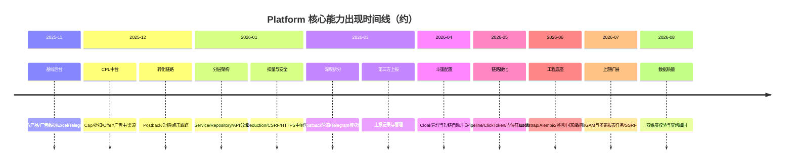

# Platform 平台版本迭代报告

> 报告生成日期：2026-08-03  
> 数据来源：Git 全量历史（约 **1579** 次提交，`main` 分支）  
> 时间跨度：2025-11-22 → 2026-08-03  
> 说明：仓库提交信息多数为日期/时间戳代号（如 `20260803`、`1125`），本报告在提交信息之外，结合**按月快照 diff、关键文件首次引入时间、少量描述性提交**还原「何时改了什么」。

---

## 一、项目定位与当前能力概览

Platform 是一套 **联盟 / CPL 投放与数据运营后台**，覆盖：

| 领域 | 能力 |
|------|------|
| 投放链路 | 跟踪链接、点击入库、短链跳转、斗篷（Cloak）桥页与上报 |
| 转化链路 | Postback 接收 / 校验 / 扣量 / Cap / 折扣 / 转发 / 通知 |
| 业务主体 | 广告主（上游）、Offer、渠道/客户（下游）、产品与产品分配 |
| 数据运营 | 广告数据（Ad Data）、淘宝搜索数据、Excel 导入导出、日报/看板 |
| 上游同步 | 定时拉取多家上游报表（虎光、ZhiSuo(含 ZhangWen/leadwin)、Aya、H5Deer、Flymobi、GAM 等） |
| 安全运维 | 鉴权/会话、CSRF、敏感路径探测、SSRF 防护、审计日志、缓存管理 |
| 协作通知 | Telegram Bot（命令、审批、统计、异常通知） |

技术栈要点：后端 FastAPI（`app/`，应用版本声明 `1.0.0`），前端 Vue 3 + Vite + Element Plus（`package.json` 为 `0.0.0`），MySQL（`sql/platform.sql`，导出日约 2026-07-29），Redis 计数/缓存，Alembic 迁移（自 2026-06），Nginx + systemd 部署配置。仓库**无 Git Tag / 无独立 CHANGELOG**，版本线索主要来自日期型提交与发版核对脚本。

**双业务主线**：① 广告数据管线（上游报表拉取 → 入库/Excel/看板 → 客户开放 API）；② CPL 转化管线（追踪/短链 → Postback → Cap/折扣/转化扣减 → 通知与像素上报）。

**三个易混概念（勿混用）**

| 概念 | 代码位置 | 含义 |
|------|----------|------|
| Cap | `core/cap` + Redis | Offer 日/总转化上限，触顶可自动下线 |
| 折扣 Discount | `core/discount` | 对 payout 打折/扣点（Offer 级优先于渠道级） |
| 转化扣减 Deduction | `core/deduction` | 转化侧策略性扣减配置与日志（独立于 Discount） |

---

## 二、提交活跃度总览

| 月份 | 提交数 | 变更规模（相对上月末） | 阶段特征 |
|------|--------|------------------------|----------|
| 2025-11 | 185 | 基线建立 | 上传起步、Telegram、清理文档 |
| 2025-12 | 388 | +205 文件 / +3.5万行 | **CPL 核心能力爆发** |
| 2026-01 | 352 | +316 文件 / +8.7万行 | **架构分层与重构高峰** |
| 2026-02 | 21 | +27 文件 / +0.6万行 | 低活跃，脚本/运维补充 |
| 2026-03 | 269 | +305 文件 / 净删约 0.6万行 | API 目录迁入 `api_v1`、Postback/Telegram 深化 |
| 2026-04 | 74 | +73 文件 / +0.5万行 | 斗篷配置、短链自动化、代码清理 |
| 2026-05 | 54 | +384 文件 / +3.6万行 | Postback 流水线、Cloak 路由、前端 composable 化、CI/测试 |
| 2026-06 | 173 | +702 文件 / +5.8万行 | Bootstrap、Alembic、监控、国家/敏感路径、模型拆分 |
| 2026-07 | 69 | +341 文件 / +2.0万行 | GAM 调度、SSRF、上游任务扩展、硬化与测试 |
| 2026-08（至 3 日） | 1 | +22 文件 / +0.08万行 | 广告数据双维度校验与查询加固 |

**累计约 1579 次提交。**

---

## 三、分阶段版本演进（何时改了什么）

### 阶段 0：项目起步（2025-11-22 ~ 2025-11-30）

**起点提交**：`Add files via upload`（2025-11-22）

**当时已有能力（基线）**

- 后端：用户/鉴权、客户、产品与分配、广告数据、Excel 导入导出、看板、定时任务、会话、Telegram、审计日志、ML 模型接口
- 前端：登录、看板、广告数据/日报、用户管理、客户管理、API 文档、定时任务、审计、ML 管理
- 部署：`nginx/`、`systemd/Platform-backend.service`、`env.example`

**当月明确动作**

| 日期 | 变更要点 |
|------|----------|
| 2025-11-22 | 仓库初始化，上传 `app` + `frontend` |
| 2025-11-24 | 引入 / 强化 **Telegram** 相关能力（提交 `1124Telegram`） |
| 2025-11-25 | 清理：删除 `docs`、优化报告 MD、导入样本目录；合并远程 `main` |

---

### 阶段 1：CPL 投放中台成型（2025-12）

**规模**：约 205 文件变更，+34849 / -10312 行；`app` 与 `frontend` 为主。

**本阶段解决的问题 / 新增能力**

1. **广告主 / Offer / 渠道（Publisher）** 管理 API 与前端页面  
2. **Cap 限额体系**：`cap_manager`、Redis 计数、一致性检查  
3. **折扣（Discount）** 管理  
4. **点击与转化**：点击队列、转化日志、转化汇总  
5. **Postback 核心**：接收处理、转发、BFT/Macan Handler、通知器  
6. **短链**：生成器、缓存、点击计数、调度归档任务  
7. **跟踪链路**：`click_id_generator`、`tracklink_generator`  
8. **设备信息、Offer 缓存、Telegram 工具**  
9. **淘宝搜索数据（TB Search）** 前后端  
10. **通知配置**（客户/产品级）与通知记录弹窗  

**前端新增页面（节选）**：广告主管理、短链管理、Cap/折扣/Offer/渠道相关 API 与视图、TB 搜索数据页。

**描述性小改动**：2025-12-15 为产品管理弹窗增加 `append-to-body`，改善模态层叠问题。

---

### 阶段 2：分层架构与扣量体系（2026-01）

**规模**：约 316 文件，+87248 / -46036 行——历史最大重构月。

**本阶段解决的问题**

1. **API 按域拆分**：`auth` / `clients` / `cpl` / `postback` / `products` / `system` / `tracking` / `users` / `ml_model` / `external`  
2. **引入 Service / Repository 层**：Offer、广告数据、审计、客户、CPL 各子服务  
3. **扣量（Deduction）体系落地**：`deduction_manager`；前端 Cap/短链/会话等管理页在本阶段成体系出现（文件首次可见于 2026-01-14 大批量提交）  
4. **基础设施**：统一缓存、分页、权限缓存、依赖注入、响应封装、查询优化工具  
5. **短链路由模块化**：`app/routes/short_link/*`（handler、URL 构建、占位符）  
6. **安全相关**：`csrf.py`、`https_middleware.py` 引入  
7. **Postback IP 白名单**、转化扣量服务与 Schema  

**描述性提交**

| 日期 | 说明 |
|------|------|
| 2026-01-14 | 更改渠道扣金额与每日转化上限；含大批量功能落盘 |
| 2026-01-21 | `frontend/public` 加入 gitignore |

---

### 阶段 3：运维脚本与低强度迭代（2026-02）

**规模**：约 27 文件，提交仅 21 次——相对静默期。

**主要内容**

- CPL API 测试脚本与 SQL 快照（`scripts/CPL_API/`）
- 点击数据 SQL、平台库导出
- IP 查询脚本、删记录工具
- Nginx / 前端少量调整

---

### 阶段 4：目录优化 + Postback/Telegram 深度拆分（2026-03）

**规模**：约 305 文件；净删除较多（重构搬迁）。

**本阶段解决的问题**

1. **API 路径迁入 `app/api_v1/`**（从旧 `app/api/api_v1/endpoints` 演进），按 Postback handler/route 细分  
2. **Postback 管道组件化**：校验器（数据/重复/IP）、转换器（归一化/点击关联）、保存器、Cap/折扣检查、转发子系统（HTTP 客户端、占位符、成功判定、缓存）  
3. **Telegram 模块化**：Bot 初始化、命令（start/help/id）、回调（菜单/Postback 审批）、轮询管理、消息发送、通知模板  
4. **第三方上报** API + 前端管理页  
5. **广告数据服务拆分**：列表/详情/统计查询、收入与费率计算器  
6. **Cap 同步**、扣量缓存补丁  
7. **缓存管理**前端页、Offer 筛选组件  

**明确问题修复 / 功能点（描述性提交）**

| 日期 | 问题 / 变更 |
|------|-------------|
| 2026-03-05 | 修复短链接创建时的**并发冲突** |
| 2026-03-14 | 修复 Telegram Bot 命令处理器导入错误；修复登录界面图标位置；tests 加入 gitignore |
| 2026-03-17 | Postback **转发成功/失败都需通知**；修复转化总览统计错误；更新斗篷网页上报；删除 `click_stats` 相关代码；优化项目目录 |
| 2026-03-20 | 增加上报记录 |

---

### 阶段 5：斗篷配置与短链自动化（2026-04）

**规模**：约 73 文件。

**本阶段解决的问题**

1. **斗篷配置管理**：`cloak_configs` API、`CloakManagement.vue`、cloak Schema/服务、像素映射  
2. **独立 `ad-tracker.py`** 与桥页/静态资源脚本补充  
3. **短链自动开关**（2026-04-02：自动关闭和打开短链）  
4. SQL 目录维护（`sql/platform.sql`）  
5. 前后端重复 import 清理（2026-04-22）  

| 日期 | 说明 |
|------|------|
| 2026-04-02 | 自动关闭 / 打开短链 |
| 2026-04-22 | 合并前端重复 import；清理后端（Telegram 外）重复引用；重构 Telegram import |
| 2026-04-24 | 斗篷配置 API 文件首次合入 |

---

### 阶段 6：链路硬化、前端工程化、测试与 CI（2026-05）

**规模**：约 384 文件，+35889 / -22393 行。

**本阶段解决的问题**

1. **Postback 流水线**：`pipeline.py`、`request_parser.py`；各 Postback 业务 Service 拆细（接收/待处理/转发日志/诊断/重复/BFT/归因等）  
2. **跟踪安全与兼容**：`ad_tracking_codec`、`click_token`、`click_persist`  
3. **URL 占位符校验**体系（含 Postback 占位符）  
4. **斗篷短链路由深化**：bridge HTML、change、click persist、report、show count 等  
5. **敏感路径探测**：API、清理定时任务、前端管理页（约 2026-05-28）  
6. **上游拉取框架**：`upstream_fetch/http/import`、智索任务等  
7. **前端大规模 composable 化**（Offer/Cap/扣量/折扣/Postback/短链/缓存/审计等）  
8. **GitHub CI**（`.github/workflows/ci.yml`）与大量 `tests/test_*.py`  

---

### 阶段 7：工程底座升级（2026-06）

**规模**：约 702 文件——单月触及文件最多。

**本阶段解决的问题**

1. **应用启动拆分**：`app/bootstrap/`（lifespan、异常处理、日志）——约 2026-06-10  
2. **数据库迁移**：引入 Alembic（`001_baseline`、`002_security_and_countries`）——约 2026-06-04  
3. **模型拆分**：`user` / `cpl` / `postback` / `deduction` / `security` / `system` / `third_party` / `client_product`  
4. **安全加固**：敏感路径守卫与规则（约 2026-06-03）；国家管理前后端（约 2026-06-11）  
5. **监控与性能**：`monitoring`、`monitoring_redis`、性能优化存储与页面（MonitoringDashboard 约 2026-06-23）  
6. **Postback 通知子系统**独立：`notification/`（配置、消息构建、发送）  
7. **Excel 广告数据导入**模块化（reader/handler/product_resolver/row_processor）  
8. **Postback 路由再拆分**：conversions / diagnostic / forward_logs / pending / receive  
9. **缓存管理 API/Service**、广告数据 Command/Query 进一步细分  
10. **pre-commit** 配置引入  

---

### 阶段 8：上游生态扩展与安全再加固（2026-07）

**规模**：约 341 文件。

**按周主题（基于路径归类）**

| 时段 | 侧重点 |
|------|--------|
| 07-01 ~ 07-07 | 测试、广告数据/Excel、**GAM**、调度、安全 |
| 07-08 ~ 07-14 | Postback、广告数据、调度、Cap/扣量/折扣、安全、短链、Telegram |
| 07-15 ~ 07-21 | 前端、斗篷/桥页、广告数据、Postback、**SSRF**（约 07-16） |
| 07-22 ~ 07-28 | 安全与其它硬化、Postback/Cap 等 |
| 07-29 ~ 07-31 | 上游任务（Aya/Flymobi 等）、Schema/模型、SQL 整理 |

**本阶段解决的问题 / 新增**

1. **Google Ad Manager（GAM）**：拉取/导入、凭证存储、调度配置页与白名单组件、密钥目录  
2. **新上游定时任务**：Aya、Flymobi、H5Deer 等；既有 Skymobi/TBSJ/智索等持续迭代  
3. **SSRF 防护**（`ssrf_guard.py`，约 2026-07-16）  
4. **桥页 HTML 消毒**（`bridge_html_sanitize.py`）  
5. **异步 ORM 辅助**、Uvicorn Worker、Telegram 运行时错误通知  
6. **产品管理页**独立视图与导航工具；发版前本地核对等测试增强  
7. `pyproject.toml`、Nginx Cloudflare Real-IP 等运维补充  

---

### 阶段 9：广告数据维度与查询加固（2026-08-01 ~ 2026-08-03）

**最新提交**：`20260803`（2026-08-03 10:18 +0800）

**本阶段解决的问题**

1. 新增 `dual_dimension_check.py`：**广告数据双维度校验**  
2. 强化维度过滤 / Join / 客户 API 查询 / 日报汇总 / Dashboard 统计  
3. 中间件、国家码、产品分配、Excel 导出、TB 搜索数据接口调整  
4. 上游导入与配置项微调；API 文档页小改  

---

## 四、核心子系统演进地图

### 4.1 Postback（转化回传）

| 时期 | 演进 |
|------|------|
| 2025-12 | 单体 processor / forwarder / handlers / notifier |
| 2026-01 | IP 白名单；API 分域 |
| 2026-03 | validators / transformers / savers / checks / forwarding 拆分；成败均通知 |
| 2026-05 | pipeline + request_parser；Service 层按场景拆分 |
| 2026-06 | notification 子系统独立；路由按 receive/pending/… 拆分 |
| 2026-07 | errors 模块、归因与待处理服务持续打磨 |

### 4.2 跟踪 / 短链 / 斗篷

| 时期 | 演进 |
|------|------|
| 2025-12 | 短链生成、缓存、点击计数；tracklink / click_id |
| 2026-01 | 短链路由模块化 |
| 2026-03-05 | 修复短链创建并发冲突 |
| 2026-03-17 | 斗篷上报更新；清理 click_stats |
| 2026-04 | 斗篷配置后台；短链自动开关 |
| 2026-05 | cloak bridge/report/persist；click_token / codec |
| 2026-07 | 桥页消毒、SSRF 防护 |

### 4.3 Cap / 折扣 / 转化扣减

| 时期 | 演进 |
|------|------|
| 2025-12 | Cap + Discount 管理与 Redis 计数 |
| 2026-01 | Deduction 管理器与前端；渠道扣金额/日上限调整 |
| 2026-03 | Cap 同步、扣量（Discount）缓存 |
| 2026-06+ | 转化扣减查询/统计 Service 再拆分；前后端持续迭代 |

### 4.4 Telegram

| 时期 | 演进 |
|------|------|
| 2025-11 | 首次强化 |
| 2026-03 | 命令/回调/轮询模块化；修复导入问题 |
| 2026-06 | 统计命令/回调、异常处理、DB 同步辅助 |
| 2026-07 | 运行时错误通知 |

### 4.5 广告数据与上游同步

| 时期 | 演进 |
|------|------|
| 2025-11 | Ad Data + Excel 导入导出基线 |
| 2026-03 | Service 查询/计算器拆分 |
| 2026-05 | 上游 fetch/import 框架、智索等任务 |
| 2026-06 | Excel 导入流水线模块化；更多 Query/Command |
| 2026-07 | GAM + Aya/Flymobi/H5Deer 等；产品管理体验增强 |
| 2026-08 | 双维度校验、维度过滤与看板查询加固 |

### 4.6 安全与运维

| 能力 | 约首次时间 |
|------|------------|
| CSRF | 2026-01 |
| HTTPS 中间件 | 2026-01 |
| 敏感路径探测管理 | 2026-05 |
| 敏感路径请求守卫 | 2026-06 |
| Alembic 迁移 | 2026-06 |
| 监控看板 | 2026-06 |
| 国家管理 | 2026-06 |
| SSRF Guard | 2026-07 |
| CI Workflow | 2026-05 |

---

## 五、问题修复与迭代清单

> **持续维护约定（自 2026-08-03 起）**：凡修复缺陷、修正业务问题、重要行为变更，均须追加到下方「持续更新日志」，按日期倒序（新的在上）。  
> 类型取值：`缺陷` / `功能` / `业务` / `安全` / `性能` / `重构` / `体验` / `清理`。

### 5.1 持续更新日志（新条目加在表顶）

| 日期 | 类型 | 模块 | 问题 / 变更 | 说明 |
|------|------|------|-------------|------|
| 2026-08-06 | 缺陷 | 定时任务/全文搜索 | 获取定时任务列表失败：Boolean value of this clause is not defined | search_with_fulltext 对 SQLAlchemy 子句用 if 真值判断触发 TypeError；改为 is not None |
| 2026-08-06 | 体验 | 广告数据/健康巡检 | 中午前不报「昨有今无」；仅倒扣时不再误写巡检正常 | 01:00 巡检跳过 today_gap 落库/Telegram（≥12:00 才报）；文案合计含 baseline_drop；前端提示与 platform.sql 错误文案同步 |
| 2026-08-06 | 功能 | 广告数据/健康巡检 | 重点关注区分生效日期与失效日期 | 含当天；生效空=立即、失效空=长期；窗口外不自动 Telegram/不强行入巡检池 |
| 2026-08-06 | 体验 | 广告数据/健康巡检 | 重点关注产品输入自动识别多种分隔符 | 回车/中英文逗号分号/顿号/空格/竖线均可拆分；保存后归一成一行一个 |
| 2026-08-06 | 功能 | 广告数据/健康巡检 | 新增「重点关注」产品：输入域名后盯今日上游是否有数 | 支持带/不带 https://；全部 *API获取数据 任务跑完后单独 Telegram；日常巡检强制入监控池；settings.watch_products |
| 2026-08-06 | 业务 | 上游/yangyangdeyi | 明确并固化拉数维度为「国家+广告单元」 | 现用 /adunit 响应已含 country+ad_unit；过滤无国家/无单元行；元数据标为 cross；不接 unit_data/country/data |
| 2026-08-06 | 性能 | 广告数据/日汇总 | daily-summary 慢请求约 9s | 单请求 3 次重扫+互斥子查询；加 Redis 120s 缓存，索引 idx_ad_data_date_report_type(date,report_type,product_id)，并复用 assignment 检测 |
| 2026-08-06 | 体验 | 广告数据/健康巡检 | 告警「指标」改为中文展示 | presence→有无数据、revenue_after→结算收益、revenue_before→收益(扣前)、request_count→请求数 |
| 2026-08-06 | 缺陷 | 广告数据/健康巡检 | 告警与标准页始终「暂无数据」 | 前端 adDataHealth.js 把 returnDataOnly 误放进 axios config，未解包 data；库内已有告警/标准但页面读不到 items |
| 2026-08-05 | 清理 | 数据库/platform.sql | 健康巡检三表同步进全量结构 | ad_data_day_baseline / health_alert / health_settings 补入 sql/platform.sql；并固化「改表必同步 platform.sql」规则 |
| 2026-08-05 | 缺陷 | 广告数据/健康巡检 | 监控池恒为 0（datetime 日期键未归一） | MySQL DATE 经驱动成 datetime，isinstance(..., date) 为真导致日键对不上；缺数/断档/日环比全部失效；已归一 + 单测 |
| 2026-08-05 | 功能 | 广告数据/健康巡检 | 补充定时任务入库 SQL | sql/ad_data_health_scheduled_tasks.sql 注册标准日冻结(00:30)与健康巡检(01:00)，可重复执行 |
| 2026-08-05 | 功能 | 广告数据/健康巡检 | 日标准倒扣+四Tab管理端落地 | 粒度=日期+产品+来源；00:30冻昨天；对比请求数与收益扣前≥2%；保留日环比；表/API/定时任务/前端四Tab；入库后对比已冻结历史日 |
| 2026-08-05 | 功能 | 广告数据/巡检 | 增加倒扣巡查（重拉前天 vs 库内） | 今日重拉 T-2 ZhiSuo channeldata，与库内结算收益比，跌≥2%告警；可用 --skip-backfill / --backfill-offset |
| 2026-08-05 | 体验 | 广告数据/巡检 | 跌幅标题展示具体日期 | 「昨天 vs 前天」改为如 2026-08-04 vs 2026-08-03 |
| 2026-08-05 | 体验 | 广告数据/巡检 | 巡检文案口语化并去掉字段提示 | 「近窗/末次」改为常人可读；去掉「收益口径 revenue_after_deduct」行 |
| 2026-08-05 | 体验 | 广告数据/巡检 | 文案「扣后收益」改为「结算收益」 | 字段仍为 revenue_after_deduct，对外展示统一称结算收益 |
| 2026-08-05 | 业务 | 广告数据/巡检 | 跌幅口径改为结算收益 | 健康巡检 SUM 由 revenue_before_deduct 改为 revenue_after_deduct |
| 2026-08-05 | 功能 | 广告数据/巡检 | 新增健康巡检探针（缺数/断档/今未入库/2%跌幅） | health_check 按天×产品汇总；探针查昨天缺数与连续断档、昨有今无、昨天vs前天结算收益跌≥2%；默认 dry-run，--notify 发 Telegram |
| 2026-08-04 | 体验 | 广告数据/告警 | 关闭 eCPM 减少 Telegram 告警 | eCPM 为比率易自然波动，阈值 0.01 导致 ZhiSuo 交叉报表刷屏；仅保留收益(减扣前/后)与流量指标减少汇总 |
| 2026-08-04 | 缺陷 | 发版核对/对账 | 门禁0b 共用模块缺失不再直接失败 | 补回 test_version_changelog_gate；发版核对与客户对账均加内联兜底 |
| 2026-08-04 | 缺陷 | 发版核对/对账 | 无数据日误判条数不完整 | `total or -1` 把 total=0 当成 -1；门禁 A/B 与客户对账改用 coerce_reported_total |
| 2026-08-04 | 缺陷 | 发版核对 | 补回 test_version_changelog_gate.py | 门禁0b 共用模块曾缺失导致发版核对直接失败；发版前核对与客户对账共用 |
| 2026-08-04 | 缺陷 | 产品转移 | 当日分配后同日转移报结束日早于开始日 | 前端误解析分配历史导致开始日「未设置」；后端同日替换（new_start=有效 start）放行并直接改 client_id；对话框支持同日更换归属 |
| 2026-08-04 | 缺陷 | 广告数据/缓存 | 上游入库后新产品下拉需强刷才出现 | 入库/改删后失效 Redis 筛选项缓存；前端去掉 products/clients/countries-with-data 的 5 分钟内存缓存 |
| 2026-08-04 | 清理 | 发版核对/日志 | 去掉 scheduled_task_cleanup_file_logs.sql 硬依赖 | 门禁0 只校验 TASK_CONFIGS/ALL_TASK_NAMES；任务入库改信 task_init |
| 2026-08-04 | 业务 | 上游/ZhiSuo | ZhangWen(leadwin) 拉数对齐 KE11 | 仅 channeldata；关闭 country/unit/日报兜底 |
| 2026-08-04 | 体验 | 上游/智索 | 任务名与账号称呼规范化 | 「zhisuo API获取数据」改为「ZhiSuo API获取数据」；ZeYao 改称 ZhangWen（探测目录/注释） |
| 2026-08-04 | 重构 | 上游/智索 | ZhangWen(leadwin) 并入 ZhiSuo 任务 | 去掉独立任务与来源；账号写入 ZHISUO_API_CLIENT_ID_5；拉数顺序交叉优先、国家次之补未覆盖 |
| 2026-08-04 | 功能 | 上游/ZhangWen | 对接 ZhangWen(tecnee) API 拉数入库 | 优先 channeldata，次之 channelcountry；后并入 ZhiSuo 多账号 |
| 2026-08-04 | 重构 | 明细维护/定时任务 | 去掉前端上游双份列表 | 来源兜底仅 excel/legacy/unknown；报表 hints 精简；删除 DATE_RELATED_TASK_NAMES，改信 API 标记与「API获取数据」后缀 |
| 2026-08-04 | 功能 | 明细维护 | 来源/报表类型改为后端目录下发 | GET /ad-data/metadata-options；前端 useAdDataMetadataOptions 缓存，常量仅作兜底；新增上游只需改 ad_data_metadata |
| 2026-08-04 | 缺陷 | 明细维护 | 来源下拉补齐 FlyMobi | 前端 AD_DATA_SOURCE_LABELS / UPSTREAM_API_DATA_SOURCES 漏 flymobi，与后端 ad_data_metadata 对齐 |
| 2026-08-03 | 缺陷 | 部署/日志 | 补回 scheduled_task_cleanup_file_logs.sql | 发版门禁0 依赖该种子 SQL；与 task_config「清理文件日志」cron 03:30 对齐 |
| 2026-08-03 | 功能 | 发版核对/对账 | 版本更新日志预检共用化 | 抽出 test_version_changelog_gate；发版前核对与 client_data_reconciliation 均挂门禁0b |
| 2026-08-03 | 功能 | 发版核对 | 门禁0b 检查版本更新日志 5.1 | 校验《平台版本迭代报告》表结构、倒序与新鲜度；支持 --skip-changelog-preflight |
| 2026-08-03 | 缺陷 | 前端部署 | 对齐 package-lock 与 postcss@8.5.6 | package.json 钉死 8.5.6 但 lock 仍为 8.5.24，生产 npm ci 失败后回退 npm install |
| 2026-08-03 | 缺陷 | Nginx | 修复 real_ip_header 重复导致 nginx -t 失败 | http 块曾同时 include cloudflare_real_ip.conf 与 cloudflare-realip.conf；现仅保留前者，旧文件名清空指令 |
| 2026-08-03 | 体验 | 限流 | 登录/API 配额改为运行时读 settings | 便于本地压测用 LOGIN_RATE_LIMIT 提额；避免模块常量缓存导致环境变量不生效 |
| 2026-08-03 | 功能 | 测试 | 补 Cap/扣量真实 Redis 并发集成测 | 日/总 Cap 并发不超限、DECR 回槽、扣量预留并发、decision_seq 唯一；无 Redis 时 skip |
| 2026-08-03 | 缺陷 | Cap/扣量 | 复核修双重 DECR 与预留静默 | Cap 异常路径去掉二次全量回退；预留成功后 flush 失败由 CapChecker 单次回退；扣量预留 fail-close 改抛错 |
| 2026-08-03 | 缺陷 | 环境/Cap/前端 | 审核 P0/P1 全修 | PRODUCTION_ENV 显式生效；Cap 超限与基础设施失败分离并 refresh ORM；路由同步失败取消跳转防振荡；conversion_cap 恢复全量 SUM；补回归测试与索引 SQL |
| 2026-08-03 | 性能 | Cap/扣量/汇总 | 修 TOCTOU、扣量竞态与汇总死查询 | Postback 改为原子 Cap 预留；扣量 Redis deducted+随机预留；汇总删两次被覆盖大表扫；配置缓存字段对齐并接入 find_config |
| 2026-08-03 | 性能 | 数据库/转化 | 修连接池 SESSION 污染与 GET 汇总误写短链 | 刷盘改事务级 RC + finally 还原 lock_wait；转化汇总只裁剪展示并用 get_db_readonly；补扣量/Cap 复合索引 SQL |
| 2026-08-03 | 安全 | 斗篷/前端 | 补齐审核 P2：/report 分配校验与路由 failClosed | /report 归因复用 resolve_attributed；Publisher/客户/广告数据路由同步 /users/me；Nginx 部署依赖注释 |
| 2026-08-03 | 安全 | CSRF/CORS | Origin 禁止父域后缀匹配 | `evil.btfrx.online` 不再因 `btfrx.online` 白名单而放行；子域须显式列入 BACKEND_CORS_ORIGINS |
| 2026-08-03 | 安全 | Offer/点击 | 客户响应消毒 + 短链分配校验 | 清空 advertiser_id/上游字段/他渠 PO；短链/斗篷显式未分配 channel_id 拒绝归因 |
| 2026-08-03 | 安全 | 限流/签名/CSRF | 认证限流、MD5 常量比较、生产强制 CSRF | 短链管理 API 不再整前缀豁免；已登录走高配额桶；签名用 compare_digest；生产忽略 ENABLE_CSRF=false |
| 2026-08-03 | 安全 | 前端守卫 | sessionStorage.role 不可 alone 放行管理页 | requiresAdmin 强制 /users/me + failClosed；refresh 后同步 Pinia userInfo |
| 2026-08-03 | 安全 | 部署/出站 | CF 真实 IP、Gunicorn 超时、Webhook SSRF | Nginx 增加 set_real_ip；timeout 对齐 120s；Webhook 走 ssrf_guard |
| 2026-08-03 | 功能 | CI | 补齐 pytest 与审计脚本 | 新增 test_security_regressions 与 audit_*，修复 CI 引用缺失 |
| 2026-08-03 | 安全 | 导入训练 | ML status/timezone 仅管理员 | 原仅登录即可访问，客户可读取映射字段元数据；改为 require_admin |
| 2026-08-03 | 业务 | 认证 | 本地 admin 密码已轮换 | 管理端改密成功，并同步 `.env` FIRST_SUPERUSER_PASSWORD（凭据仅本地记忆） |
| 2026-08-03 | 体验 | 通知 | 管理员 Telegram Chat ID 纠正 | 无效群 `-4944286056` 改为可用本机 Chat ID，test-connection/test-message 实发成功 |
| 2026-08-03 | 安全 | 敏感路径 | 回环地址不自动封禁 | 127.0.0.1/::1 探测达阈值只记日志，避免本地安全扫描锁死本机 |
| 2026-08-03 | 安全 | 中间件 | 恢复 X-Frame-Options: DENY | 与 CSP frame-ancestors 双轨，满足扫描器与旧浏览器防点击劫持 |
| 2026-08-03 | 体验 | 日志系统 | Windows 控制台中文乱码 | 启动时强制 UTF-8（控制台 CP + stdout/stderr reconfigure），修复 Cursor 终端「���」 |
| 2026-08-03 | 缺陷 | 短链 | 诊断接口 500：错误导入 APP_TIMEZONE | `short_links.diagnose` 应从 `app.core.utils` 导入，非 `constants` |
| 2026-08-03 | 缺陷 | 日志系统 | 修复异步队列清空 exc_info 导致告警失效 | PlatformQueueHandler 保留异常；ErrorLogFormatter/Telegram 兼容 exc_text；logrotate 仅 gunicorn；清理冷却改 Redis；核对补部署项 |
| 2026-08-03 | 安全 | 日志系统 | 一键清理冷却复检与失败提示 | 冷却判断移入锁内防并发双清；监控页失败也写入 hint |
| 2026-08-03 | 安全 | 日志系统 | 一键清理加审计与冷却 | CLEANUP 审计类型；进程内互斥+冷却；LOG_DISK_STATS_CACHE_SECONDS/LOG_MANUAL_CLEANUP_COOLDOWN 纳入 settings；前端展示 partial errors |
| 2026-08-03 | 体验 | 日志系统 | 监控页一键清理文件日志 | 新增 POST /monitoring/logs/cleanup 与 GET /logs/stats；仪表盘「立即清理」同步返回统计并刷新用量 |
| 2026-08-03 | 体验 | 日志系统 | 队列可观测、回环收尾、systemd 对齐 | dropped/qsize 进 metrics/告警/仪表盘；LoggingStream 改 thread-local；handleError 写真实 stderr；去掉默认 gunicorn access touch；配置清单降为 INFO |
| 2026-08-03 | 性能 | 日志系统 | 关闭排空、有界队列背压、preload 重建 | lifespan/worker_exit 排空；LOG_QUEUE_MAXSIZE 满则丢弃计数；preload 后 post_fork 重建；生产 telegram.log 改为 INFO+ |
| 2026-08-03 | 性能 | 日志系统 | 进程内异步队列写盘（QueueHandler） | 默认 LOG_QUEUE_ENABLED；文件 Handler 挂 QueueListener；模块靠 NamePrefix 分流；access 隔离；可回退直写 |
| 2026-08-03 | 体验 | 日志系统 | 告警指标对齐、冷却窗口生效、发版门禁挂日志预检 | 告警下拉补慢请求/P99；window_seconds 参与冷却；发版核对增加门禁0日志配置预检；补 access/展平单测 |
| 2026-08-03 | 体验 | 日志系统 | 监控页展示日志用量并纳入告警 | 仪表盘新增应用日志进度条；默认 soft/hard 告警规则；用量缓存 30s；外置 archive 合计对齐 |
| 2026-08-03 | 功能 | 日志系统 | error 无栈标记、auth.log、孤儿清理与监控用量 | error.log 追加 [no_exc_info]；新增 auth.log；清理超龄杂文件；/metrics/resources 返回 logs 目录用量 |
| 2026-08-03 | 性能 | 日志系统 | 多进程轮转锁 + tracking 分类 + 关闭 gunicorn access 双写 | SafeRotating 增加跨进程锁；新增 tracking.log；GUNICORN_ACCESSLOG_ENABLED 默认关；补充 logrotate 样例 |
| 2026-08-03 | 体验 | 日志系统 | 生产 access 降噪 + 磁盘限制 Telegram 告警 | 生产默认仅记 4xx/5xx/慢请求/异常；新增 LOG_ACCESS_* / LOG_DISK_TELEGRAM_*；config 注释对齐 |
| 2026-08-03 | 缺陷 | 日志系统 | 修复控制台/stderr 回环与 Filter 叠加 | 控制台改写真实 stderr；LoggingStream 加重入保护；StreamErrorFilter 提升为模块级类并收紧 anyio 误过滤 |
| 2026-08-03 | 功能 | 日志系统 | 完善分类落盘、错误单独文件与超期清理 | 新增 error.log/warning.log；打通 LOG_MAX_BYTES 等配置；定时任务「清理文件日志」支持归档 gzip、分级保留与磁盘守卫；发版脚本不再清空 logs/ |
| （此后新记录写在本行之上） | — | — | — | — |

### 5.2 历史条目（来自描述性提交，2025-11 ~ 2026-04）

因早期提交多为日期戳，下列为**历史中可核对到明确语义**的条目：

| 日期 | 类型 | 内容 |
|------|------|------|
| 2025-12-15 | 体验 | 产品管理弹窗 `append-to-body`，改善模态行为 |
| 2026-01-14 | 业务 | 更改渠道扣金额、每日转化上限 |
| 2026-03-05 | 缺陷 | 短链接创建并发冲突 |
| 2026-03-14 | 缺陷 | Telegram Bot 命令处理器导入错误 |
| 2026-03-14 | 缺陷 | 登录界面图标位置 |
| 2026-03-17 | 功能 | Postback 转发成功/失败均通知 |
| 2026-03-17 | 缺陷 | 转化总览统计信息有误 |
| 2026-03-17 | 功能 | 更新斗篷网页上报 |
| 2026-03-17 | 清理 | 删除 click_stats 及相关代码；优化目录结构 |
| 2026-03-20 | 功能 | 增加上报记录 |
| 2026-04-02 | 功能 | 短链自动关闭/打开 |
| 2026-04-22 | 重构 | 前后端重复 import 清理；Telegram import 重构 |

其余早期变更以日期戳提交，详见第三、四章按模块还原。

---

## 六、当前版本能力快照（截至 2026-08-03）

### 后端 API 域（`app/api_v1`）

`auth`、`users`、`clients`、`products`、`cpl`（广告主/Offer/渠道/Cap/折扣）、`conversions`、`postback`、`tracking`、`excel`、`external`、`system`（审计/缓存/斗篷/国家/会话/敏感路径/定时任务/Telegram 状态/第三方上报）、`ml_model`、`ai_agent`、广告数据与 TB 搜索等。

### 前端主要页面

- 运营：Dashboard、AdData、DailyReport、TBSearchData、TrendAnalysis、ApiDocumentation  
- 管理：Offer/广告主/渠道、Cap/折扣/扣量、转化汇总、点击日志、Postback、短链、斗篷、产品、用户/客户、会话、审计、缓存、国家、敏感路径探测、定时任务、GAM 调度配置、第三方上报、Telegram 通知、ML、监控与性能优化等  

### 数据与测试

- 库结构主文件：`sql/platform.sql`（约 2026-07-29 全库导出）  
- 迁移：`alembic/versions/`（baseline + security/countries 等）  
- 测试：`tests/` 偏运维联调与发版核对（含 `发版前本地核对`，近期报告约 2026-08-02），另有 cloak/click/postback 等单测与各上游 API 探测脚本  

### 协议与功能演进痕迹

- 点击追踪编解码：`ad_tracking_codec` **v3**（升级须递增版本号）  
- 外部 API：GAM 默认协议版本约 `v202605`；Facebook Graph 默认 `v23.0`  
- 功能合并：原 **ConversionLog（转化日志）** 前端路由已重定向并入 **PostbackManagement**  
- 兼容保留：Postback BFT、客户 API MD5 签名向后兼容；前端 `versionCheck` 热更新对比 `__APP_VERSION__`  

---

## 七、迭代规律与建议

1. **提交惯例**：以「日期/时间戳」为主，便于发版对齐，但不利于审计「修了什么问题」。建议后续重要修复采用：`fix(范围): 现象/原因` 或在发版提交附变更摘要。  
2. **演进节奏**：先堆 CPL 业务能力（12–1 月）→ 再拆模块与硬化（3–5 月）→ 再补工程底座与安全（6–7 月）→ 近期侧重数据质量与上游扩展。  
3. **风险面**：Postback / 短链斗篷 / Cap·折扣·转化扣减 为高频改动区，发版前宜继续跑 `tests/发版前本地核对`。  
4. **本报告局限**：无法从纯时间戳提交还原每一次微观 bug；若需「某日逐提交说明」，可指定日期区间再做细粒度 diff 报告。

---

## 八、附录：月度变更量速查

| 区间 | 文件数 | 插入行 | 删除行 |
|------|--------|--------|--------|
| 2025-11 → 2025-12 | 205 | 34849 | 10312 |
| 2025-12 → 2026-01 | 316 | 87248 | 46036 |
| 2026-01 → 2026-02 | 27 | 6246 | 157 |
| 2026-02 → 2026-03 | 305 | 22841 | 28702 |
| 2026-03 → 2026-04 | 73 | 4852 | 1082 |
| 2026-04 → 2026-05 | 384 | 35889 | 22393 |
| 2026-05 → 2026-06 | 702 | 57910 | 29702 |
| 2026-06 → 2026-07 | 341 | 20373 | 12969 |
| 2026-07 → 2026-08-03 | 22 | 803 | 306 |

---

*本报告基于 Git 历史自动归纳整理，用于版本回顾与发版沟通；不替代具体需求单或缺陷单。*
